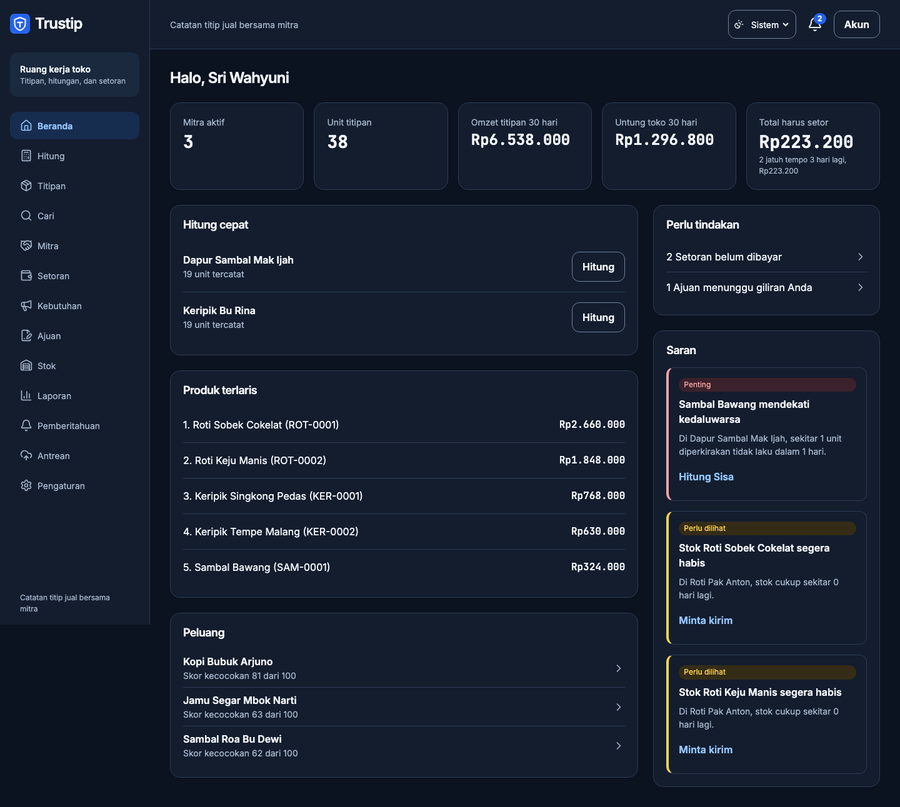
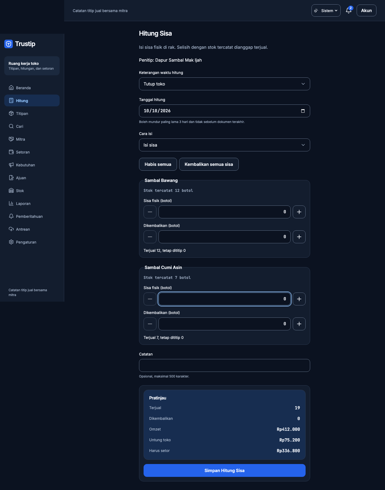
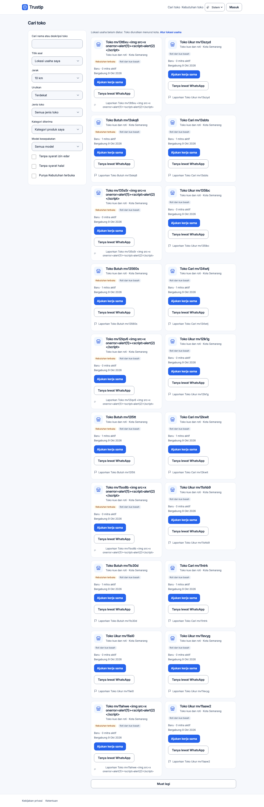
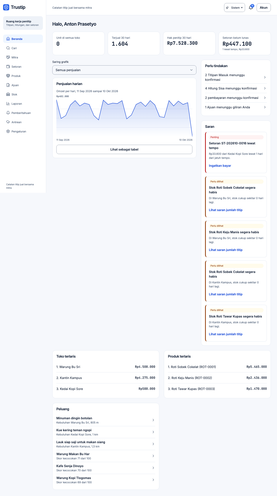
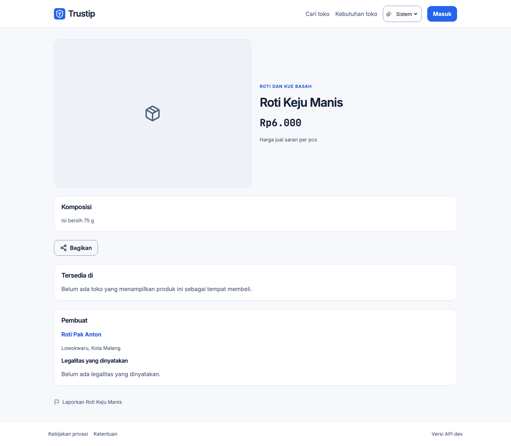
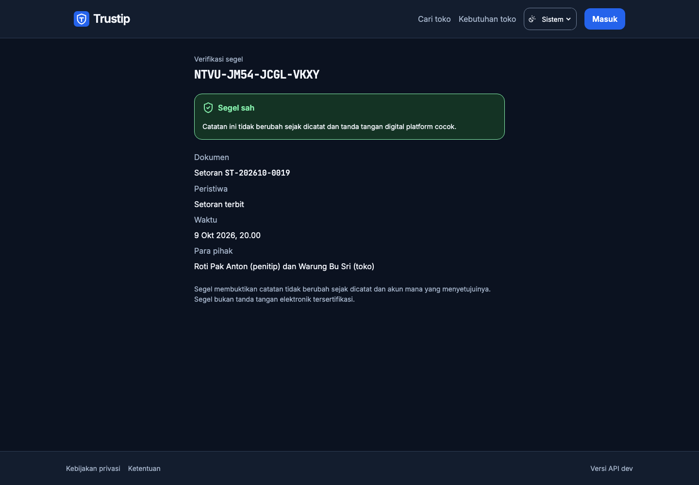

# Trustip

Platform titip jual untuk UMKM: penitip dan toko mencatat Titipan Masuk, Hitung Sisa, dan Setoran di satu tempat, dengan setiap catatan dagang tersegel tanda tangan digital.

## Tampilan

Warna utama biru `#2563EB`, dengan pilihan Sistem, Terang, dan Gelap. Pilihan tersimpan di perangkat, mengikuti perubahan sistem, dan berlaku juga pada halaman luring. Halaman publik, akun, dasbor, formulir, dan detail transaksi memakai token dan komponen bersama.

## Tangkapan layar

| Dasbor toko | Hitung Sisa | Cari Mitra |
|---|---|---|
|  |  |  |

| Dasbor penitip | Produk publik | Verifikasi segel |
|---|---|---|
|  |  |  |

## Isi repositori

| Folder | Isi |
|---|---|
| `api/` | Server Go |
| `app/` | Antarmuka SvelteKit yang bisa dipasang sebagai aplikasi |
| `docs/` | Dokumen produk, aturan rekayasa, rencana, dan desain |

## Dokumen

- [Dokumen Kebutuhan Produk](docs/01-PRD.md)
- [Spesifikasi Fitur](docs/02-SPESIFIKASI-FITUR.md)
- [Aturan Rekayasa](docs/03-ATURAN-REKAYASA.md)
- [Rencana Implementasi](docs/04-RENCANA-IMPLEMENTASI.md)
- [Sistem Desain](docs/DESIGN.md)
- [Rencana redesain](docs/RENCANA-REDESAIN.md)
- [Verifikasi redesain](docs/VERIFIKASI-REDESAIN.md)
- [Kinerja](docs/KINERJA.md)
