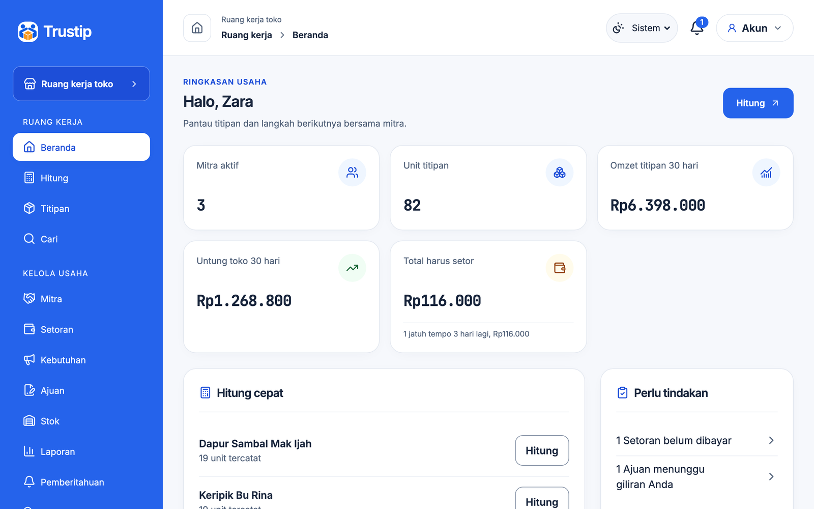
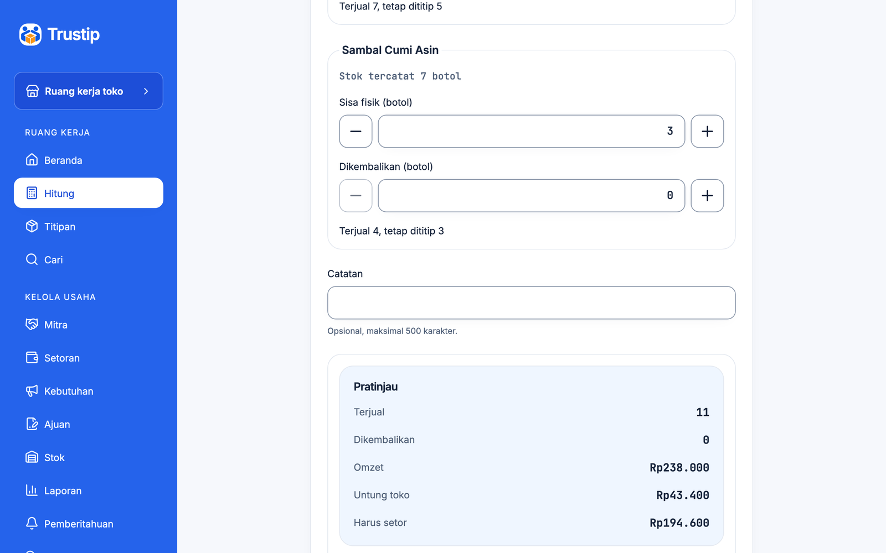
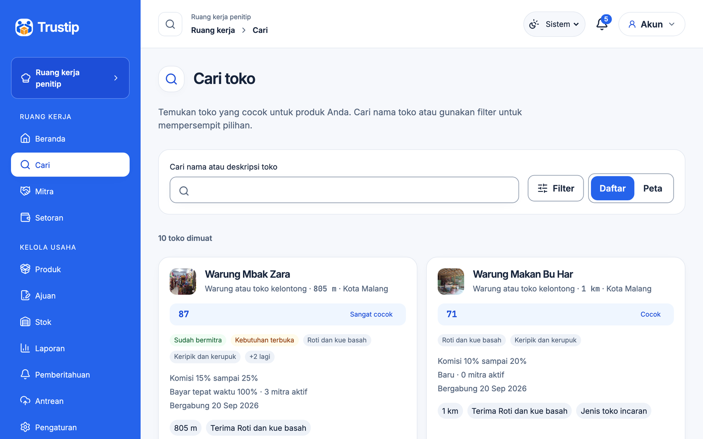
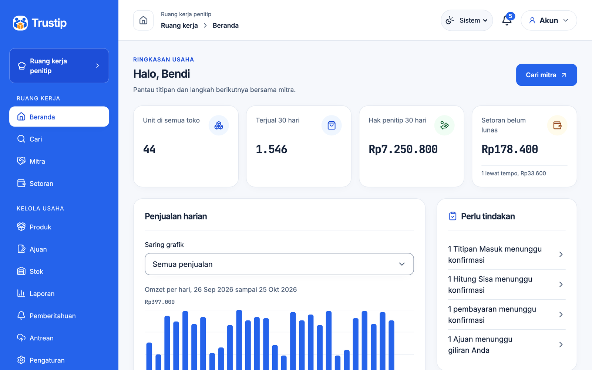
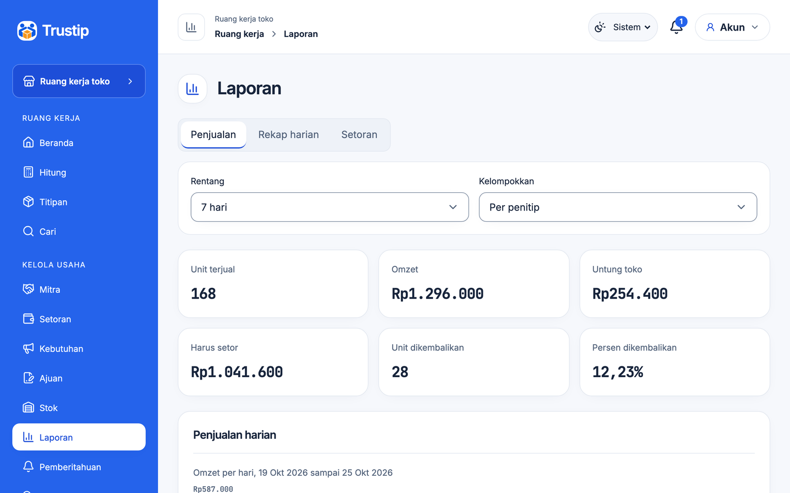
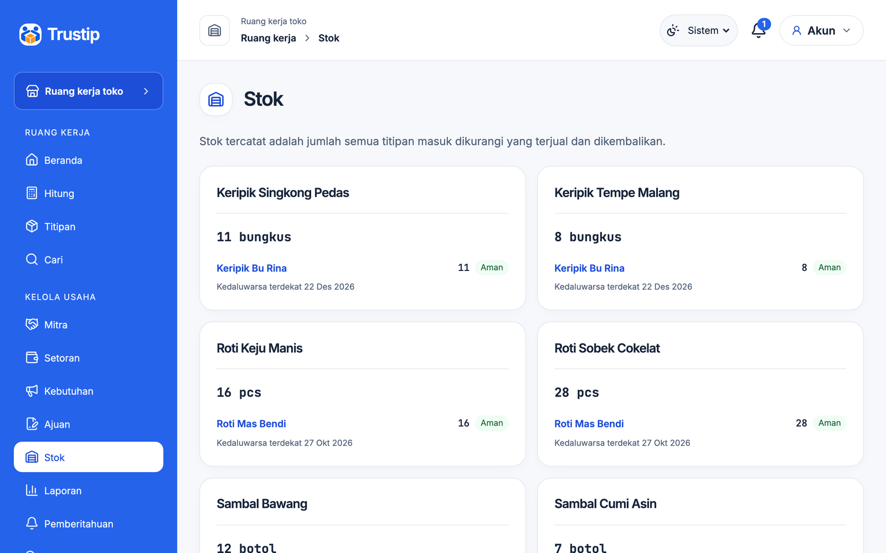
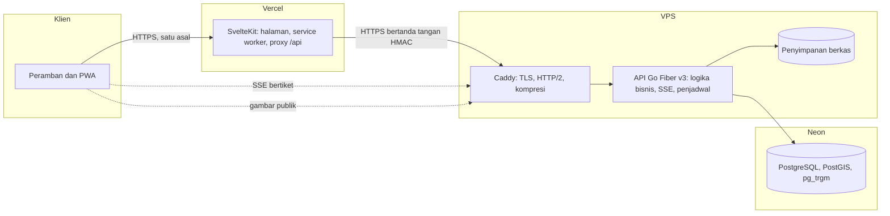
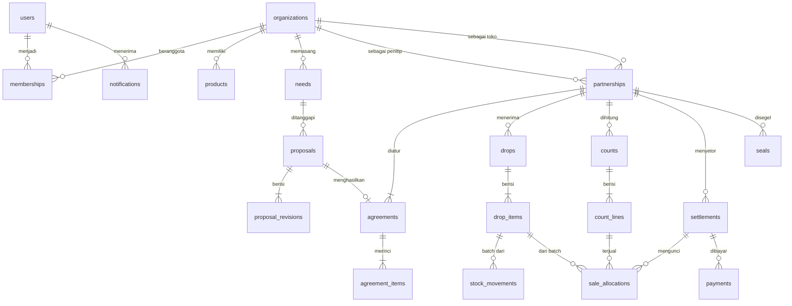

# Trustip

Platform titip jual untuk UMKM. Penitip dan toko saling menemukan, menyepakati aturan dagang secara terbuka, lalu mencatat Titipan Masuk, Hitung Sisa, dan Setoran di satu data yang sama. Hitungan terjual, bagian toko, dan setoran dibuat otomatis dan dikonfirmasi kedua pihak.

Karya lomba GTNIC 2026, kategori Web Development, subtema Accelerating Digital Transformation for Business and SMEs.

**Coba langsung: [trustip.vercel.app](https://trustip.vercel.app)** dengan [akun demo](#coba-akun-demo).

## Masalah

Titip jual (konsinyasi) adalah cara jual yang lazim bagi UMKM produsen: barang ditaruh di warung, kantin, toko oleh-oleh, atau kedai, dan uang baru diterima setelah barang laku. Dua hal membuatnya melelahkan:

1. **Mencari pasangan dagang.** Produsen tidak tahu toko mana yang mau menerima titipan, dan toko tidak tahu siapa yang punya produk yang dibutuhkannya.
2. **Mencatatnya.** Titipan, sisa, dan setoran dicatat di nota kertas masing-masing. Angka kedua pihak sering berbeda, dan tidak ada bukti bila ada yang mengubahnya.

## Yang dilakukan Trustip

| Bagian | Isi |
|---|---|
| Cari Mitra | Penitip mencari toko terdekat yang menerima kategorinya. Toko mencari produk atau memasang Kebutuhan Toko |
| Kesepakatan Dagang | Ajuan dengan tawar-menawar. Harga setor atau komisi, jadwal setor, dan irama hitung tampil sama di dua layar |
| Kelola Titipan | Toko mencatat Titipan Masuk dan Hitung Sisa, juga tanpa sinyal. Sistem langsung menghitung terjual, omzet, untung toko, dan yang harus disetor |
| Setoran | Terbit otomatis per hitung, mingguan, atau bulanan. Toko mencatat bayar, penitip mengonfirmasi |
| Laporan dan saran | Laporan penjualan kedua pihak, peringatan kedaluwarsa, saran jumlah titip, dan mitra yang cocok |
| Halaman publik | Profil toko dan penitip, Kebutuhan Toko, serta halaman produk dengan kode QR dan daftar toko yang menjualnya |

## Tangkapan layar

Tampilan memakai biru dengan pilihan Sistem, Terang, dan Gelap. Pilihan tersimpan di perangkat dan berlaku juga pada halaman luring.

| Dasbor toko | Hitung Sisa | Cari Mitra |
|---|---|---|
|  |  |  |

| Dasbor penitip | Laporan | Stok dan kedaluwarsa |
|---|---|---|
|  |  |  |

## Coba akun demo

Buka [halaman masuk](https://trustip.vercel.app/masuk) dan tekan **Coba akun demo**, atau masuk dengan:

| Akun | Usaha | Email | Kata sandi | Yang bisa dicoba |
|---|---|---|---|---|
| Bendi | Penitip, Roti Mas Bendi | `penitip@demo.trustip.id` | `Coba-Demo-2026` | Cari toko, terima Ajuan dari Minimarket Berkah, konfirmasi Hitung Sisa dan pembayaran |
| Zara | Toko, Warung Mbak Zara | `toko@demo.trustip.id` | `Coba-Demo-2026` | Catat Titipan Masuk, Hitung Sisa titipan kemarin, catat bayar Setoran |
| Jessica | Toko, Minimarket Berkah | `minimarket@demo.trustip.id` | `Coba-Demo-2026` | Ajuan ke Roti Mas Bendi yang menunggu jawaban |

Data contoh berisi 30 hari transaksi di Kecamatan Lowokwaru, Kota Malang: 8 penitip dan toko yang bermitra, 20 usaha lain di Cari Mitra, Kebutuhan Toko, Ajuan, dan Setoran dalam semua keadaan. Data organisasi demo disetel ulang setiap malam pukul 03.00 WIB. Organisasi demo hanya bisa bermitra dengan organisasi demo (ADR 0043, ADR 0057).

## Arsitektur



- **App** (`app/`): SvelteKit 3 dengan Svelte 5. Halaman publik dirender server, area aplikasi berjalan di peramban dan bisa dipasang sebagai PWA. Titipan Masuk dan Hitung Sisa bisa dicatat luring lewat antrean IndexedDB yang terkirim sendiri saat sinyal kembali.
- **API** (`api/`): Go dengan Fiber v3, kueri bertipe dari `sqlc`, lapisan domain murni, layanan, repositori, dan penangan. Kontrak di `api/openapi/openapi.yaml`.
- **Keamanan**: token hanya di cookie HttpOnly, Argon2id dengan salt dan pepper, captcha Turnstile, tanda tangan HMAC dari proxy ke API, CSP berbasis hash, dan segel Ed25519 berantai untuk setiap peristiwa dagang yang diperiksa di server tanpa tampil di antarmuka (ADR 0058). Daftar lengkap di [`docs/SECURITY_CHECKLIST.md`](docs/SECURITY_CHECKLIST.md).

## Basis data



Diagram lengkap ada di [spesifikasi bagian 22](docs/02-SPESIFIKASI-FITUR.md#22-model-data). Skema dibangun oleh migrasi di `api/internal/db/migrations`.

## Menjalankan di mesin sendiri

Butuh Go 1.26, Node.js 24, dan akses ke basis data PostgreSQL 17 atau lebih baru dengan PostGIS.

```sh
make setup
```

`make setup` memasang alat, dependensi app, kait git, dan membangkitkan `api/.env` dan `app/.env` dengan rahasia pengembangan acak. Isi `DATABASE_URL` dan `DATABASE_MIGRATE_URL` di `api/.env` dengan string koneksi basis data (diapit tanda kutip tunggal bila memuat `&`), lalu:

```sh
make dev
```

API berjalan di `http://localhost:8080` dan app di `http://localhost:5173`. Untuk mengisi data contoh dan akun demo:

```sh
make demo
```

| Perintah | Guna |
|---|---|
| `make check` | Format, lint, tipe, arsitektur, tanpa komentar, tanpa rahasia, pemindai kerentanan |
| `make test` | Uji unit dan integrasi (basis data sementara dibuat dan dihapus otomatis) |
| `make e2e` | Uji ujung ke ujung di HP dan desktop, termasuk keamanan, aksesibilitas, dan Lighthouse |
| `make load` | Uji beban ringan dan pencarian terdekat pada 10.000 organisasi |
| `make demo` | Menyetel ulang dan mengisi data contoh |

## Deploy

Langkah deploy API ke VPS dengan Docker dan Caddy, peran basis data aplikasi, dan app ke Vercel ada di [`docs/DEPLOY.md`](docs/DEPLOY.md).

## Dokumen

| Dokumen | Isi |
|---|---|
| [Dokumen Kebutuhan Produk](docs/01-PRD.md) | Latar, masalah, tujuan, dan lingkup |
| [Spesifikasi Fitur](docs/02-SPESIFIKASI-FITUR.md) | Perilaku, aturan bisnis, dan angka |
| [Aturan Rekayasa](docs/03-ATURAN-REKAYASA.md) | Cara menulis kode, arsitektur, dan keamanan |
| [Rencana Implementasi](docs/04-RENCANA-IMPLEMENTASI.md) | Urutan kerja dan gerbang |
| [Sistem Desain](docs/DESIGN.md) | Tampilan |
| [Verifikasi redesain](docs/VERIFIKASI-REDESAIN.md) | Bukti tema, responsivitas, aksesibilitas, fungsi, dan batas performa |
| [Daftar periksa keamanan](docs/SECURITY_CHECKLIST.md) | Setiap aturan keamanan dengan uji buktinya |
| [Kinerja](docs/KINERJA.md) | Hasil ukur terhadap anggaran performa |
| [Verifikasi segel](docs/VERIFIKASI-SEGEL.md) | Cara kerja segel di belakang layar, format kanonik, dan pemeriksaan lewat API |
| [Pihak ketiga](docs/THIRD_PARTY.md) | Pustaka, layanan, dan lisensinya |
| [Moderasi](docs/MODERASI.md) | Menangani laporan profil, produk, dan Kebutuhan |
| [Keputusan arsitektur](docs/adr/) | Catatan keputusan |

## Batasan

- Pembayaran hanya dicatat. Uang tetap berpindah tunai atau transfer di luar Trustip.
- Di iPhone tidak ada sinkron latar belakang, sehingga catatan luring terkirim saat aplikasi dibuka kembali.
- Lupa kata sandi, anggota staf, pemberitahuan dorong, dan unduhan PDF direncanakan setelah lomba (rencana implementasi bagian 7).
