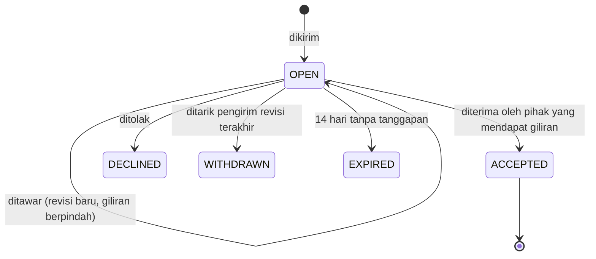
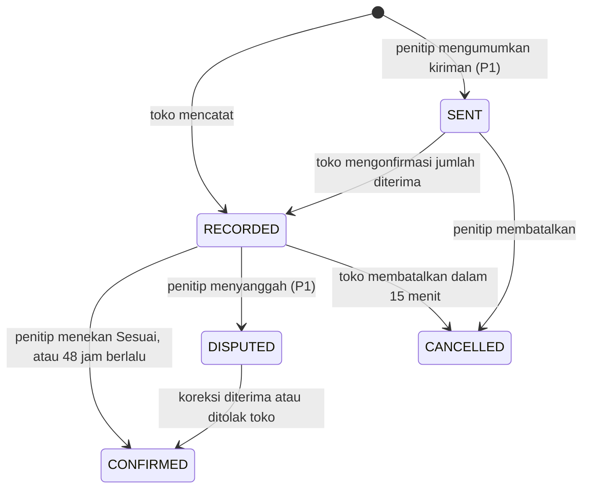
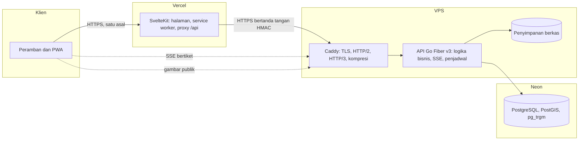
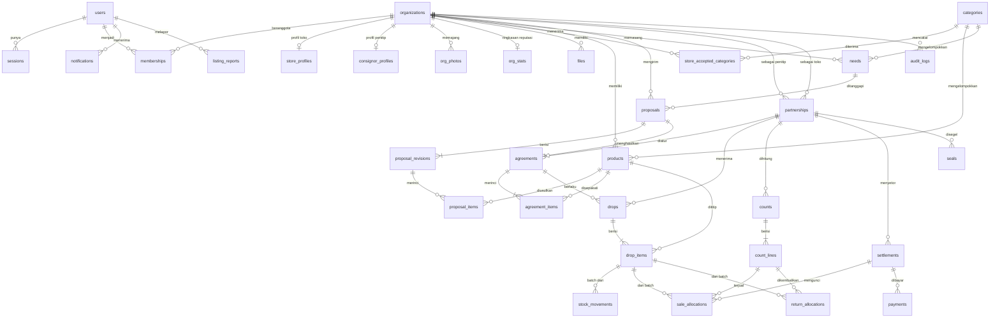

# Spesifikasi Fitur: Trustip

| Item | Keterangan |
|---|---|
| Versi | 2.1 |
| Tanggal | 7 Oktober 2026 |
| Dokumen pasangan | `01-PRD.md`, `03-ATURAN-REKAYASA.md`, `04-RENCANA-IMPLEMENTASI.md`, `DESIGN.md` |

Dokumen ini adalah acuan implementasi. Setiap kebutuhan punya ID (`FR-<MODUL>-<NN>`) dan setiap aturan bisnis punya ID (`BR-<MODUL>-<NN>`) supaya bisa dirujuk di tugas, commit, dan pengujian.

Prioritas: **P0** inti platform dan wajib ada saat demo, **P1** dikerjakan setelah seluruh P0 lulus uji, **P2** pengembangan lanjutan.

Kriteria penerimaan ditulis dengan pola `WHEN <keadaan> THE SYSTEM SHALL <perilaku>`.

**Perubahan dari versi 2.0**

| # | Perubahan | Bagian |
|---|---|---|
| 1 | Nama produk menjadi Trustip | Semua |
| 2 | Captcha, serta kata sandi dengan salt dan pepper | 2, 20, 21.6 |
| 3 | Segel dokumen bertanda tangan digital dan halaman verifikasinya | 18.1, 22, 23 |
| 4 | Mencatat Titipan Masuk dan Hitung Sisa saat luring naik dari P1 ke P0 | 19, 22, 24, 26 |
| 5 | Bentuk jawaban API baku dan tanda tangan permintaan dari proxy | 20, 21.3, 21.6, 21.9 |
| 6 | Folder kode `api` dan `app` | 21.2 |
| 7 | Tampilan mengikuti `DESIGN.md`: tema terang/gelap dan primary biru | 24 |

## Daftar isi

1. Peran dan hak akses
2. AUTH: akun dan onboarding
3. ORG: organisasi, lokasi, anggota
4. DIR: Cari Mitra
5. NED: Kebutuhan Toko
6. PRP: Ajuan Kerja Sama
7. AGR: Kesepakatan Dagang
8. PRT: Kemitraan
9. PRD: Produk
10. DRP: Titipan Masuk
11. STK: Stok
12. CNT: Hitung Sisa
13. STL: Setoran dan pembayaran
14. RPT: Laporan
15. DSH dan INS: dasbor dan saran
16. NTF: pemberitahuan
17. PUB: halaman publik
18. TRS: reputasi, pelaporan, moderasi, segel
19. PWA
20. Kebutuhan non-fungsional
21. Arsitektur dan teknologi
22. Model data
23. Peta halaman
24. Standar UX dan pesan sistem
25. Data contoh dan skenario demo
26. Rencana uji

## 1. Peran dan hak akses

Setiap pengguna menjadi anggota tepat satu **organisasi**. Organisasi bertipe `CONSIGNOR` (Penitip) atau `STORE` (Toko). Peran anggota: `OWNER` atau `STAFF`. Di luar itu ada **Admin platform**, yaitu akun tim yang hanya mengurus moderasi.

| Aksi | Penitip OWNER | Penitip STAFF | Toko OWNER | Toko STAFF |
|---|:-:|:-:|:-:|:-:|
| Ubah profil, lokasi, dan tampil di Cari Mitra | Ya | Tidak | Ya | Tidak |
| Kelola anggota (P1) | Ya | Tidak | Ya | Tidak |
| Kelola produk | Ya | Ya | Tidak | Tidak |
| Pasang dan tutup Kebutuhan Toko | Tidak | Tidak | Ya | Tidak |
| Kirim, tawar, terima, tolak Ajuan | Ya | Tidak | Ya | Tidak |
| Usul dan setujui perubahan Kesepakatan | Ya | Tidak | Ya | Tidak |
| Catat Titipan Masuk | Tidak | Tidak | Ya | Ya |
| Umumkan kiriman (P1) | Ya | Ya | Tidak | Tidak |
| Konfirmasi Titipan Masuk dan Hitung Sisa | Ya | Ya | Tidak | Tidak |
| Isi Hitung Sisa | Tidak | Tidak | Ya | Ya |
| Lihat rekap satu dokumen beserta nilainya | Ya | Ya | Ya | Ya |
| Catat pembayaran Setoran | Tidak | Tidak | Ya | Bila diizinkan OWNER |
| Konfirmasi atau tolak pembayaran | Ya | Tidak | Tidak | Tidak |
| Lihat laporan dan angka gabungan | Ya | Tidak | Ya | Tidak |
| Akhiri kemitraan | Ya | Tidak | Ya | Tidak |
| Laporkan profil atau unggahan | Ya | Ya | Ya | Ya |
| Ubah akun sendiri: nama, WhatsApp, foto, dan kata sandi | Ya | Ya | Ya | Ya |

**Aturan otorisasi**

- **BR-AUTHZ-01** Setiap operasi di server memeriksa empat hal: pengguna sudah masuk, pengguna adalah anggota aktif sebuah organisasi, perannya cukup, dan data yang diakses milik organisasi itu atau milik kemitraan tempat organisasi itu menjadi salah satu pihak.
- **BR-AUTHZ-02** Akses ke data organisasi lain dibalas **404**, bukan 403, supaya keberadaan data tidak bocor.
- **BR-AUTHZ-03** Otorisasi dilakukan di server. Antarmuka hanya menyembunyikan tombol dan itu bukan pengaman.
- **BR-AUTHZ-04** Halaman dan API publik hanya mengembalikan kolom yang masuk daftar putih (bagian 17). Nilai uang kemitraan, alamat lengkap penitip, dan nomor WhatsApp tidak pernah ikut.
- **BR-AUTHZ-05** Organisasi dan identitas pengguna selalu diambil dari sesi, tidak pernah dari isi permintaan.
- **BR-AUTHZ-06** Organisasi berstatus `SUSPENDED` tidak bisa mengirim Ajuan, tidak tampil di Cari Mitra, tetapi tetap bisa menyelesaikan kewajiban yang sedang berjalan.

## 2. AUTH: akun dan onboarding

| ID | Kebutuhan | Prioritas |
|---|---|:-:|
| FR-AUTH-01 | Daftar dengan nama, email, kata sandi, dan nomor WhatsApp | P0 |
| FR-AUTH-02 | Masuk dengan email dan kata sandi | P0 |
| FR-AUTH-03 | Keluar, dan keluar dari semua perangkat | P0 |
| FR-AUTH-04 | Onboarding tiga langkah: pilih tipe usaha, isi profil, tentukan lokasi | P0 |
| FR-AUTH-05 | Pengguna tanpa organisasi selalu diarahkan ke onboarding | P0 |
| FR-AUTH-06 | Area aplikasi hanya bisa dibuka setelah masuk | P0 |
| FR-AUTH-07 | Akun demo penitip dan toko dibagikan lewat `docs/AKUN-DEMO.md` dan dipakai di halaman masuk biasa. Halaman `/demo` disembunyikan sejak 2 November 2026 (ADR 0062) | P0 |
| FR-AUTH-08 | Persetujuan kebijakan privasi saat mendaftar | P0 |
| FR-AUTH-09 | Lupa kata sandi lewat email | P1 |
| FR-AUTH-10 | Hapus akun dan data pribadi atas permintaan | P1 |
| FR-AUTH-11 | Masuk dengan akun Google | P2 |
| FR-AUTH-12 | Captcha pada daftar, masuk, akun demo, dan lupa kata sandi | P0 |
| FR-AUTH-13 | Halaman Profil: ubah nama, nomor WhatsApp, dan foto profil akun sendiri | P0 |
| FR-AUTH-14 | Ubah kata sandi dengan kata sandi saat ini; sesi di perangkat lain berakhir | P0 |

**Validasi**

| Isian | Aturan |
|---|---|
| Nama | 2 sampai 80 karakter |
| Email | Format sah, disimpan huruf kecil, unik |
| Kata sandi | 10 sampai 128 karakter |
| WhatsApp | Dinormalkan ke `62xxxxxxxxxx`, 10 sampai 15 angka |

**Aturan**

- **BR-AUTH-01** Lima kali gagal masuk berturut-turut mengunci akun 15 menit. Pesan galat tidak membedakan email salah dan kata sandi salah.
- **BR-AUTH-02** Onboarding membuat organisasi dan keanggotaan `OWNER` dalam satu transaksi.
- **BR-AUTH-03** Pengguna yang datang dari tautan undangan (`/undangan/<kode>`) atau dari tombol "Ajukan kerja sama" dikembalikan ke halaman itu setelah mendaftar.
- **BR-AUTH-04** Kata sandi disimpan sebagai hash Argon2id dengan salt acak per kata sandi dan pepper rahasia server yang tidak pernah disimpan di basis data (`03-ATURAN-REKAYASA.md` bagian 7.2).
- **BR-AUTH-05** Token captcha diverifikasi di server. Bila gagal, kosong, atau layanan verifikasi tidak menjawab, permintaan ditolak dengan `CAPTCHA_FAILED`.

**Kriteria penerimaan**

- WHEN pengguna mendaftar dengan email yang sudah terdaftar THE SYSTEM SHALL menampilkan "Email sudah terdaftar. Silakan masuk."
- WHEN pengguna belum masuk membuka `/app/...` THE SYSTEM SHALL mengarahkan ke `/masuk?lanjut=<url>` dan kembali ke url itu setelah masuk.
- WHEN pengguna yang sudah punya organisasi membuka `/onboarding` THE SYSTEM SHALL mengarahkannya ke dasbor.
- WHEN formulir masuk dikirim tanpa token captcha yang sah THE SYSTEM SHALL menolak dengan pesan "Verifikasi keamanan gagal. Coba lagi." tanpa memeriksa kata sandi.

## 3. ORG: organisasi, lokasi, anggota

| ID | Kebutuhan | Prioritas |
|---|---|:-:|
| FR-ORG-01 | Profil dasar: nama usaha, tipe, deskripsi, alamat, kecamatan, kota, WhatsApp, logo | P0 |
| FR-ORG-02 | Slug unik otomatis dari nama usaha untuk alamat halaman publik | P0 |
| FR-ORG-03 | Lokasi: tombol "Gunakan lokasi saya" atau geser pin di peta | P0 |
| FR-ORG-04 | Profil toko: jenis toko, kategori produk yang diterima, model yang diterima, kisaran komisi, syarat penitip, jam buka, sampai 5 foto | P0 |
| FR-ORG-05 | Profil penitip: jangkauan antar (km), hari antar, jenis toko yang diincar, NIB, nomor izin edar, nomor sertifikat halal, bisa kirim sampel | P0 |
| FR-ORG-06 | Sakelar "Tampil di Cari Mitra" | P0 |
| FR-ORG-07 | Cara pembayaran penitip: metode yang diterima (tunai, transfer bank, QRIS), rekening bank, gambar QRIS, dan catatan untuk toko (ADR 0063) | P0 |
| FR-ORG-08 | Meter kelengkapan profil dengan daftar yang belum diisi | P0 |
| FR-ORG-09 | OWNER mengundang STAFF lewat tautan yang berlaku 7 hari, dan menonaktifkannya | P1 |
| FR-ORG-10 | OWNER mengizinkan STAFF mencatat pembayaran | P1 |

**Jenis toko** (daftar tetap): Warung atau toko kelontong, Minimarket lokal, Toko oleh-oleh, Kantin (sekolah, kampus, kantor), Kafe atau kedai kopi, Toko kue dan roti, Koperasi, Kios pasar, Lainnya.

**Kategori produk** (data awal): Roti dan kue basah, Kue kering dan camilan, Keripik dan kerupuk, Sambal dan bumbu, Minuman, Makanan beku, Lauk siap saji, Oleh-oleh khas daerah, Kerajinan dan suvenir, Fesyen dan aksesori, Perawatan diri, Lainnya.

**Syarat penitip di profil toko**: wajib izin edar (PIRT atau MD), wajib sertifikat halal, wajib sampel, dan satu isian bebas. Bentuk ini mengikuti praktik toko yang menerima titipan [PRD S9].

**Aturan**

- **BR-ORG-01** Tipe organisasi tidak bisa diubah setelah dibuat.
- **BR-ORG-02** Slug berisi huruf kecil, angka, dan tanda hubung. Bila bentrok, ditambah akhiran `-2`, `-3`, dan seterusnya.
- **BR-ORG-03** Setiap organisasi menyimpan dua titik: lokasi persis dan **lokasi publik**. Untuk Toko keduanya sama. Untuk Penitip, lokasi publik dibulatkan ke kisi sekitar 500 meter, karena banyak penitip berproduksi di rumah.
- **BR-ORG-04** Alamat lengkap dan lokasi persis Penitip hanya terlihat oleh Toko yang punya kemitraan aktif dengannya.
- **BR-ORG-05** Organisasi baru bisa tampil di Cari Mitra bila sudah punya nama, kota, lokasi, dan: jenis toko serta minimal satu kategori diterima (Toko), atau minimal satu produk aktif (Penitip).
- **BR-ORG-06** Gambar: JPG, PNG, atau WebP. Sebelum diunggah, peramban mengecilkannya ke lebar maksimal 1280 piksel dan mengodekannya ulang, sehingga data lokasi di foto ikut terbuang. Ukuran akhir maksimal 1 MB.
- **BR-ORG-07** NIB, izin edar, dan sertifikat halal ditampilkan dengan keterangan "dinyatakan oleh pemilik usaha". Trustip tidak memverifikasinya.

**Kriteria penerimaan**

- WHEN pengguna menolak izin lokasi peramban THE SYSTEM SHALL tetap membolehkan penentuan lokasi dengan menggeser pin.
- WHEN profil belum memenuhi BR-ORG-05 dan pengguna menyalakan "Tampil di Cari Mitra" THE SYSTEM SHALL menolak dan menampilkan daftar yang kurang.

## 4. DIR: Cari Mitra

Direktori dua arah. Penitip mencari Toko. Toko mencari Penitip dan produknya. Pengunjung yang belum masuk boleh melihat, tetapi harus masuk untuk mengirim Ajuan.

| ID | Kebutuhan | Prioritas |
|---|---|:-:|
| FR-DIR-01 | Direktori Toko: kartu berisi nama, jenis, jarak, kategori diterima, kisaran komisi, tanda Kebutuhan terbuka, reputasi bayar, skor kecocokan | P0 |
| FR-DIR-02 | Direktori Penitip dengan dua tab: **Produk** (produk yang sedang mencari toko) dan **Penitip** | P0 |
| FR-DIR-03 | Urutan bawaan **terdekat** dari titik asal | P0 |
| FR-DIR-04 | Titik asal: lokasi organisasi pengguna. Bisa diganti ke "lokasi saya sekarang" atau ke kota tertentu | P0 |
| FR-DIR-05 | Saring jarak: 2, 5, 10, 25 km, atau semua. Bawaan 10 km | P0 |
| FR-DIR-06 | Saring Toko: jenis toko, kategori diterima, model kesepakatan, komisi maksimal, tanpa syarat izin edar, tanpa syarat halal, punya Kebutuhan terbuka | P0 |
| FR-DIR-07 | Saring Penitip dan Produk: kategori, rentang harga jual saran, punya izin edar, punya sertifikat halal, bisa kirim sampel, jangkauan antar mencakup toko saya, masa simpan minimal | P0 |
| FR-DIR-08 | Pilihan urutan lain: paling cocok, reputasi, terbaru | P0 |
| FR-DIR-09 | Pencarian teks pada nama usaha, nama produk, dan deskripsi | P0 |
| FR-DIR-10 | Skor kecocokan dengan alasan singkat di kartu, misalnya "1,2 km", "Butuh camilan", "Bayar tepat waktu 96%" | P0 |
| FR-DIR-11 | Tombol **Ajukan kerja sama** dan **Tanya lewat WhatsApp** di kartu dan di profil | P0 |
| FR-DIR-12 | Saringan tersimpan di alamat halaman sehingga hasil bisa dibagikan | P0 |
| FR-DIR-13 | Tampilan peta dengan penanda | P1 |
| FR-DIR-14 | Simpan ke daftar favorit | P1 |

Arahan pengguna 10 Oktober 2026 mengizinkan FR-DIR-13 untuk direktori Toko. Daftar dan Peta memakai saringan serta pagination yang sama. Marker menampilkan lokasi publik dan membuka detail toko melalui klik atau keyboard. Toko tanpa koordinat tetap tersedia dalam Daftar, dan peta menjelaskan bahwa hanya hasil yang sudah dimuat yang ditampilkan. Lihat ADR 0047.

**Aturan**

- **BR-DIR-01** Jarak dihitung garis lurus dari titik asal ke lokasi publik sasaran. Jarak ke Penitip ditampilkan dengan awalan "±".
- **BR-DIR-02** Hanya organisasi `ACTIVE` dengan "Tampil di Cari Mitra" menyala yang muncul. Organisasi sendiri dan organisasi yang sudah bermitra ditandai, bukan disembunyikan.
- **BR-DIR-03** Bila hasil dalam jarak terpilih kurang dari 5, sistem memperluas ke jarak berikutnya dan memberi tahu, misalnya "Diperluas ke 25 km".
- **BR-DIR-04** Bila titik asal tidak ada, hasil diurutkan menurut kota lalu yang terbaru, dan muncul ajakan menentukan lokasi.
- **BR-DIR-05** Hasil dimuat 20 per halaman dengan muat berikutnya.
- **BR-DIR-06** Kategori bawaan pada saringan Toko adalah kategori produk milik penitip yang sedang mencari.

**Skor kecocokan** (0 sampai 100, fungsi murni, dihitung di server)

| Komponen | Nilai maksimal | Aturan |
|---|---:|---|
| Jarak | 40 | `40 × max(0, 1 − d / R)`. `d` jarak dalam km. `R` jangkauan antar penitip, atau 25 km bila kosong |
| Kategori | 30 | 30 bila toko punya Kebutuhan terbuka pada kategori produk penitip. 20 bila toko menerima kategori itu. 0 bila tidak |
| Jenis toko | 10 | 10 bila jenis toko termasuk incaran penitip. 5 bila penitip tidak mengisi incaran. 0 bila tidak termasuk |
| Reputasi | 10 | Toko: ketepatan bayar dikali 10, dibulatkan. 5 bila masih "Baru". Penitip: 10 bila punya minimal 3 kemitraan tanpa laporan terbukti, 5 bila belum |
| Keaktifan | 10 | 10 bila aktif dalam 14 hari terakhir, 5 bila dalam 30 hari, 0 bila lebih lama |

Label: 75 ke atas "Sangat cocok", 50 sampai 74 "Cocok", di bawah itu tanpa label.

Contoh wajib jadi kasus uji: jarak 5 km dengan `R` 25 (32), toko menerima kategori tanpa Kebutuhan (20), penitip tanpa incaran (5), ketepatan bayar 96% (10), aktif kemarin (10). Total **77**, label "Sangat cocok".

**Kriteria penerimaan**

- WHEN penitip membuka Cari Mitra THE SYSTEM SHALL menampilkan toko terurut dari yang terdekat dengan lokasi usahanya, lengkap dengan jarak.
- WHEN pengguna memilih jenis toko "Kantin" THE SYSTEM SHALL hanya menampilkan toko berjenis Kantin dan memperbarui alamat halaman.
- WHEN pengunjung yang belum masuk menekan "Ajukan kerja sama" THE SYSTEM SHALL mengarahkan ke halaman masuk lalu kembali ke formulir ajuan untuk sasaran yang sama.

## 5. NED: Kebutuhan Toko

Toko memberi tahu produk apa yang sedang dicarinya.

| ID | Kebutuhan | Prioritas |
|---|---|:-:|
| FR-NED-01 | Toko memasang Kebutuhan: judul, kategori, deskripsi, perkiraan jumlah per minggu, harga jual maksimal, model yang diinginkan, komisi yang ditawarkan | P0 |
| FR-NED-02 | Masa tayang 30 hari, bisa diperpanjang | P0 |
| FR-NED-03 | Papan Kebutuhan: daftar semua Kebutuhan terbuka, urut terdekat, saring kategori dan jarak | P0 |
| FR-NED-04 | Kebutuhan terbuka tampil di kartu dan profil toko | P0 |
| FR-NED-05 | Penitip menanggapi dengan Ajuan yang tertaut ke Kebutuhan itu | P0 |
| FR-NED-06 | Toko melihat semua tanggapan per Kebutuhan dan menandainya terpenuhi atau menutupnya | P0 |
| FR-NED-07 | Penitip dengan produk di kategori yang sama dalam jarak 10 km menerima pemberitahuan saat Kebutuhan baru tayang | P0 |
| FR-NED-08 | Halaman publik per Kebutuhan yang bisa dibagikan | P0 |

**Status**: `OPEN`, `FULFILLED`, `CLOSED`, `EXPIRED`.

**Aturan**

- **BR-NED-01** Satu toko maksimal punya 5 Kebutuhan `OPEN` sekaligus.
- **BR-NED-02** Judul 5 sampai 80 karakter, deskripsi sampai 500 karakter. Nomor telepon dan tautan di dalam teks tidak diizinkan, supaya kontak lewat tombol yang tersedia.
- **BR-NED-03** Kebutuhan berubah `EXPIRED` setelah masa tayang lewat. Toko diingatkan 3 hari sebelumnya.
- **BR-NED-04** Menerima sebuah Ajuan tidak otomatis menutup Kebutuhan, karena toko boleh menerima lebih dari satu penitip.

**Kriteria penerimaan**

- WHEN toko memasang Kebutuhan THE SYSTEM SHALL menayangkannya di Papan Kebutuhan dan mengirim pemberitahuan sesuai FR-NED-07.
- WHEN penitip menanggapi Kebutuhan yang sudah tidak `OPEN` THE SYSTEM SHALL menolak dengan pesan "Kebutuhan ini sudah ditutup."

## 6. PRP: Ajuan Kerja Sama

Ajuan adalah usulan syarat dari satu organisasi ke organisasi lain yang tipenya berlawanan. Ajuan bisa ditawar bolak-balik. Saat diterima, Ajuan menjadi Kesepakatan.

| ID | Kebutuhan | Prioritas |
|---|---|:-:|
| FR-PRP-01 | Mengirim Ajuan dari profil, kartu Cari Mitra, kartu produk, atau Kebutuhan Toko | P0 |
| FR-PRP-02 | Isi Ajuan: daftar produk penitip beserta syarat per produk, syarat umum, dan pesan pengantar | P0 |
| FR-PRP-03 | Penerima bisa **Terima**, **Tawar** (mengirim revisi), atau **Tolak** dengan alasan | P0 |
| FR-PRP-04 | Setiap revisi menampilkan perbedaan dengan revisi sebelumnya | P0 |
| FR-PRP-05 | Pengirim bisa menarik Ajuan selama belum diputuskan | P0 |
| FR-PRP-06 | Daftar Ajuan masuk dan keluar dengan status dan giliran siapa | P0 |
| FR-PRP-07 | **Undang mitra lama**: membuat Ajuan tanpa sasaran lalu membagikan tautan `/undangan/<kode>` lewat WhatsApp | P0 |
| FR-PRP-08 | Ajuan jenis **perubahan** untuk kemitraan yang sudah aktif: ubah syarat, tambah produk, hentikan produk | P0 |
| FR-PRP-09 | Pratinjau "contoh hitungan" di formulir: bila terjual 10, omzet, hak penitip, dan untung toko berapa | P0 |
| FR-PRP-10 | Percakapan bebas di dalam Ajuan | P1 |

**Status Ajuan**

**Aturan**

- **BR-PRP-01** Ajuan hanya antara satu Penitip dan satu Toko. Produk di dalamnya selalu milik Penitip itu, siapa pun yang mengirim.
- **BR-PRP-02** Hanya pihak yang **tidak** menulis revisi terakhir yang boleh menerima.
- **BR-PRP-03** Saat Ajuan jenis baru diterima, sistem membuat Kemitraan `ACTIVE` dan Kesepakatan versi 1 dalam satu transaksi. Saat Ajuan jenis perubahan diterima, sistem membuat versi Kesepakatan berikutnya.
- **BR-PRP-04** Tidak boleh ada dua Ajuan `OPEN` berjenis sama untuk pasangan organisasi yang sama.
- **BR-PRP-05** Ajuan jenis baru ditolak sistem bila pasangan itu sudah punya Kemitraan `ACTIVE`. Pesannya mengarahkan ke Ajuan perubahan.
- **BR-PRP-06** Satu organisasi maksimal mengirim 10 Ajuan baru per hari. Setelah ditolak, organisasi yang sama baru bisa mengajukan lagi ke sasaran itu setelah 7 hari.
- **BR-PRP-07** Kode undangan berupa 10 karakter acak. Undangan hanya bisa diklaim oleh organisasi bertipe berlawanan, dan hanya sekali.
- **BR-PRP-08** Masa berlaku dihitung ulang 14 hari setiap ada revisi.
- **BR-PRP-09** Pesan pengantar sampai 1.000 karakter.

**Kriteria penerimaan**

- WHEN penerima menawar harga setor THE SYSTEM SHALL menyimpan revisi baru, memindahkan giliran ke pengirim awal, dan menandai baris yang berubah.
- WHEN pihak yang menulis revisi terakhir mencoba menerima THE SYSTEM SHALL menolak dengan pesan "Menunggu tanggapan dari {Organisasi}."
- WHEN dua pengguna memutuskan Ajuan yang sama pada saat bersamaan THE SYSTEM SHALL memproses satu saja dan memberi tahu yang lain "Ajuan ini sudah diputuskan."
- WHEN toko membuka tautan undangan milik toko lain THE SYSTEM SHALL menampilkan "Undangan ini untuk penitip."

## 7. AGR: Kesepakatan Dagang

Kesepakatan adalah syarat yang berlaku untuk satu Kemitraan. Kedua pihak melihat isi yang persis sama.

| ID | Kebutuhan | Prioritas |
|---|---|:-:|
| FR-AGR-01 | Halaman Kesepakatan menampilkan versi aktif: syarat umum dan tabel produk dengan tiga angka per produk (harga jual, hak penitip per unit, untung toko per unit) | P0 |
| FR-AGR-02 | Dua model per produk: Harga Setor dan Komisi | P0 |
| FR-AGR-03 | Jejak persetujuan: siapa mengusulkan, siapa menyetujui, kapan | P0 |
| FR-AGR-04 | Riwayat versi dengan perbedaan antar versi | P0 |
| FR-AGR-05 | Perubahan lewat Ajuan perubahan (FR-PRP-08) | P0 |
| FR-AGR-06 | Jalur cepat tambah produk: penitip mengusulkan satu produk, toko menyetujui dengan satu ketukan | P0 |
| FR-AGR-07 | Unduh Kesepakatan sebagai PDF | P1 |
| FR-AGR-08 | Model biaya sewa rak per periode | P2 |

**Model harga per produk**

| Model | Isian | Hak penitip per unit | Untung toko per unit |
|---|---|---|---|
| `FIXED_DEPOSIT` (Harga Setor) | `retail_price`, `deposit_price` | `deposit_price` | `retail_price − deposit_price` |
| `COMMISSION` (Komisi) | `retail_price`, `commission_bps` | `retail_price − komisi` | `komisi = bulatkan(retail_price × commission_bps / 10000)` |

Contoh: roti dijual Rp2.000 dengan harga setor Rp1.750. Hak penitip Rp1.750, untung toko Rp250 per roti.

**Syarat umum**

| Isian | Pilihan |
|---|---|
| Jadwal setor | `ON_COUNT` (setiap Hitung Sisa), `WEEKLY` (Senin sampai Minggu), `MONTHLY` (bulan kalender) |
| Tempo bayar | 0 sampai 30 hari setelah Setoran terbit |
| Irama hitung | `DAILY` (setiap tutup), `EACH_VISIT` (setiap penitip datang), `WEEKLY` |
| Catatan | Teks bebas sampai 500 karakter, misalnya letak pajang |

Dua ketentuan tetap yang selalu tercantum di setiap Kesepakatan dan tidak bisa diubah di P0:

1. Barang tak laku dan kedaluwarsa dikembalikan ke penitip dan tidak dibayar.
2. Selisih antara stok tercatat dan sisa fisik dianggap terjual.

**Aturan**

- **BR-AGR-01** Semua nilai uang adalah bilangan bulat rupiah, 0 sampai 100.000.000.
- **BR-AGR-02** `deposit_price` tidak boleh melebihi `retail_price`.
- **BR-AGR-03** `commission_bps` 0 sampai 5000 (0 sampai 50%). Persen disimpan sebagai basis poin: 20% sama dengan `2000`.
- **BR-AGR-04** Pembulatan ke rupiah terdekat, setengah ke atas, dilakukan per baris (lihat bagian 13).
- **BR-AGR-05** Hanya satu versi `ACTIVE` per Kemitraan. Versi sebelumnya menjadi `SUPERSEDED` dan tidak pernah diubah atau dihapus.
- **BR-AGR-06** Saat barang dicatat masuk, model, harga jual, dan komisi atau harga setor **disalin ke baris titipan**. Versi baru hanya berlaku untuk titipan yang dicatat setelah versi itu aktif.
- **BR-AGR-07** Produk yang dihentikan di Kesepakatan tidak bisa dititip lagi, tetapi stok yang masih ada tetap bisa dihitung dan disetor.

**Kriteria penerimaan**

- WHEN salah satu pihak membuka Kesepakatan THE SYSTEM SHALL menampilkan isi dan jejak persetujuan yang sama dengan yang dilihat pihak lain.
- WHEN Kesepakatan versi 2 aktif dengan harga setor baru THE SYSTEM SHALL tetap menghitung batch yang dititip sebelum itu dengan harga versi 1.

## 8. PRT: Kemitraan

| ID | Kebutuhan | Prioritas |
|---|---|:-:|
| FR-PRT-01 | Daftar mitra dengan status, sisa stok, dan saldo Setoran belum lunas | P0 |
| FR-PRT-02 | Halaman mitra dengan tab: Ringkasan, Kesepakatan, Stok, Titipan Masuk, Hitung Sisa, Setoran | P0 |
| FR-PRT-03 | Sakelar toko "Tampilkan toko saya sebagai tempat membeli produk mitra ini" | P0 |
| FR-PRT-04 | Mengakhiri kemitraan | P0 |
| FR-PRT-05 | Kemitraan yang berakhir tetap bisa dibaca | P0 |

**Status**: `ACTIVE`, `ENDED`.

**Aturan**

- **BR-PRT-01** Hanya satu Kemitraan `ACTIVE` untuk pasangan Penitip dan Toko yang sama.
- **BR-PRT-02** Kemitraan tidak bisa diakhiri selama stok di toko masih ada, masih ada dokumen yang menunggu konfirmasi, atau ada Setoran belum lunas. Sistem menampilkan daftar penghalangnya dengan tautan ke masing-masing.
- **BR-PRT-03** Saat diminta berakhir, sistem lebih dulu menerbitkan Setoran untuk penjualan yang belum disetorkan.
- **BR-PRT-04** Setelah `ENDED`, kedua pihak bisa bermitra lagi lewat Ajuan baru.

## 9. PRD: Produk

| ID | Kebutuhan | Prioritas |
|---|---|:-:|
| FR-PRD-01 | Penitip membuat produk: nama, kategori, satuan, deskripsi, foto, harga jual saran, harga setor saran, masa simpan (hari), berat atau isi bersih, komposisi | P0 |
| FR-PRD-02 | SKU otomatis bila kosong | P0 |
| FR-PRD-03 | Ubah, arsipkan, aktifkan kembali. Tidak ada hapus permanen bila sudah pernah dititip | P0 |
| FR-PRD-04 | Sakelar "Sedang mencari toko" per produk | P0 |
| FR-PRD-05 | Cari dan saring produk | P0 |
| FR-PRD-06 | Toko melihat katalog mitra beserta syarat yang berlaku | P0 |
| FR-PRD-07 | Kode QR per produk yang bisa diunduh untuk ditempel di kemasan | P0 |
| FR-PRD-08 | Impor produk dari CSV | P2 |

**Aturan**

- **BR-PRD-01** SKU unik per penitip. Bentuk otomatis: tiga huruf awal nama dan empat angka urut, misalnya `ROT-0001`.
- **BR-PRD-02** Masa simpan dipakai untuk mengisi otomatis tanggal kedaluwarsa saat titipan dicatat (tanggal titip ditambah masa simpan), dan tetap bisa diubah.
- **BR-PRD-03** Produk berarsip tidak tampil di direktori dan tidak bisa masuk Ajuan baru.
- **BR-PRD-04** Harga saran hanya nilai awal di formulir Ajuan. Harga yang berlaku selalu yang ada di Kesepakatan.

## 10. DRP: Titipan Masuk

Titipan Masuk adalah catatan barang yang ditaruh di toko pada satu waktu. Di P0 pencatatnya adalah toko, karena tokolah yang menerima dan menghitung barang.

| ID | Kebutuhan | Prioritas |
|---|---|:-:|
| FR-DRP-01 | Toko mencatat Titipan Masuk: pilih mitra, lalu isi jumlah per produk dari daftar produk dalam Kesepakatan | P0 |
| FR-DRP-02 | Tanggal kedaluwarsa per baris terisi otomatis dari masa simpan dan bisa diubah | P0 |
| FR-DRP-03 | Saran jumlah titip tampil di samping isian (bagian 15, INS-09) | P0 |
| FR-DRP-04 | Pratinjau sebelum simpan: jumlah unit dan nilai bila semua terjual | P0 |
| FR-DRP-05 | Nomor otomatis `TM-<YYYYMM>-<4 angka urut per toko>` | P0 |
| FR-DRP-06 | Penitip menerima pemberitahuan dan menekan **Sesuai** | P0 |
| FR-DRP-07 | Titipan yang tidak ditanggapi 48 jam dianggap sesuai | P0 |
| FR-DRP-08 | Riwayat Titipan Masuk dengan saringan mitra, status, dan rentang tanggal | P0 |
| FR-DRP-09 | Tombol "Ulangi titipan terakhir" mengisi formulir dengan jumlah sebelumnya | P0 |
| FR-DRP-10 | Toko membatalkan titipan dalam 15 menit selama stoknya belum berubah | P0 |
| FR-DRP-11 | Penitip menyanggah jumlah, toko menerima atau menolak koreksi | P1 |
| FR-DRP-12 | Penitip mengumumkan kiriman lebih dulu, toko mengonfirmasi jumlah yang diterima | P1 |
| FR-DRP-13 | Foto barang saat ditaruh | P1 |

**Status**

**Aturan**

- **BR-DRP-01** Hanya untuk Kemitraan `ACTIVE`, dan hanya produk yang aktif di Kesepakatan versi berjalan.
- **BR-DRP-02** Jumlah per baris 1 sampai 10.000. Minimal 1 baris, maksimal 50 baris.
- **BR-DRP-03** Stok bertambah saat status menjadi `RECORDED`, dalam satu transaksi dengan penyimpanan dokumen. Prinsipnya: stok masuk ketika toko menyatakan menerima.
- **BR-DRP-04** Setiap baris menjadi satu **batch** dan menyimpan salinan syarat (BR-AGR-06).
- **BR-DRP-05** Tanggal kedaluwarsa tidak boleh sebelum tanggal titip. Bila kurang dari 2 hari lagi dan masa simpan produk lebih dari 7 hari, tampil peringatan yang tidak menghalangi.
- **BR-DRP-06** Tanggal titip bawaan sekarang, boleh mundur maksimal 3 hari, dan tidak boleh lebih awal dari Hitung Sisa terakhir untuk mitra itu.
- **BR-DRP-07** Permintaan simpan membawa kunci idempotensi. Permintaan ulang dengan kunci sama tidak membuat dokumen kedua.
- **BR-DRP-08** Status "dianggap sesuai" dihitung saat dokumen dibaca (waktu diterima server ditambah 48 jam sudah lewat) dan ditetapkan oleh tugas harian. Untuk catatan daring, waktu diterima sama dengan waktu catat (BR-PWA-07).

**Kriteria penerimaan**

- WHEN toko menyimpan Titipan Masuk 20 roti THE SYSTEM SHALL menambah stok roti mitra itu sebesar 20, memberi nomor dokumen, dan mengirim pemberitahuan ke penitip.
- WHEN toko menekan simpan dua kali karena jaringan lambat THE SYSTEM SHALL hanya membuat satu dokumen.
- WHEN penitip menekan Sesuai THE SYSTEM SHALL mengubah status menjadi `CONFIRMED` dan mencatat nama serta waktunya.

## 11. STK: Stok

Stok **tidak disimpan sebagai angka yang ditimpa**. Stok adalah jumlah seluruh mutasi.

| Jenis mutasi | Tanda | Sumber |
|---|:-:|---|
| `RECEIVE` | tambah | Titipan Masuk |
| `SALE` | kurang | Hitung Sisa |
| `RETURN` | kurang | Hitung Sisa (barang dikembalikan) |
| `ADJUSTMENT` | tambah atau kurang | Koreksi yang disetujui dua pihak (P1) |

| ID | Kebutuhan | Prioritas |
|---|---|:-:|
| FR-STK-01 | Stok per mitra: produk, sisa per batch, tanggal kedaluwarsa, umur stok | P0 |
| FR-STK-02 | Penitip melihat stok gabungan semua toko per produk | P0 |
| FR-STK-03 | Toko melihat stok titipan gabungan semua penitip | P0 |
| FR-STK-04 | Kartu stok: riwayat mutasi per produk per mitra, dengan tautan ke dokumen sumbernya | P0 |
| FR-STK-05 | Tanda batch: aman, mendekati kedaluwarsa, kedaluwarsa | P0 |

**Aturan**

- **BR-STK-01** Saldo per batch tidak boleh negatif. Operasi yang mengurangi stok memeriksa saldo di dalam transaksi dengan mengunci baris terkait.
- **BR-STK-02** Pengurangan karena terjual dialokasikan **FEFO** (kedaluwarsa terdekat keluar lebih dulu). Batch tanpa tanggal kedaluwarsa diurutkan paling akhir, lalu menurut waktu titip. Alokasi ini fungsi murni dan wajib diuji.
- **BR-STK-03** Setiap mutasi menyimpan jenis dan nomor dokumen sumber.
- **BR-STK-04** "Mendekati kedaluwarsa" berarti 7 hari lagi atau kurang. Untuk produk bermasa simpan 7 hari atau kurang, ambangnya 1 hari.

**Contoh FEFO** (wajib jadi kasus uji)

| Batch | Kedaluwarsa | Sisa |
|---|---|---:|
| B1 | 10 Nov | 5 |
| B2 | 20 Nov | 12 |

Terjual 8: B1 berkurang 5, B2 berkurang 3. Sisa B1 0, B2 9.

## 12. CNT: Hitung Sisa

Hitung Sisa dilakukan toko saat tutup, saat penitip datang mengambil sisa, atau sebelum titipan baru ditaruh. Dari sinilah jumlah terjual, omzet, untung toko, dan Setoran berasal.

| ID | Kebutuhan | Prioritas |
|---|---|:-:|
| FR-CNT-01 | Toko memilih mitra. Sistem menampilkan stok tercatat per produk. Toko mengisi **sisa fisik** | P0 |
| FR-CNT-02 | Dari sisa itu, toko mengisi berapa yang **dikembalikan** ke penitip beserta alasannya. Selebihnya tetap dititip | P0 |
| FR-CNT-03 | Keterangan waktu hitung: tutup toko, barang diambil, sebelum titipan baru, lainnya | P0 |
| FR-CNT-04 | Pratinjau langsung saat mengetik: terjual per produk, omzet, untung toko, harus setor | P0 |
| FR-CNT-05 | Rekap setelah simpan dengan nomor `HS-<YYYYMM>-<4 angka urut per toko>` | P0 |
| FR-CNT-06 | Tombol cepat: "Habis semua", "Kembalikan semua sisa" | P0 |
| FR-CNT-07 | Pilihan cara isi: mengisi **sisa** atau mengisi **terjual**. Sistem menghitung yang satunya | P0 |
| FR-CNT-08 | Penitip menerima pemberitahuan dan menekan **Sesuai**. Tanpa tanggapan 48 jam dianggap sesuai | P0 |
| FR-CNT-09 | Setelah rekap: tombol "Catat bayar" bila jadwal setor `ON_COUNT`, dan "Catat titipan baru" | P0 |
| FR-CNT-10 | Riwayat Hitung Sisa dengan foto mitra, saringan mitra dan tanggal | P0 |
| FR-CNT-11 | "Hitung cepat" dari dasbor toko: daftar mitra yang belum dihitung hari ini | P0 |
| FR-CNT-12 | Penitip menyanggah hitungan, toko menerima atau menolak koreksi | P1 |
| FR-CNT-13 | Hitung per batch bila satu produk punya beberapa batch | P1 |
| FR-CNT-14 | Layar gabungan "Tukar barang": hitung sisa dan catat titipan baru dalam satu alur | P1 |

**Rumus per produk**

- `terjual = stok tercatat − sisa fisik`
- `tetap dititip = sisa fisik − dikembalikan`
- Unit terjual dialokasikan ke batch secara FEFO. Unit dikembalikan dialokasikan ke batch tersisa, juga FEFO.
- Nilai uang dihitung per alokasi batch dengan syarat yang tersalin di batch itu (bagian 13).

**Alasan pengembalian**: `UNSOLD` (tidak laku), `EXPIRED` (kedaluwarsa), `NEAR_EXPIRY` (mendekati kedaluwarsa), `DAMAGED` (rusak), `RECALL` (ditarik penitip), `OTHER`.

**Aturan**

- **BR-CNT-01** Sisa fisik 0 sampai stok tercatat. Bila lebih besar, tampil galat "Sisa melebihi stok tercatat. Catat dulu titipan masuk yang belum dicatat." dengan tombol ke formulir Titipan Masuk.
- **BR-CNT-02** Jumlah dikembalikan 0 sampai sisa fisik. Bila lebih dari 0, alasan wajib diisi.
- **BR-CNT-03** Satu Hitung Sisa mencakup satu mitra. Produk berstok 0 tidak ditampilkan.
- **BR-CNT-04** Menyimpan Hitung Sisa membuat mutasi `SALE` dan `RETURN`, alokasi penjualan, serta (bila `ON_COUNT`) Setoran, semuanya dalam satu transaksi.
- **BR-CNT-05** Baris tanpa perubahan (terjual 0 dan dikembalikan 0) tetap disimpan sebagai bukti bahwa produk itu dihitung.
- **BR-CNT-06** Waktu hitung bawaan sekarang, boleh mundur maksimal 3 hari, tidak boleh lebih awal dari dokumen terakhir mitra itu, dan tidak boleh masuk periode yang Setorannya sudah terbit.
- **BR-CNT-07** Permintaan simpan membawa kunci idempotensi (seperti BR-DRP-07).
- **BR-CNT-08** Semua hitungan terjual, alokasi, dan nilai adalah fungsi murni yang diuji tanpa basis data.
- **BR-CNT-09** Barang yang dikembalikan tidak pernah masuk Setoran.

**Contoh** (wajib jadi kasus uji)

Roti Manis, model Harga Setor, harga jual Rp2.000, harga setor Rp1.750. Stok tercatat 20, sisa fisik 2, dikembalikan 2 dengan alasan tidak laku.

| Hasil | Nilai |
|---|---:|
| Terjual | 18 |
| Tetap dititip | 0 |
| Omzet | Rp36.000 |
| Harus setor (hak penitip) | Rp31.500 |
| Untung toko | Rp4.500 |

**Kriteria penerimaan**

- WHEN toko mengisi sisa 12 dari stok tercatat 20 THE SYSTEM SHALL menampilkan "Terjual 8" beserta nilainya sebelum disimpan.
- WHEN Hitung Sisa disimpan THE SYSTEM SHALL menampilkan rekap berisi terjual, omzet, untung toko, dan harus setor, serta mengirim pemberitahuan ke penitip.
- WHEN dua staf toko menyimpan Hitung Sisa untuk mitra yang sama pada saat bersamaan THE SYSTEM SHALL memproses yang pertama dan menolak yang kedua dengan pesan "Stok baru saja berubah. Muat ulang lalu hitung lagi."

## 13. STL: Setoran dan pembayaran

Setoran adalah jumlah yang wajib dibayar toko ke penitip untuk barang yang terjual. Setoran diterbitkan sistem, bukan oleh salah satu pihak.

| ID | Kebutuhan | Prioritas |
|---|---|:-:|
| FR-STL-01 | Jadwal `ON_COUNT`: Setoran terbit bersamaan dengan Hitung Sisa | P0 |
| FR-STL-02 | Jadwal `WEEKLY` dan `MONTHLY`: Setoran terbit otomatis setelah periode berakhir | P0 |
| FR-STL-03 | Nomor `ST-<YYYYMM>-<4 angka urut per penitip>`. Jatuh tempo sama dengan tanggal terbit ditambah tempo bayar | P0 |
| FR-STL-04 | Halaman Setoran: baris per produk (jumlah, harga jual, model, omzet, untung toko, hak penitip), total, dan daftar Hitung Sisa sumbernya | P0 |
| FR-STL-05 | Toko memilih metode yang diterima penitip, melihat rekening atau QRIS-nya, lalu **Catat bayar**: metode, tanggal, bukti foto atau PDF | P0 |
| FR-STL-06 | Penitip **Uang diterima** atau **Tolak** dengan alasan | P0 |
| FR-STL-07 | Penitip bisa langsung menandai Setoran lunas bila uang diterima tunai tanpa dicatat toko | P0 |
| FR-STL-08 | Tombol "Ingatkan lewat WhatsApp" dengan pesan terisi | P0 |
| FR-STL-09 | Daftar Setoran dengan saringan status dan umur: belum jatuh tempo, lewat 1 sampai 7 hari, 8 sampai 30 hari, lebih dari 30 hari | P0 |
| FR-STL-10 | Penjualan yang belum masuk Setoran tampil sebagai "berjalan" di halaman mitra | P0 |
| FR-STL-11 | Pembayaran sebagian | P1 |
| FR-STL-12 | Unduh PDF Setoran | P1 |
| FR-STL-13 | Salah satu OWNER menerbitkan Setoran lebih awal dari jadwal | P1 |

**Status Setoran**: `ISSUED`, `PAID`. "Lewat jatuh tempo" bukan status tersimpan. Ia dihitung saat tampil: belum `PAID` dan hari ini sudah melewati jatuh tempo.

**Status pembayaran**: `PENDING_CONFIRMATION`, `CONFIRMED`, `REJECTED`.

**Aturan dan rumus**

- **BR-STL-01** Setoran memuat seluruh alokasi penjualan Kemitraan itu yang waktu hitungnya masuk periode dan belum tertaut Setoran mana pun. Saat terbit, alokasi itu ditautkan dan terkunci, dalam satu transaksi.
- **BR-STL-02** Tidak boleh ada dua Setoran yang periodenya beririsan untuk Kemitraan yang sama.
- **BR-STL-03** Periode tanpa penjualan tidak menghasilkan Setoran.
- **BR-STL-04** Hitungan per alokasi (satu produk pada satu batch):
  - `omzet = jumlah × retail_price`
  - Model Komisi: `untung_toko = bulatkanSetengahKeAtas(omzet × commission_bps / 10000)`, `hak_penitip = omzet − untung_toko`
  - Model Harga Setor: `hak_penitip = jumlah × deposit_price`, `untung_toko = omzet − hak_penitip`
  - Total adalah penjumlahan baris. Komisi **tidak** dihitung ulang dari total.
- **BR-STL-05** Di P0 pembayaran harus sebesar sisa Setoran, memakai metode yang diterima penitip, dan wajib disertai bukti berupa foto atau PDF untuk semua metode, termasuk `CASH` (ADR 0063).
- **BR-STL-06** Setoran menjadi `PAID` saat pembayaran `CONFIRMED`. Pembayaran yang ditolak tidak mengubah status, dan toko bisa mencatat ulang. Bila penitip menandai lunas sendiri (FR-STL-07), sistem membuat pembayaran yang langsung `CONFIRMED` atas nama penitip.
- **BR-STL-07** Batas periode dihitung dalam zona waktu Asia/Jakarta. Mingguan: Senin 00.00 sampai Minggu 23.59. Bulanan: tanggal 1 sampai akhir bulan.
- **BR-STL-08** Mengonfirmasi pembayaran berarti menyetujui Hitung Sisa yang menjadi sumbernya. Setelah itu hitungan tersebut tidak bisa disanggah.
- **BR-STL-09** Fungsi `hitungAlokasi`, `ringkasSetoran`, dan `turunkanStatusSetoran` adalah fungsi murni dan wajib diuji, termasuk kasus pembulatan.

**Contoh perhitungan** (wajib jadi kasus uji)

| Produk | Model | Jumlah | Harga jual | Syarat | Omzet | Untung toko | Hak penitip |
|---|---|---:|---:|---|---:|---:|---:|
| Keripik Pedas 100 g | Komisi | 27 | 15.000 | 2000 bps (20%) | 405.000 | 81.000 | 324.000 |
| Kue Bawang 250 g | Komisi | 3 | 22.500 | 1750 bps (17,5%) | 67.500 | 11.813 | 55.687 |
| Sambal Roa | Harga Setor | 10 | 35.000 | setor 28.000 | 350.000 | 70.000 | 280.000 |
| Roti Manis | Harga Setor | 18 | 2.000 | setor 1.750 | 36.000 | 4.500 | 31.500 |
| **Total** | | | | | **858.500** | **167.313** | **691.187** |

Catatan pembulatan: 67.500 × 0,175 = 11.812,5 dibulatkan setengah ke atas menjadi 11.813.

**Kriteria penerimaan**

- WHEN Hitung Sisa disimpan pada Kemitraan berjadwal `ON_COUNT` dan ada unit terjual THE SYSTEM SHALL menerbitkan Setoran sebesar hak penitip pada rekap itu.
- WHEN periode mingguan berakhir dan ada penjualan THE SYSTEM SHALL menerbitkan satu Setoran untuk periode itu dan mengirim pemberitahuan ke kedua OWNER.
- WHEN toko mencatat bayar tanpa bukti, dengan metode apa pun, THE SYSTEM SHALL menolak dengan pesan di bawah isian bukti.
- WHEN penitip menekan Uang diterima THE SYSTEM SHALL mengubah Setoran menjadi `PAID` dan memberi tahu toko.

## 14. RPT: Laporan

| ID | Kebutuhan | Prioritas |
|---|---|:-:|
| FR-RPT-01 | **Rekap harian toko**: untuk satu tanggal, per penitip: barang masuk, terjual, dikembalikan, omzet, untung toko, harus setor, sudah dibayar | P0 |
| FR-RPT-02 | **Laporan penjualan toko**: rentang tanggal, dikelompokkan per penitip, per produk, atau per hari | P0 |
| FR-RPT-03 | **Laporan penjualan penitip**: rentang tanggal, dikelompokkan per toko, per produk, atau per hari | P0 |
| FR-RPT-04 | Ringkasan di atas laporan: unit terjual, omzet, untung toko, hak penitip, unit dikembalikan, persen dikembalikan | P0 |
| FR-RPT-05 | Grafik penjualan harian pada rentang terpilih | P0 |
| FR-RPT-06 | Laporan Setoran: terbit, lunas, belum lunas, lewat tempo | P0 |
| FR-RPT-07 | Rentang cepat: hari ini, 7 hari, 30 hari, bulan ini, bulan lalu, atur sendiri | P0 |
| FR-RPT-08 | Ekspor Excel | P0 |
| FR-RPT-09 | Ekspor PDF | P1 |

**Definisi angka** (sama di semua layar)

| Angka | Definisi |
|---|---|
| Unit terjual | Jumlah mutasi `SALE` pada rentang |
| Omzet | Jumlah `omzet` alokasi penjualan pada rentang |
| Untung toko | Jumlah `untung_toko` alokasi penjualan |
| Hak penitip | Jumlah `hak_penitip` alokasi penjualan. Di sisi toko disebut "harus setor" |
| Unit dikembalikan | Jumlah mutasi `RETURN` |
| Persen dikembalikan | Unit dikembalikan dibagi unit masuk pada rentang |
| Persen laku | Unit terjual dibagi (stok awal rentang ditambah unit masuk) |

**Aturan**

- **BR-RPT-01** Laporan hanya untuk OWNER.
- **BR-RPT-02** Penitip melihat omzet, untung toko, dan hak penitip untuk produknya sendiri di tiap toko. Toko melihat hal yang sama untuk semua titipan di tokonya. Tidak ada pihak yang melihat data mitra lain milik pihak lawan.
- **BR-RPT-03** Angka laporan berasal dari alokasi penjualan dan mutasi yang sama dengan yang dipakai Setoran, sehingga total laporan selalu cocok dengan total Setoran pada rentang yang sama.
- **BR-RPT-04** Rentang maksimal 366 hari.

**Kriteria penerimaan**

- WHEN toko membuka rekap harian setelah menghitung tiga penitip THE SYSTEM SHALL menampilkan tiga baris beserta total omzet, untung toko, dan harus setor hari itu.
- WHEN laporan diekspor THE SYSTEM SHALL menghasilkan berkas Excel (.xlsx) dengan kolom dan angka yang sama dengan yang tampil di layar, ditambah judul, periode, dan baris total.

## 15. DSH dan INS: dasbor dan saran

### 15.1 Dasbor Penitip (P0)

| Bagian | Isi |
|---|---|
| Angka kunci | Unit di semua toko, unit terjual 30 hari, hak penitip 30 hari, Setoran belum lunas (dan yang lewat tempo) |
| Perlu tindakan | Titipan dan hitungan menunggu konfirmasi, pembayaran menunggu konfirmasi, Ajuan yang menunggu giliran saya |
| Grafik | Penjualan harian 30 hari, bisa disaring per toko atau produk |
| Peringkat | Toko dan produk terlaris |
| Saran | Maksimal 5 kartu teratas, tampil dengan judul Pengingat |

### 15.2 Dasbor Toko (P0)

| Bagian | Isi |
|---|---|
| Angka kunci | Mitra aktif, unit titipan, omzet titipan 30 hari, untung toko 30 hari, total harus setor (dan yang jatuh tempo 3 hari lagi) |
| Hitung cepat | Mitra yang belum dihitung hari ini, dengan tombol Hitung |
| Perlu tindakan | Setoran belum dibayar, pembayaran ditolak, Ajuan yang menunggu giliran saya, Kebutuhan yang akan habis masa tayang |
| Terlaris | 5 produk titipan terlaris 30 hari |

Bagian Peluang dihapus dari kedua dasbor (ADR 0059). Toko dan penitip yang cocok tetap ditemukan lewat Cari dan saran INS-10.

### 15.3 Mesin saran (fitur pintar)

Saran dihitung di server oleh fungsi murni `buatSaran(snapshot, hariIni)`, sehingga hasilnya pasti dan mudah diuji. Setiap saran punya jenis, tingkat (`HIGH`, `MEDIUM`, `LOW`), judul, penjelasan, dan satu aksi.

| ID | Saran | Untuk | Pemicu | Tingkat | Aksi | Prioritas |
|---|---|---|---|---|---|:-:|
| INS-01 | Kedaluwarsa | Keduanya | Batch bersisa dan tanggal kedaluwarsa sudah lewat | HIGH | Buka Hitung Sisa dengan pengembalian terisi | P0 |
| INS-02 | Mendekati kedaluwarsa | Keduanya | Batch bersisa dalam ambang BR-STK-04. Penjelasan menyebut perkiraan unit tak laku: sisa dikurangi (rata-rata harian dikali hari tersisa), bila positif | HIGH bila perkiraan tak laku positif, selain itu MEDIUM | Ingatkan toko, atau buka Hitung Sisa | P0 |
| INS-03 | Stok segera habis | Keduanya | Hari tahan stok kurang dari 3 dan rata-rata harian lebih dari 0 | MEDIUM | Penitip: lihat saran jumlah titip. Toko: minta kirim lewat WhatsApp | P0 |
| INS-06 | Setoran lewat tempo | Keduanya | Setoran belum lunas melewati jatuh tempo | HIGH | Penitip: ingatkan lewat WhatsApp. Toko: catat bayar | P0 |
| INS-07 | Belum dihitung | Keduanya | Kemitraan berstok tanpa Hitung Sisa selama dua kali irama hitung (harian: 2 hari, mingguan: 14 hari, per kunjungan: 14 hari) | LOW | Toko: Hitung. Penitip: ingatkan | P0 |
| INS-09 | Saran jumlah titip | Keduanya | Lihat rumus di bawah | LOW | Tampil di formulir Titipan Masuk | P0 |
| INS-10 | Mitra yang cocok | Keduanya | Organisasi dengan skor kecocokan 75 ke atas yang belum bermitra dan belum punya Ajuan terbuka | LOW | Buka profil | P0 |
| INS-04 | Produk lambat | Penitip | Persen laku 14 hari di bawah 20% dan batch tertua berumur 14 hari atau lebih | MEDIUM | Kurangi jumlah titip atau tarik | P1 |
| INS-05 | Saran pindah stok | Penitip | Produk sama: toko A hari tahan stok di atas 21, toko B di bawah 5 | MEDIUM | "Pindahkan sekitar N unit dari A ke B" | P1 |
| INS-08 | Toko terbaik | Penitip | Toko dengan persen laku tertinggi 30 hari, minimal 20 unit masuk | LOW | Titip lebih banyak | P1 |

**Definisi**

- Rata-rata harian: unit terjual 14 hari terakhir dibagi 14. Bila kemitraan lebih muda dari 14 hari, dibagi jumlah hari sejak titipan pertama, minimal 1.
- Hari tahan stok: sisa stok dibagi rata-rata harian. Tak terhingga bila rata-rata 0.

**Rumus INS-09, saran jumlah titip**

Untuk Kesepakatan berirama `DAILY`:

1. Ambil unit terjual pada hari yang sama dalam pekan (misalnya sesama Rabu) dari maksimal 4 kejadian terakhir. Butuh minimal 2 data.
2. `dasar = rata-rata` data itu.
3. `faktor = 1,25` bila pada 2 kejadian terakhir sisanya 0 (habis, ada kemungkinan permintaan tak terlayani). Selain itu `1,10`.
4. `saran = bulatkanKeAtas(dasar × faktor)`, minimal 1.

Untuk irama lain:

1. `rata_harian` seperti definisi di atas, butuh minimal 3 hari data.
2. `hari_tahan = 7`.
3. `saran = max(0, bulatkanKeAtas(rata_harian × hari_tahan × 1,10) − sisa stok)`.
4. Bila produk punya masa simpan, saran tidak melebihi `bulatkanKeAtas(rata_harian × masa simpan)`.

Bila data kurang, tampil "Belum cukup data untuk saran".

Contoh wajib jadi kasus uji: empat Rabu terakhir terjual 16, 18, 17, 17 dan tidak pernah habis. Dasar 17, faktor 1,10, saran **19**.

**Kriteria penerimaan**

- WHEN pengguna membuka dasbor THE SYSTEM SHALL menampilkan saran terurut menurut tingkat, lalu nilai rupiah yang terdampak.
- WHEN pengguna menekan aksi sebuah saran THE SYSTEM SHALL membuka formulir terkait dengan isian yang sudah terisi.

### 15.4 Ringkasan berbahasa alami (P2)

Bila kelak dipakai, model bahasa hanya menerima hasil mesin saran, bukan data mentah, dan aplikasi tetap berfungsi penuh tanpanya.

## 16. NTF: pemberitahuan

| ID | Kebutuhan | Prioritas |
|---|---|:-:|
| FR-NTF-01 | Pemberitahuan di dalam aplikasi per pengguna, dengan ikon lonceng dan jumlah belum dibaca | P0 |
| FR-NTF-02 | Pembaruan langsung lewat koneksi Server-Sent Events saat aplikasi terbuka | P0 |
| FR-NTF-03 | Bila koneksi langsung gagal, aplikasi memeriksa tiap 30 detik saat tab terlihat dan saat jendela kembali aktif | P0 |
| FR-NTF-04 | Tandai dibaca satu atau semua | P0 |
| FR-NTF-05 | Setiap pemberitahuan menaut ke dokumen terkait | P0 |
| FR-NTF-06 | Tautan WhatsApp dengan pesan terisi untuk: undangan, ajuan, pengingat hitung, pengingat Setoran, minta kirim barang | P0 |
| FR-NTF-07 | Pemberitahuan dorong (web push) untuk PWA terpasang | P1 |
| FR-NTF-08 | Pengaturan jenis pemberitahuan yang ingin diterima | P1 |

**Katalog peristiwa**

| Peristiwa | Penerima | Pesan |
|---|---|---|
| `PROPOSAL_RECEIVED` | OWNER sasaran | "{Org} mengajukan kerja sama." |
| `PROPOSAL_COUNTERED` | OWNER pihak lawan | "{Org} menawar ajuan {no}." |
| `PROPOSAL_ACCEPTED`, `PROPOSAL_DECLINED` | OWNER penulis revisi terakhir | "{Org} menerima ajuan {no}." atau "{Org} menolak ajuan {no}." |
| `NEED_POSTED` | OWNER penitip yang cocok (FR-NED-07) | "{Toko} butuh {kategori}, {jarak} dari Anda." |
| `NEED_EXPIRING` | OWNER toko | "Kebutuhan '{judul}' berakhir 3 hari lagi." |
| `DROP_RECORDED` | Anggota penitip | "{Toko} mencatat {N} unit titipan masuk ({no})." |
| `DROP_CONFIRMED` | Pencatat di toko | "{Penitip} menyatakan {no} sesuai." |
| `COUNT_RECORDED` | Anggota penitip | "{Toko} menghitung sisa: {N} terjual, {M} dikembalikan ({no})." |
| `SETTLEMENT_ISSUED` | OWNER kedua pihak | "Setoran {no} sebesar {Rp}, jatuh tempo {tgl}." |
| `PAYMENT_RECORDED` | OWNER penitip | "{Toko} mencatat pembayaran {Rp} untuk {no}." |
| `PAYMENT_CONFIRMED`, `PAYMENT_REJECTED` | OWNER toko dan pencatat | "Pembayaran {Rp} untuk {no} diterima." atau "ditolak." |
| `AGREEMENT_UPDATED` | OWNER kedua pihak | "Kesepakatan dengan {Org} kini versi {n}." |
| `PARTNERSHIP_ENDED` | OWNER pihak lawan | "{Org} mengakhiri kemitraan." |

**Aturan**

- **BR-NTF-01** Pemberitahuan dibuat di dalam transaksi yang sama dengan peristiwanya.
- **BR-NTF-02** Pelaku tidak menerima pemberitahuan atas aksinya sendiri.
- **BR-NTF-03** Pemberitahuan yang memuat nilai uang gabungan hanya untuk OWNER.
- **BR-NTF-04** Peristiwa langsung hanya membawa ringkasan. Rincian diambil lewat API biasa dengan otorisasi biasa.
- **BR-NTF-05** Koneksi langsung berhenti saat tab tersembunyi lebih dari 5 menit dan tersambung lagi saat terlihat.

**Kriteria penerimaan**

- WHEN toko menyimpan Titipan Masuk dan penitip sedang membuka aplikasi THE SYSTEM SHALL menampilkan pemberitahuan di layar penitip tanpa muat ulang dalam 3 detik.
- WHEN permintaan pemberitahuan datang tanpa sesi sah THE SYSTEM SHALL membalas 401.

## 17. PUB: halaman publik

Halaman yang bisa dibuka tanpa masuk. Tujuannya tiga: membuat toko dan penitip bisa ditemukan, membuat Kebutuhan bisa dibagikan, dan melayani pembeli akhir.

| ID | Kebutuhan | Prioritas |
|---|---|:-:|
| FR-PUB-01 | Beranda: masalah, cara kerja, ajakan daftar | P0 |
| FR-PUB-02 | Profil toko `/t/<slug>`: jenis, alamat, peta, jam buka, kategori diterima, syarat, Kebutuhan terbuka, reputasi, foto | P0 |
| FR-PUB-03 | Profil penitip `/u/<slug>`: deskripsi, kota dan kecamatan, produk, legalitas yang dinyatakan, jumlah toko mitra | P0 |
| FR-PUB-04 | Halaman produk `/p/<slug>/<sku>`: foto, deskripsi, komposisi, harga jual saran, pembuat, legalitas yang dinyatakan | P0 |
| FR-PUB-05 | "Tersedia di": daftar toko yang sedang punya stok produk itu, urut terdekat dari pengunjung bila lokasi diizinkan, dengan tautan ke peta | P0 |
| FR-PUB-06 | Halaman Kebutuhan `/kebutuhan/<id>` | P0 |
| FR-PUB-07 | Direktori dan Papan Kebutuhan bisa dibuka tanpa masuk | P0 |
| FR-PUB-08 | Tombol bagikan dan gambar pratinjau tautan | P0 |
| FR-PUB-09 | Halaman kebijakan privasi dan ketentuan | P0 |
| FR-PUB-10 | Data terstruktur untuk mesin pencari pada profil dan produk | P1 |

**Daftar putih data publik**

| Entitas | Boleh tampil | Tidak pernah tampil |
|---|---|---|
| Toko | Nama, jenis, deskripsi, alamat, lokasi, jam buka, kategori, syarat, kisaran komisi, foto, reputasi | Nomor WhatsApp (hanya lewat tombol setelah masuk), daftar mitra, angka penjualan |
| Penitip | Nama, deskripsi, kecamatan dan kota, lokasi publik, produk, legalitas yang dinyatakan, jumlah toko mitra | Alamat lengkap, lokasi persis, nomor WhatsApp, angka penjualan |
| Produk | Nama, foto, deskripsi, komposisi, harga jual saran | Harga setor, komisi, stok per toko |
| "Tersedia di" | Nama dan alamat toko | Jumlah stok, syarat kemitraan |

**Aturan**

- **BR-PUB-01** Toko hanya muncul di "Tersedia di" bila sakelar FR-PRT-03 menyala dan stok produk itu lebih dari 0.
- **BR-PUB-02** Profil organisasi yang tidak `ACTIVE` atau tidak tampil di Cari Mitra dibalas 404. Halaman produk tetap bisa dibuka lewat QR selama produk tidak diarsipkan.
- **BR-PUB-03** Halaman publik di-cache singkat di tepi jaringan. Halaman bertoken atau yang memuat data pribadi tidak pernah di-cache.

## 18. TRS: reputasi, pelaporan, moderasi, segel

| ID | Kebutuhan | Prioritas |
|---|---|:-:|
| FR-TRS-01 | Angka reputasi toko: ketepatan bayar, jumlah mitra aktif, lama bergabung | P0 |
| FR-TRS-02 | Angka reputasi penitip: jumlah toko mitra aktif, jumlah produk, lama bergabung | P0 |
| FR-TRS-03 | Tanda "Baru" bila data belum cukup | P0 |
| FR-TRS-04 | Tombol "Laporkan" pada profil, produk, dan Kebutuhan, dengan alasan | P0 |
| FR-TRS-05 | Halaman admin: antrean laporan, sembunyikan unggahan, tangguhkan organisasi | P1 |
| FR-TRS-06 | Ulasan bintang dan komentar antar mitra | P1 |

**Aturan**

- **BR-TRS-01** Ketepatan bayar: jumlah Setoran yang pembayaran terkonfirmasinya bertanggal tidak melewati jatuh tempo, dibagi jumlah Setoran yang sudah jatuh tempo, dalam 180 hari terakhir. Ditampilkan bila ada minimal 3 Setoran. Sebelum itu "Baru".
- **BR-TRS-02** Angka reputasi dihitung ulang oleh tugas harian dan disimpan sebagai ringkasan. Nilai uang tidak pernah ikut ditampilkan.
- **BR-TRS-03** Ulasan (P1) hanya bisa ditulis oleh mitra yang punya minimal satu Setoran lunas dengan pihak yang diulas, satu ulasan per kemitraan.
- **BR-TRS-04** Organisasi yang ditangguhkan mengikuti BR-AUTHZ-06.
- **BR-TRS-05** Sebelum halaman admin ada (P0), laporan tetap tersimpan dan tim menindaknya langsung di basis data sesuai panduan di dokumentasi.

### 18.1 SIG: segel dan tanda tangan digital

Setiap peristiwa dagang disegel supaya kedua pihak yakin catatan tidak diubah setelah terjadi, oleh siapa pun. Segel adalah tanda tangan digital platform atas isi dokumen dan atas siapa yang menyetujuinya.

| ID | Kebutuhan | Prioritas |
|---|---|:-:|
| FR-SIG-01 | Setiap peristiwa berikut membuat satu entri segel: Kesepakatan disetujui, Titipan Masuk dicatat, dikonfirmasi, atau dibatalkan, Hitung Sisa dicatat atau dikonfirmasi, Setoran terbit, pembayaran dicatat, dikonfirmasi, atau ditolak, dan kemitraan berakhir | P0 |
| FR-SIG-02 | Server memeriksa segel setiap kali dokumen dibuka. Status segel, jejak segel, dan kode verifikasi tidak tampil di antarmuka (ADR 0058) | P0 |
| FR-SIG-03 | Rute publik API `GET /api/v1/public/seals/<kode>` menjawab apakah sebuah segel sah, tanpa perlu masuk. Tidak ada halaman verifikasi di app (ADR 0058) | P0 |
| FR-SIG-04 | Kunci publik dan cara memeriksa segel secara mandiri diterbitkan | P0 |
| FR-SIG-05 | Tugas harian memeriksa keutuhan rantai segel tiap kemitraan | P0 |
| FR-SIG-06 | Kode QR segel pada PDF Kesepakatan dan Setoran | P1 |
| FR-SIG-07 | Persetujuan ditandatangani dengan kunci di perangkat pengguna, sehingga bisa dibuktikan tanpa bergantung pada platform | P2 |

**Aturan**

- **BR-SIG-01** Isi dokumen yang tidak boleh berubah diubah ke bentuk kanonik (JSON berkunci terurut, tanpa spasi, hanya string dan bilangan bulat) lalu di-hash dengan SHA-256.
- **BR-SIG-02** Entri segel memuat kemitraan, nomor urut, jenis peristiwa, jenis, ID, dan nomor dokumen, hash isi, pengguna dan organisasi pelaku, waktu, dan hash entri sebelumnya pada kemitraan yang sama. Entri di-hash lalu ditandatangani dengan Ed25519 memakai kunci privat platform.
- **BR-SIG-03** Segel dibuat dalam transaksi yang sama dengan peristiwanya. Bila segel gagal dibuat, peristiwanya batal.
- **BR-SIG-04** Entri segel tidak bisa diubah. Entri tidak bisa dihapus, kecuali milik kemitraan antar organisasi demo saat data demo disetel ulang.
- **BR-SIG-05** Kode verifikasi adalah 16 karakter pertama hash entri dalam base32, ditulis berkelompok empat. Permintaan ulang idempoten tidak membuat entri baru.
- **BR-SIG-06** Rute verifikasi publik hanya mengembalikan jenis dan nomor dokumen, nama kedua pihak, jenis peristiwa, waktu, dan status segel. Nilai uang, jumlah barang, dan syarat tidak tampil.
- **BR-SIG-07** Segel membuktikan dokumen tidak berubah sejak dicatat dan akun mana yang menyetujuinya. Antarmuka dan proposal tidak menyebutnya tanda tangan elektronik tersertifikasi.

**Kriteria penerimaan**

- WHEN toko menyimpan Hitung Sisa THE SYSTEM SHALL membuat entri segel dalam transaksi yang sama tanpa menampilkan segel di rekapnya.
- WHEN isi sebuah dokumen di basis data berbeda dari hash yang disegel THE SYSTEM SHALL mencatat peristiwa keamanan `seal_invalid` tanpa menampilkan status segel di antarmuka.
- WHEN rute verifikasi publik menerima kode yang tidak dikenal THE SYSTEM SHALL menjawab 404.

## 19. PWA

| ID | Kebutuhan | Prioritas |
|---|---|:-:|
| FR-PWA-01 | Manifes aplikasi: nama, ikon, warna, tampilan mandiri, pintasan ke "Hitung sisa" dan "Catat titipan" | P0 |
| FR-PWA-02 | Service worker menyimpan cangkang aplikasi dan aset statis sehingga pembukaan berikutnya cepat | P0 |
| FR-PWA-03 | Ajakan pasang yang muncul setelah pengguna menyelesaikan satu aksi, bukan saat pertama membuka. Di iOS berupa petunjuk "Tambahkan ke Layar Utama" | P0 |
| FR-PWA-04 | Saat luring: daftar dan dokumen yang terakhir dibuka tetap terbaca dengan tanda "data terakhir", dan ada halaman luring yang ramah | P0 |
| FR-PWA-05 | Pemberitahuan versi baru dengan tombol muat ulang | P0 |
| FR-PWA-06 | Catat saat luring: Titipan Masuk dan Hitung Sisa tersimpan di perangkat lalu terkirim sendiri saat sinyal kembali | P0 |
| FR-PWA-07 | Pemberitahuan dorong | P1 |
| FR-PWA-08 | Paket kerja luring: kesepakatan aktif, produk, dan stok tercatat tiap mitra tersimpan di perangkat saat daring | P0 |
| FR-PWA-09 | Halaman Antrean: catatan yang belum terkirim, statusnya, tombol kirim sekarang, tinjau, dan buang. Jumlahnya tampil di kepala aplikasi | P0 |
| FR-PWA-10 | Dokumen yang dicatat luring ditandai dan menampilkan waktu dicatat serta waktu terkirim kepada kedua pihak | P0 |

**Aturan**

- **BR-PWA-01** Yang disimpan service worker hanya aset statis dan jawaban permintaan baca. Permintaan tulis tidak pernah dijawab dari simpanan.
- **BR-PWA-02** Simpanan baca dihapus saat keluar. Antrean catatan mengikuti BR-PWA-08.
- **BR-PWA-03** Setiap catatan luring membawa kunci idempotensi, sehingga pengiriman ulang tidak membuat dokumen kedua.
- **BR-PWA-04** Catatan dikirim sesuai urutan dicatat per kemitraan. Catatan yang ditolak hanya menahan catatan berikutnya pada kemitraan yang sama.
- **BR-PWA-05** Catatan hanya dikirim atas nama pengguna yang membuatnya. Bila sesi habis, catatan tetap tersimpan sampai pengguna itu masuk lagi.
- **BR-PWA-06** Catatan membawa stok tercatat yang dilihat pengguna dan versi Kesepakatan yang dipakainya. Bila salah satunya sudah berbeda di server, catatan ditolak (`STOCK_CHANGED` atau `AGREEMENT_CHANGED`) dan pengguna meninjaunya di samping keadaan terbaru.
- **BR-PWA-07** Server menyimpan waktu dicatat di perangkat dan waktu diterima. Waktu perangkat yang lebih dari 5 menit di depan jam server diganti waktu diterima. Batas 48 jam "dianggap sesuai" dan 15 menit pembatalan dihitung dari waktu diterima. Aturan mundur maksimal 3 hari (BR-DRP-06, BR-CNT-06) tetap berlaku terhadap waktu dicatat.
- **BR-PWA-08** Saat keluar dengan catatan belum terkirim, pengguna memilih: kirim dulu, simpan di perangkat sampai masuk lagi, atau buang. Catatan berumur lebih dari 24 jam memunculkan peringatan.
- **BR-PWA-09** Di iOS, pemberitahuan dorong hanya tersedia untuk PWA yang sudah dipasang ke layar utama, dan catatan luring terkirim saat aplikasi dibuka kembali karena tidak ada sinkron latar belakang. Antarmuka menjelaskan keduanya.

Yang bisa dicatat saat luring hanya Titipan Masuk dan Hitung Sisa. Ajuan, pembayaran, dan pencarian memerlukan koneksi. Rancangan antrean dan sinkronnya ada di `03-ATURAN-REKAYASA.md` bagian 8.

**Kriteria penerimaan**

- WHEN toko menyimpan Hitung Sisa tanpa koneksi THE SYSTEM SHALL menyimpannya di perangkat, menampilkan "Tersimpan di perangkat, menunggu sinyal", dan menambah angka antrean.
- WHEN koneksi kembali THE SYSTEM SHALL mengirim catatan sesuai urutan dan mengganti tandanya dengan nomor dokumen.
- WHEN catatan yang sama terkirim dua kali THE SYSTEM SHALL hanya membuat satu dokumen.
- WHEN stok tercatat sudah berubah saat catatan tiba THE SYSTEM SHALL menolaknya dan menampilkan layar tinjau berisi isian pengguna dan stok terbaru.

## 20. Kebutuhan non-fungsional

| ID | Kategori | Kebutuhan |
|---|---|---|
| NFR-01 | Responsif | Dirancang dari 360 piksel. Titik ubah 768, 1024, 1440. Tabel menjadi kartu di bawah 768. Navigasi bawah di HP, bilah samping di desktop |
| NFR-02 | Peramban | Chrome, Firefox, Safari, Edge, dua versi terakhir |
| NFR-03 | Performa halaman | LCP di bawah 2,5 detik dan INP di bawah 200 ms pada 4G lambat untuk halaman publik dan dasbor. JavaScript awal halaman publik maksimal 90 KB terkompresi |
| NFR-04 | Performa API | p95 di bawah 150 ms untuk baca dan 300 ms untuk tulis, di luar waktu bangun basis data. Pencarian terdekat di bawah 200 ms pada 10.000 organisasi |
| NFR-05 | Keamanan akun | Kata sandi Argon2id dengan salt per kata sandi dan pepper server. Captcha pada daftar dan masuk. Token akses berumur pendek dan token penyegar hanya disimpan di cookie yang dipasang server (HttpOnly, Secure, SameSite). Token penyegar dirotasi dan pemakaian ulang mencabut seluruh sesi |
| NFR-06 | Keamanan permintaan | Validasi di server untuk setiap masukan. Pemeriksaan asal permintaan untuk operasi tulis. Pembatasan laju untuk masuk, daftar, ajuan, unggah, dan pencarian. Kebijakan keamanan konten tanpa skrip sebaris bebas. API hanya menerima permintaan bertanda tangan HMAC dari proxy app |
| NFR-07 | Isolasi data | BR-AUTHZ-01 sampai 06. Setiap jenis data punya uji yang membuktikan organisasi lain mendapat 404 |
| NFR-08 | Integritas | Operasi stok dan uang dalam transaksi. Batasan basis data: jumlah dan uang tidak negatif, nomor dokumen unik, satu kemitraan aktif per pasangan, satu kesepakatan aktif per kemitraan. Uang bilangan bulat rupiah, persen dalam basis poin |
| NFR-09 | Unggahan | Hanya gambar JPG, PNG, WebP, maksimal 1 MB setelah dikecilkan di peramban. Server memeriksa jenis berkas dari isinya, bukan dari namanya. Berkas disimpan di luar basis data. Bukti bayar bersifat privat dan hanya untuk kedua pihak kemitraan |
| NFR-10 | Privasi | Lokasi publik penitip dibulatkan. Data lokasi di foto dibuang. Persetujuan kebijakan privasi saat daftar. Log tidak memuat kata sandi, token, nomor telepon, atau alamat |
| NFR-11 | Aksesibilitas | Label di semua isian, fokus terlihat, kontras AA, target sentuh minimal 44 piksel, pengumuman toast untuk pembaca layar, bisa dipakai dengan papan ketik |
| NFR-12 | Lokalisasi | Rupiah tanpa desimal, tanggal Indonesia, zona waktu Asia/Jakarta untuk semua batas hari dan periode |
| NFR-13 | Keandalan | Kunci idempotensi untuk semua pembuatan dokumen. Kegagalan jaringan tidak menghapus isian formulir. Titipan Masuk dan Hitung Sisa bisa dicatat tanpa koneksi |
| NFR-14 | Jejak | Log audit untuk masuk, perubahan profil, keputusan ajuan, perubahan kesepakatan, pembatalan, konfirmasi, dan pembayaran |
| NFR-15 | Kualitas kode | Go lolos format, vet, dan lint. TypeScript mode ketat tanpa `any`. Cakupan uji minimal 90% untuk modul uang, stok, saran, skor, dan segel. Seluruh kode memenuhi `03-ATURAN-REKAYASA.md` |
| NFR-16 | Dokumentasi | README dengan tangkapan layar, arsitektur, diagram basis data, cara menjalankan, akun demo, daftar pustaka pihak ketiga dan lisensinya |
| NFR-17 | Ketersediaan | Live sampai kompetisi berakhir. Halaman beranda tidak bergantung pada basis data |
| NFR-18 | Pengamatan | Log terstruktur dengan nomor permintaan dalam empat aliran: akses, aplikasi, keamanan, dan klien. Galat tak terduga dicatat lengkap dan pengguna melihat halaman galat yang ramah |
| NFR-19 | Kontrak API | Semua jawaban API memakai satu bentuk baku: `code`, `message`, `data` atau `errors`, dan `meta` (bagian 21.9) |
| NFR-20 | Keutuhan catatan | Peristiwa dagang disegel dengan tanda tangan digital berantai (bagian 18.1) |

## 21. Arsitektur dan teknologi

Bagian ini menggantikan rancangan v1.0 (berkas di dalam basis data, polling 15 detik). Tiga alasannya:

1. Menyimpan foto di basis data cepat menghabiskan kuota 0,5 GB pada paket gratis.
2. Polling tiap 15 detik membuat basis data tidak pernah tidur selama ada tab terbuka, sehingga jatah komputasi gratis terkuras.
3. RLS pada v1.0 tidak pernah aktif karena aplikasi terhubung sebagai pemilik tabel, jadi tidak layak ditulis sebagai fitur keamanan.

### 21.1 Gambaran

### 21.2 Pilihan teknologi

| Lapisan | Pilihan | Alasan |
|---|---|---|
| Bahasa dan kerangka API | Go, Fiber v3 | Cepat, hemat memori, satu berkas biner. Satu proses menangani API, koneksi langsung, dan tugas terjadwal |
| Driver dan akses data | pgx v5, sqlc | Kueri ditulis tangan dan diperiksa saat kompilasi. Tanpa ORM dan tanpa penyusunan kueri dari teks |
| Migrasi | goose | Berurutan dan bisa diulang |
| Basis data | PostgreSQL di Neon | Terkelola dan gratis untuk skala lomba |
| Pencarian lokasi | PostGIS, kolom titik geografi dengan indeks spasial | Urut terdekat dan saring jarak dikerjakan basis data, bukan aplikasi |
| Pencarian teks | pg_trgm | Cari sambil mengetik dan toleran salah ketik |
| Antarmuka | SvelteKit 2, Svelte 5, TypeScript | Bundel kecil, render server untuk halaman publik, service worker bawaan |
| Gaya | Tailwind CSS 4 dengan token dari `DESIGN.md` | Konsisten dan ringan. Komponen ditulis sendiri |
| Peta | Leaflet dengan ubin OpenStreetMap | Sumber terbuka. Atribusi wajib tampil. Untuk pemakaian besar, ganti ke penyedia ubin berbayar |
| Grafik | Komponen grafik area SVG buatan sendiri, dimuat hanya di halaman yang memakainya | Tanpa pustaka tambahan dan mengikuti token desain |
| Kontrak API | Berkas OpenAPI, tipe TypeScript dihasilkan darinya | Antarmuka dan server tidak bisa menyimpang |
| Koneksi langsung | Server-Sent Events | Satu arah dari server sudah cukup untuk pemberitahuan dan lebih sederhana dari WebSocket |
| Captcha | Cloudflare Turnstile, diverifikasi di server | Menahan pendaftaran dan percobaan masuk otomatis tanpa teka-teki yang mengganggu |
| Tanda tangan digital | Ed25519 untuk segel dokumen, HMAC-SHA256 untuk permintaan proxy ke API | Catatan dagang tidak bisa diubah diam-diam, dan API tidak bisa dipanggil tanpa lewat app |
| Penyimpanan luring | IndexedDB untuk simpanan baca, paket kerja, dan antrean catat | Toko tetap bisa mencatat tanpa sinyal |
| Penyimpanan berkas | Antarmuka penyimpanan dengan pelaksana bawaan cakram VPS, bisa diganti penyimpanan objek | Tidak memakan kuota basis data dan tidak mengikat ke satu penyedia |
| Proxy balik | Caddy | HTTPS otomatis, HTTP/3 |
| Kontainer | Docker dengan citra minimal, pengguna bukan root | Permukaan serangan kecil |
| Uji | go test, Vitest, Playwright | Unit, integrasi, ujung ke ujung |
| CI | GitHub Actions | Lint, uji, dan pemindaian kerentanan di setiap perubahan |

Kode berada di dua folder di akar repositori: `api` untuk server dan `app` untuk antarmuka. Susunan dalamnya ada di `03-ATURAN-REKAYASA.md` bagian 4 dan 6.

Semua pustaka dan layanan pihak ketiga, versinya, dan lisensinya dicatat di `docs/THIRD_PARTY.md`, karena guidebook mewajibkannya masuk proposal.

Ekstensi PostGIS dan pg_trgm tersedia di Neon [PRD S19].

### 21.3 Alur permintaan

1. Peramban hanya berbicara dengan satu asal, yaitu alamat web. Permintaan `/api/...` diteruskan oleh proxy di SvelteKit ke API di VPS.
2. Proxy menandatangani setiap permintaan dengan HMAC-SHA256 atas metode, jalur, waktu, nonce, alamat IP asli klien, dan hash isi. API menolak permintaan yang tanda tangannya tidak cocok, yang waktunya menyimpang lebih dari 60 detik, atau yang nonce-nya pernah dipakai.
3. Karena satu asal, cookie sesi menjadi cookie pihak pertama dan tidak perlu izin lintas asal.
4. Dua pengecualian yang dibuka langsung ke API: aliran SSE memakai tiket sekali pakai berumur 30 detik yang diminta lewat proxy, dan gambar publik disajikan langsung dengan masa simpan panjang.
5. Gambar privat (bukti bayar) hanya lewat proxy dengan pemeriksaan keanggotaan kemitraan.

### 21.4 Lapisan kode di API

| Lapisan | Tanggung jawab |
|---|---|
| Penangan | Membaca permintaan, memvalidasi, memanggil layanan, menulis jawaban |
| Layanan | Aturan bisnis, otorisasi, transaksi |
| Domain | Fungsi murni tanpa basis data: uang, alokasi FEFO, mesin status, saran, skor kecocokan, periode Setoran |
| Repositori | Pembungkus tipis di atas kueri hasil sqlc |

Arah ketergantungan hanya ke bawah. Lapisan domain tidak mengenal lapisan lain.

### 21.5 Tugas terjadwal

Dijalankan penjadwal di dalam proses API. Semua tugas aman diulang.

| Waktu (WIB) | Tugas |
|---|---|
| 00.05 setiap hari | Menetapkan Titipan Masuk dan Hitung Sisa yang sudah lewat 48 jam sebagai sesuai. Menandai Ajuan dan Kebutuhan yang kedaluwarsa |
| 00.10 setiap Senin | Menerbitkan Setoran mingguan |
| 00.10 setiap tanggal 1 | Menerbitkan Setoran bulanan |
| 00.20 setiap hari | Menghitung ulang ringkasan reputasi |
| 03.00 setiap hari | Menyetel ulang data organisasi demo |
| 06.00 setiap hari | Mengirim pemberitahuan Kebutuhan yang akan berakhir |

Penjadwal memeriksa jam di memori dan baru menyentuh basis data saat ada tugas yang jatuh tempo, supaya basis data bisa tidur di luar waktu itu.

### 21.6 Keamanan

| Lapis | Tindakan |
|---|---|
| Jaringan | TLS oleh Caddy, HSTS. Firewall VPS hanya membuka 22, 80, 443. API tidak dibuka langsung ke internet |
| Akun | Argon2id dengan salt per kata sandi dan pepper server. Captcha pada daftar, masuk, dan akun demo. Token hanya di cookie yang dipasang server. Token akses 15 menit. Token penyegar acak, disimpan sebagai hash, dirotasi, dan pemakaian ulang mencabut seluruh keluarga sesi. Penguncian setelah gagal berulang |
| Permintaan | Tanda tangan HMAC dari proxy. Pemeriksaan asal untuk operasi tulis. Batas ukuran isi permintaan. Penolakan isian tak dikenal. Kueri berparameter saja |
| Otorisasi | Hak peran dari tabel izin dan hak data dari lingkup kueri (BR-AUTHZ-01 sampai 06), dengan uji isolasi per jenis data |
| Keutuhan | Segel Ed25519 berantai per kemitraan, tabel segel hanya bisa ditambah, pemeriksaan harian |
| Keluaran | Antarmuka meloloskan teks secara bawaan. Penyisipan HTML mentah dilarang. Kebijakan keamanan konten berbasis hash. Ekspor Excel aman dari rumus |
| Unggahan | Pemeriksaan jenis dari isi berkas, dikode ulang di server, batas ukuran, nama acak, disajikan dari asal terpisah |
| Penyalahgunaan | Pembatasan laju per IP dan per organisasi. Batas ajuan harian. Kode undangan acak sekali pakai |
| Rahasia | Hanya dari variabel lingkungan. Aplikasi menolak berjalan bila rahasia kosong |
| Rantai pasok | Pemindaian kerentanan pustaka di CI |

Rincian tiap tindakan ada di `03-ATURAN-REKAYASA.md` bagian 7. Hasil pemeriksaan butir demi butir ditulis di `docs/SECURITY_CHECKLIST.md`.

### 21.7 Performa

- Indeks untuk setiap kueri daftar (bagian 22.3). Pemeriksaan rencana kueri untuk pencarian terdekat, papan stok, dan laporan pada data contoh.
- Daftar memakai paginasi berbasis kursor.
- Halaman publik dirender di server dan di-cache singkat di tepi jaringan. Dasbor dimuat sebagai cangkang statis lalu mengambil data.
- Gambar dikecilkan di peramban menjadi dua ukuran (kecil untuk kartu, sedang untuk halaman) sebelum diunggah, disajikan dengan ukuran eksplisit dan muat malas.
- Pemisahan kode per halaman. Peta dan grafik dimuat hanya saat dibutuhkan.
- Kumpulan koneksi basis data membiarkan koneksi diam tertutup, sehingga basis data bisa tidur saat sepi. Penjaga hidup hanya dinyalakan pada jam penjurian.
- Laporan memakai agregasi di basis data dengan rentang terindeks. Ringkasan reputasi disimpan, tidak dihitung tiap permintaan.

### 21.8 Deployment

| Bagian | Tempat | Catatan |
|---|---|---|
| Antarmuka | Vercel, wilayah Singapura, direktori akar `app` | Variabel: alamat API, kunci tanda tangan tepi |
| API dan Caddy | VPS dengan Docker Compose | Subdomain sendiri, sertifikat otomatis |
| Basis data | Neon, wilayah Singapura bila tersedia | Dua peran: pemilik skema untuk migrasi dan peran aplikasi dengan hak terbatas |
| Berkas | Volume di VPS | Dicadangkan berkala |

### 21.9 Bentuk jawaban API

Semua rute memakai satu bentuk. Status HTTP tetap menjadi penanda utama berhasil atau gagal.

| Bidang | Isi |
|---|---|
| `code` | String stabil untuk mesin, misalnya `OK`, `VALIDATION_FAILED`, `STOCK_CHANGED` |
| `message` | Kalimat Indonesia untuk pengguna |
| `data` | Hasil pada jawaban berhasil: objek, daftar, atau `null` |
| `errors` | Daftar galat per isian (`field`, `code`, `message`), hanya pada galat validasi |
| `meta` | `request_id` selalu ada. `next_cursor` dan `has_more` pada daftar |

Rincian, contoh, dan tabel status ada di `03-ATURAN-REKAYASA.md` bagian 5.

## 22. Model data

### 22.1 Konvensi

- Nama tabel dan kolom `snake_case`. Kunci utama `uuid` yang terurut waktu.
- Uang `bigint` rupiah. Persen `integer` basis poin. Waktu `timestamptz` dalam UTC. Tanggal bisnis dihitung di Asia/Jakarta.
- Nilai terbatas disimpan sebagai teks dengan batasan periksa.
- Semua tabel punya `created_at`, dan `updated_at` bila bisa berubah.

### 22.2 Diagram relasi

### 22.3 Tabel dan kolom penting

**Akun dan organisasi**

| Tabel | Kolom penting | Batasan dan indeks |
|---|---|---|
| `users` | `email`, `password_hash`, `pepper_version`, `full_name`, `whatsapp`, `is_platform_admin`, `failed_login_count`, `locked_until`, `privacy_accepted_at` | `email` unik |
| `sessions` | `user_id`, `family_id`, `token_hash`, `expires_at`, `rotated_at`, `revoked_at` | `token_hash` unik |
| `organizations` | `type`, `name`, `slug`, `description`, `whatsapp`, `address`, `district`, `city_code`, `city_name`, `location`, `location_public`, `logo_file_id`, `is_listed`, `status` (`ACTIVE`, `SUSPENDED`), `is_demo`, `last_active_at`, `payment_info`, `payment_qr_file_id`, `payment_methods`, `bank_name`, `bank_account_number`, `bank_account_holder` | `slug` unik. Indeks spasial pada `location_public`. Indeks trigram pada `name` |
| `memberships` | `organization_id`, `user_id`, `role`, `is_active`, `can_handle_payments` | `user_id` unik (satu organisasi per pengguna) |
| `store_profiles` | `organization_id`, `store_type`, `opening_hours`, `accepts_fixed_deposit`, `accepts_commission`, `commission_min_bps`, `commission_max_bps`, `requires_distribution_permit`, `requires_halal`, `requires_sample`, `other_requirements` | Kunci utama `organization_id`. Indeks pada `store_type` |
| `consignor_profiles` | `organization_id`, `delivery_radius_km`, `delivery_days`, `preferred_store_types`, `business_id_no` (NIB), `distribution_permit_no`, `halal_cert_no`, `can_provide_sample` | Kunci utama `organization_id` |
| `categories` | `name`, `slug`, `sort_order` | `slug` unik |
| `store_accepted_categories` | `organization_id`, `category_id` | Kunci utama gabungan |
| `org_photos` | `organization_id`, `file_id`, `sort_order` | Maksimal 5 per organisasi |
| `org_stats` | `organization_id`, `active_partner_count`, `on_time_payment_bps`, `settlements_counted`, `product_count`, `computed_at` | Kunci utama `organization_id` |
| `files` | `organization_id`, `visibility` (`PUBLIC`, `PRIVATE`), `content_type`, `size_bytes`, `storage_key`, `sha256`, `width`, `height`, `created_by` | `size_bytes` maksimal 1.048.576 |

**Produk dan pencarian mitra**

| Tabel | Kolom penting | Batasan dan indeks |
|---|---|---|
| `products` | `consignor_org_id`, `sku`, `name`, `category_id`, `unit`, `description`, `composition`, `net_content`, `photo_file_id`, `suggested_retail_price`, `suggested_deposit_price`, `shelf_life_days`, `is_seeking_stores`, `is_archived` | Unik (`consignor_org_id`, `sku`). Indeks trigram pada `name`. Indeks (`category_id`) untuk yang `is_seeking_stores` |
| `needs` | `store_org_id`, `title`, `category_id`, `description`, `est_qty_per_week`, `max_retail_price`, `preferred_model`, `offered_commission_bps`, `status`, `expires_at`, `created_by` | Indeks (`status`, `category_id`). Maksimal 5 `OPEN` per toko ditegakkan di layanan |
| `proposals` | `number`, `kind` (`NEW`, `AMENDMENT`), `consignor_org_id`, `store_org_id` (boleh kosong sebelum undangan diklaim), `from_org_id`, `awaiting_org_id`, `partnership_id`, `need_id`, `invite_code`, `status`, `current_revision_no`, `expires_at`, `decided_by`, `decided_at` | `invite_code` unik. Indeks unik sebagian (`consignor_org_id`, `store_org_id`, `kind`) untuk status `OPEN` |
| `proposal_revisions` | `proposal_id`, `revision_no`, `author_org_id`, `author_user_id`, `settlement_schedule`, `payment_terms_days`, `count_rhythm`, `notes`, `message` | Unik (`proposal_id`, `revision_no`) |
| `proposal_items` | `revision_id`, `product_id`, `action` (`ADD`, `UPDATE`, `STOP`), `pricing_model`, `retail_price`, `commission_bps`, `deposit_price` | Unik (`revision_id`, `product_id`) |

**Kemitraan dan kesepakatan**

| Tabel | Kolom penting | Batasan dan indeks |
|---|---|---|
| `partnerships` | `consignor_org_id`, `store_org_id`, `status`, `show_on_public`, `started_at`, `ended_at`, `ended_by_org_id`, `end_reason`, `seal_seq`, `seal_head_hash` | Indeks unik sebagian (`consignor_org_id`, `store_org_id`) untuk status `ACTIVE` |
| `agreements` | `partnership_id`, `version`, `status` (`ACTIVE`, `SUPERSEDED`), `settlement_schedule`, `payment_terms_days`, `count_rhythm`, `notes`, `source_proposal_id`, `proposed_by`, `accepted_by`, `accepted_at`, `effective_from` | Unik (`partnership_id`, `version`). Indeks unik sebagian (`partnership_id`) untuk status `ACTIVE` |
| `agreement_items` | `agreement_id`, `product_id`, `pricing_model`, `retail_price`, `commission_bps`, `deposit_price`, `is_active` | Unik (`agreement_id`, `product_id`). `deposit_price` tidak melebihi `retail_price`. `commission_bps` 0 sampai 5000 |

**Titipan, stok, hitungan**

| Tabel | Kolom penting | Batasan dan indeks |
|---|---|---|
| `drops` | `number`, `partnership_id`, `agreement_id`, `initiated_by` (`STORE`, `CONSIGNOR`), `status`, `occurred_at`, `note`, `recorded_by`, `confirmed_by`, `confirmed_at`, `auto_confirmed`, `idempotency_key`, `client_recorded_at`, `received_at`, `recorded_offline` | `number` unik per toko. `idempotency_key` unik per organisasi. Indeks (`partnership_id`, `occurred_at`) |
| `drop_items` | `drop_id`, `product_id`, `batch_code`, `expiry_date`, `qty_declared`, `qty_received`, salinan `pricing_model`, `retail_price`, `commission_bps`, `deposit_price` | `qty_received` lebih dari 0. Indeks (`product_id`, `expiry_date`) |
| `stock_movements` | `partnership_id`, `product_id`, `drop_item_id`, `type`, `qty` (bertanda), `occurred_at`, `source_type`, `source_id`, `created_by` | Indeks (`partnership_id`, `product_id`, `occurred_at`) dan (`drop_item_id`) |
| `counts` | `number`, `partnership_id`, `occasion`, `counted_at`, `status`, `note`, `sold_qty`, `returned_qty`, `gross_amount`, `store_share_amount`, `consignor_share_amount`, `recorded_by`, `confirmed_by`, `confirmed_at`, `auto_confirmed`, `idempotency_key`, `client_recorded_at`, `received_at`, `recorded_offline` | `number` unik per toko. Indeks (`partnership_id`, `counted_at`) |
| `count_lines` | `count_id`, `product_id`, `recorded_qty`, `counted_qty`, `sold_qty`, `returned_qty`, `kept_qty`, `return_reason` | `counted_qty` 0 sampai `recorded_qty`. `returned_qty` 0 sampai `counted_qty` |
| `sale_allocations` | `count_line_id`, `drop_item_id`, `partnership_id`, `product_id`, `qty`, `gross_amount`, `store_share_amount`, `consignor_share_amount`, `occurred_at`, `settlement_id` | Indeks (`partnership_id`, `occurred_at`) dan (`settlement_id`) |
| `return_allocations` | `count_line_id`, `drop_item_id`, `qty` | Indeks (`drop_item_id`) |

Saldo batch adalah jumlah `qty` pada `stock_movements` per `drop_item_id`. Sebuah tampilan basis data menyajikan saldo per batch dan per produk.

**Setoran dan lainnya**

| Tabel | Kolom penting | Batasan dan indeks |
|---|---|---|
| `settlements` | `number`, `partnership_id`, `schedule`, `period_start`, `period_end`, `status`, `gross_amount`, `store_share_amount`, `consignor_share_amount`, `due_date`, `issued_at`, `paid_at` | `number` unik per penitip. Batasan tidak boleh beririsan periode per kemitraan. Indeks (`partnership_id`, `status`, `due_date`) |
| `payments` | `settlement_id`, `amount`, `method`, `paid_at`, `proof_file_id`, `status`, `rejection_reason`, `recorded_by`, `reviewed_by`, `reviewed_at` | Indeks (`settlement_id`, `status`) |
| `notifications` | `user_id`, `type`, `title`, `body`, `link`, `read_at` | Indeks (`user_id`, `created_at`) |
| `listing_reports` | `reporter_user_id`, `target_type`, `target_id`, `reason`, `note`, `status`, `resolved_by` | Indeks (`status`) |
| `document_sequences` | `organization_id`, `prefix`, `period`, `last_value` | Kunci utama gabungan. Dinaikkan di dalam transaksi pembuatan dokumen |
| `audit_logs` | `organization_id`, `actor_id`, `action`, `entity_type`, `entity_id`, `metadata`, `ip` | Indeks (`organization_id`, `created_at`) |
| `seals` | `partnership_id`, `seq`, `event_type`, `entity_type`, `entity_id`, `entity_number`, `content_hash`, `actor_user_id`, `actor_org_id`, `occurred_at`, `prev_hash`, `entry_hash`, `signature`, `key_id`, `code` | Unik (`partnership_id`, `seq`). `code` unik. Indeks (`entity_type`, `entity_id`). Pemicu menolak ubah dan hapus (BR-SIG-04) |

Tabel P1: `reviews`, `push_subscriptions`, `proposal_messages`, `saved_listings`, `member_invites`.

Baris Setoran tidak punya tabel sendiri. Ia adalah `sale_allocations` yang tertaut ke Setoran itu, dikelompokkan per produk saat ditampilkan.

## 23. Peta halaman

Area publik dan area aplikasi dipisah supaya tidak bentrok alamat.

**Publik**

| Alamat | Isi |
|---|---|
| `/` | Beranda |
| `/masuk`, `/daftar` | Masuk dan registrasi |
| `/cari/toko` | Direktori toko |
| `/cari/penitip` | Direktori penitip dan produk |
| `/kebutuhan`, `/kebutuhan/[id]` | Papan Kebutuhan dan rinciannya |
| `/t/[slug]` | Profil toko |
| `/u/[slug]` | Profil penitip |
| `/p/[slug]/[sku]` | Halaman produk |
| `/undangan/[kode]` | Undangan kerja sama |
| `/privasi`, `/ketentuan` | Kebijakan |
| `/luring` | Halaman saat tanpa koneksi |

**Aplikasi, bersama** (setelah masuk)

| Alamat | Isi |
|---|---|
| `/onboarding` | Tipe usaha, profil, lokasi |
| `/app` | Mengarahkan ke dasbor sesuai tipe |
| `/app/ajuan`, `/app/ajuan/baru`, `/app/ajuan/[id]` | Ajuan masuk dan keluar, formulir, rincian dan tawar-menawar |
| `/app/mitra`, `/app/mitra/[id]` | Daftar mitra dan halaman mitra bertab |
| `/app/mitra/[id]/kesepakatan` | Kesepakatan aktif dan riwayat versi |
| `/app/stok` | Stok gabungan |
| `/app/titipan`, `/app/titipan/[id]` | Riwayat dan rincian Titipan Masuk |
| `/app/hitung`, `/app/hitung/[id]` | Riwayat dan rekap Hitung Sisa |
| `/app/setoran`, `/app/setoran/[id]` | Daftar dan rincian Setoran |
| `/app/laporan` | Laporan penjualan dan Setoran |
| `/app/pemberitahuan` | Semua pemberitahuan |
| `/app/antrean` | Catatan luring yang belum terkirim |
| `/app/profil` | Data akun (nama, WhatsApp, foto, ubah sandi), profil dan lokasi usaha, profil toko atau penitip |
| `/app/pengaturan` | Tampilan, tampil di Cari Mitra, info pembayaran, keluar dari semua perangkat, anggota (P1) |

**Aplikasi, khusus Penitip**

| Alamat | Isi |
|---|---|
| `/app/penitip` | Dasbor |
| `/app/produk`, `/app/produk/baru`, `/app/produk/[id]` | Katalog dan QR |

**Aplikasi, khusus Toko**

| Alamat | Isi |
|---|---|
| `/app/toko` | Dasbor dengan Hitung cepat |
| `/app/titipan/baru?mitra=` | Catat Titipan Masuk |
| `/app/hitung/baru?mitra=` | Hitung Sisa |
| `/app/kebutuhan`, `/app/kebutuhan/baru`, `/app/kebutuhan/[id]` | Kebutuhan saya dan tanggapannya |
| `/app/laporan/harian` | Rekap harian |

**Admin** (P1): `/admin/laporan`, `/admin/organisasi`.

Navigasi bawah di HP. Penitip: Beranda, Cari, Mitra, Laporan, Lainnya. Toko: Beranda, Hitung, Titipan, Cari, Lainnya.

## 24. Standar UX dan pesan sistem

**Pola wajib di setiap fitur**

| Keadaan | Perilaku |
|---|---|
| Memuat | Kerangka yang bentuknya menyerupai isi |
| Mengirim formulir | Tombol nonaktif dengan penanda proses dan teks "Menyimpan". Kiriman ganda dicegah |
| Berhasil | Toast dengan kalimat spesifik dan tautan ke hasil |
| Gagal validasi | Pesan di bawah isian, fokus ke isian pertama yang salah |
| Gagal server atau jaringan | Toast dengan pesan yang bisa ditindaklanjuti dan tombol coba lagi. Isian tidak hilang |
| Kosong | Ikon, satu kalimat penjelasan, dan satu ajakan bertindak |
| Aksi yang tidak bisa dibatalkan | Dialog konfirmasi yang menyebut akibatnya |
| Uang | Selalu berformat Rupiah. Isian uang memberi pemisah ribuan otomatis |
| Jumlah | Tombol tambah dan kurang yang besar, papan angka di HP |
| Status | Warna tetap dan selalu disertai teks: abu (draf, berakhir), biru (dikirim, terbit), kuning (menunggu, belum terkirim), hijau (sesuai, lunas), merah (ditolak, lewat tempo) |
| Luring | Pita "Tanpa koneksi. Catatan disimpan di perangkat dan dikirim saat sinyal kembali." Aksi yang butuh koneksi dinonaktifkan dengan keterangan |

**Prinsip layar pencatatan**

1. Titipan Masuk dan Hitung Sisa selesai dengan satu ibu jari.
2. Satu produk satu baris: nama, stok tercatat, dan satu isian angka.
3. Angka rekap berubah saat pengguna mengetik.
4. Tiga angka rekap selalu berurutan: omzet, untung toko, harus setor.

**Pesan galat**

| Kode | Pesan ke pengguna |
|---|---|
| `PARTNERSHIP_NOT_ACTIVE` | Kemitraan ini sudah tidak aktif. |
| `PRODUCT_NOT_IN_AGREEMENT` | Produk ini belum ada di kesepakatan. Usulkan dulu lewat Ajuan. |
| `COUNT_EXCEEDS_STOCK` | Sisa melebihi stok tercatat ({n}). Catat dulu titipan masuk yang belum dicatat. |
| `STOCK_CHANGED` | Stok baru saja berubah. Muat ulang lalu hitung lagi. |
| `PERIOD_ALREADY_SETTLED` | Tanggal ini sudah masuk Setoran {no}. |
| `PAYMENT_AMOUNT_MISMATCH` | Jumlah harus sama dengan sisa Setoran ({Rp}). |
| `PROOF_REQUIRED` | Unggah bukti untuk pembayaran transfer atau QRIS. |
| `NOT_YOUR_TURN` | Menunggu tanggapan dari {Organisasi}. |
| `PROPOSAL_ALREADY_DECIDED` | Ajuan ini sudah diputuskan. |
| `INVITE_WRONG_ORG_TYPE` | Undangan ini untuk {penitip atau toko}. |
| `PROPOSAL_LIMIT_REACHED` | Batas 10 ajuan baru per hari tercapai. Coba lagi besok. |
| `PROFILE_INCOMPLETE` | Lengkapi profil dulu: {daftar yang kurang}. |
| `PARTNERSHIP_HAS_BLOCKERS` | Belum bisa diakhiri: {daftar penghalang}. |
| `RATE_LIMITED` | Terlalu banyak percobaan. Coba lagi dalam {n} menit. |
| `NOT_FOUND` | Data tidak ditemukan atau Anda tidak punya akses. |
| `CAPTCHA_FAILED` | Verifikasi keamanan gagal. Coba lagi. |
| `AGREEMENT_CHANGED` | Kesepakatan sudah berubah ke versi {n}. Tinjau lagi catatan ini. |
| `VALIDATION_FAILED` | Periksa kembali isian Anda. |
| `SESSION_EXPIRED` | Sesi Anda berakhir. Silakan masuk lagi. |
| `FORBIDDEN` | Peran Anda tidak diizinkan melakukan ini. |
| `SERVICE_UNAVAILABLE` | Layanan sedang sibuk. Coba lagi sebentar lagi. |
| `INTERNAL` | Terjadi kesalahan di sistem. Kode: {request_id}. |

**Desain visual**

Arah tampilan ditetapkan di `DESIGN.md`. Ringkasnya:

- Tema bawaan Terang dengan pilihan Terang dan Gelap yang tersimpan di perangkat. Primary biru `#2563EB`; latar terang `#F0F9FF` dan gelap `#0D1522`. Semua warna mengikuti token semantik pada `DESIGN.md`.
- Huruf Inter untuk teks dan JetBrains Mono untuk semua angka uang dan jumlah, disajikan dari server sendiri.
- Teks isi 16 piksel di HP. Angka kunci 32 piksel tebal.
- Bahasa: kalimat aktif, sapaan "Anda", tanpa istilah akuntansi. Pakai "hak penitip" dan "harus setor", bukan "utang dagang".
- Teks antarmuka tidak memakai tanda pisah panjang.

## 25. Data contoh dan skenario demo

**Data contoh**

Wilayah: satu kecamatan yang dipilih tim (PRD bagian 18 butir 5), supaya jarak di direktori masuk akal.

| Jenis | Isi |
|---|---|
| Penitip | Roti Pak Anton (harian, Harga Setor), Keripik Bu Rina (mingguan, Komisi), Dapur Sambal Mak Ijah (bulanan, campuran) |
| Toko | Warung Bu Sri, Kantin Kampus, Toko Oleh-oleh Pak Dedi, Kedai Kopi Sore, Minimarket Berkah |
| Direktori | Tambahan 12 toko dan 8 penitip tanpa transaksi, tersebar 0,5 sampai 20 km, beragam jenis dan kategori |
| Kebutuhan Toko | 5 terbuka di kategori berbeda, 1 terpenuhi |
| Ajuan | 1 menunggu giliran penitip demo, 1 menunggu giliran toko demo, 1 ditolak |
| Kemitraan | 8 aktif, 1 berakhir |
| Riwayat 30 hari | Titipan dan hitungan harian untuk roti (akhir pekan lebih ramai), mingguan untuk keripik |
| Setoran | Lunas, menunggu konfirmasi, belum dibayar, lewat tempo |
| Pemicu saran | Batch kedaluwarsa, batch mendekati kedaluwarsa, stok segera habis, belum dihitung, saran jumlah titip, mitra yang cocok |

Akun demo: satu OWNER penitip (Roti Pak Anton) dan satu OWNER toko (Warung Bu Sri). Alamat email dan kata sandi semua akun demo ditulis di README dan `docs/AKUN-DEMO.md`. Halaman `/demo` disembunyikan (ADR 0062). Data organisasi demo disetel ulang tiap malam.

**Skenario video (sekitar 4 menit 30 detik)**

| Waktu | Adegan |
|---|---|
| 0.00 | Perkenalan tim dan masalah, dengan satu kutipan narasumber |
| 0.35 | Penitip membuka Cari Mitra: toko terdekat, saring "Kantin", lihat tanda Kebutuhan dan skor kecocokan |
| 1.05 | Penitip mengirim Ajuan. Di layar sebelah, toko menerima pemberitahuan langsung, menawar harga setor, penitip menerima. Kesepakatan tampil sama di dua layar |
| 1.50 | Toko mencatat Titipan Masuk dengan saran jumlah titip. Penitip menekan Sesuai |
| 2.20 | Toko mengisi Hitung Sisa di HP. Rekap: terjual, omzet, untung toko, harus setor. Catat bayar, penitip menekan Uang diterima |
| 3.05 | Laporan penjualan toko dan penitip, lalu kartu saran kedaluwarsa |
| 3.35 | Pembeli memindai QR: halaman produk dan "Tersedia di" |
| 3.55 | PWA terpasang di HP: mode pesawat dinyalakan, toko tetap mengisi Hitung Sisa, sinyal kembali dan catatan terkirim sendiri |
| 4.15 | Batasan dan rencana pengembangan |

## 26. Rencana uji

**Uji unit fungsi murni (tanpa basis data)**

| Fungsi | Kasus wajib |
|---|---|
| Hitungan uang per alokasi dan ringkasan | Tabel di bagian 13, termasuk pembulatan 11.812,5 menjadi 11.813. Jumlah 0. Harga setor sama dengan harga jual. Komisi 0 dan 50% |
| Alokasi FEFO | Contoh di bagian 11. Batch tanpa tanggal kedaluwarsa. Terjual melebihi satu batch. Terjual 0 |
| Hitung Sisa | Contoh di bagian 12. Sisa sama dengan stok. Dikembalikan sebagian. Sisa melebihi stok ditolak |
| Periode Setoran | Batas Minggu ke Senin dan akhir bulan di Asia/Jakarta. Tahun kabisat |
| Status turunan | Lewat tempo. Dianggap sesuai setelah 48 jam |
| Mesin status | Semua perpindahan sah dan tidak sah untuk Ajuan, Titipan Masuk, Hitung Sisa, Setoran, pembayaran |
| Skor kecocokan | Contoh di bagian 4. Jarak di luar `R`. Tanpa lokasi |
| Saran jumlah titip | Contoh di bagian 15. Data kurang. Habis dua kali berturut-turut. Batas masa simpan |
| Mesin saran | Satu kasus pemicu dan satu kasus bukan pemicu untuk tiap saran P0 |
| Pembulatan lokasi publik | Titik yang sama selalu jatuh ke kisi yang sama |
| Bentuk kanonik dan segel | Vektor tetap menghasilkan hash dan tanda tangan yang sama. Satu karakter berubah membuat verifikasi gagal. Rantai yang putus terdeteksi |
| Hash kata sandi | Salt berbeda tiap hash. Pepper yang salah menggagalkan verifikasi. Hash lama di-hash ulang saat parameter naik |
| Tanda tangan permintaan | Tanda tangan sah diterima. Waktu kedaluwarsa, nonce ulang, dan isi yang diubah ditolak |

**Uji integrasi (basis data nyata)**

- Transaksi Titipan Masuk, Hitung Sisa, dan terbit Setoran: semua berhasil atau semua batal.
- Idempotensi: kunci sama tidak membuat dokumen kedua.
- Kebersamaan: dua Hitung Sisa bersamaan hanya satu yang lolos. Dua keputusan Ajuan bersamaan hanya satu yang lolos.
- Isolasi: untuk setiap jenis data, organisasi lain mendapat 404.
- Batasan: kemitraan aktif ganda dan periode Setoran beririsan ditolak basis data.
- Pencarian terdekat mengembalikan urutan yang benar pada titik uji.
- Total laporan sama dengan total Setoran pada rentang yang sama.
- Segel: mengubah isi dokumen langsung di basis data terdeteksi. Ubah dan hapus pada tabel segel ditolak.
- Catatan luring: stok yang berubah dan kesepakatan yang berganti versi ditolak dengan kode yang benar. Waktu terima dipakai untuk jendela 48 jam.

**Uji ujung ke ujung (dua peramban, HP dan desktop)**

1. Alur A: penitip mencari toko, mengajukan, toko menawar, penitip menerima.
2. Alur B: toko memasang Kebutuhan, penitip menanggapi, toko menerima.
3. Alur C: titipan masuk, sesuai, hitung sisa, bayar, uang diterima.
4. Alur D: hitungan mingguan lalu Setoran terbit oleh penjadwal (waktu dipalsukan).
5. Alur E: halaman produk publik menampilkan toko yang berstok.
6. Pemberitahuan langsung lintas peramban.
7. PWA: aplikasi bisa dipasang, halaman luring tampil, data terakhir terbaca.
8. Luring: Titipan Masuk dan Hitung Sisa dicatat tanpa jaringan lalu terkirim tepat satu kali. Bentrok bisa ditinjau. Catatan pengguna lain tidak ikut terkirim.
9. Keamanan: muatan skrip di setiap isian teks tidak pernah berjalan. Permintaan tulis lintas asal ditolak.

**Uji non-fungsional**

- Lighthouse pada beranda, direktori, profil publik, dan dasbor.
- Pemeriksaan aksesibilitas otomatis ditambah uji papan ketik manual.
- Uji beban ringan pada pencarian terdekat dan penyimpanan Hitung Sisa.
- Daftar periksa keamanan bagian 21.6 dan `03-ATURAN-REKAYASA.md` bagian 7.

**Uji pengguna**

Minimal 3 penitip dan 3 toko menjalankan Alur C tanpa dibantu. Catat waktu, kesalahan, dan skor SUS. Hasilnya masuk proposal.
