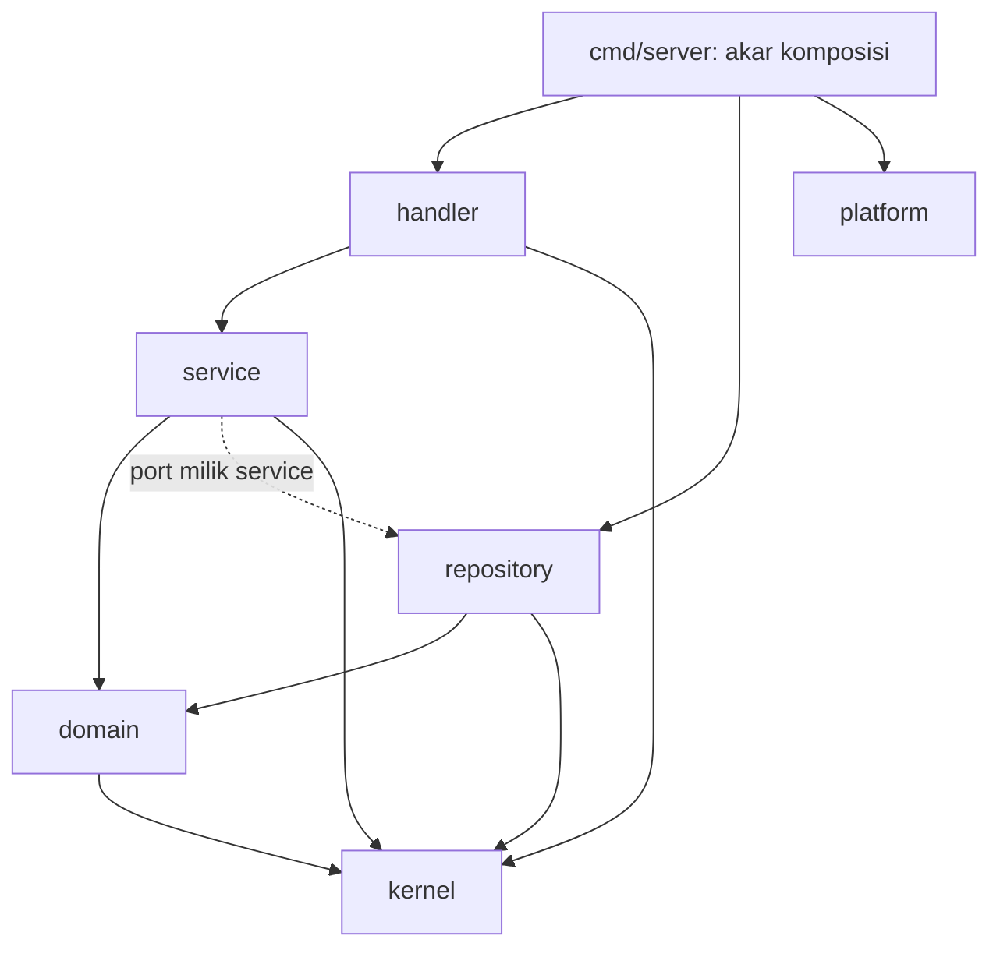
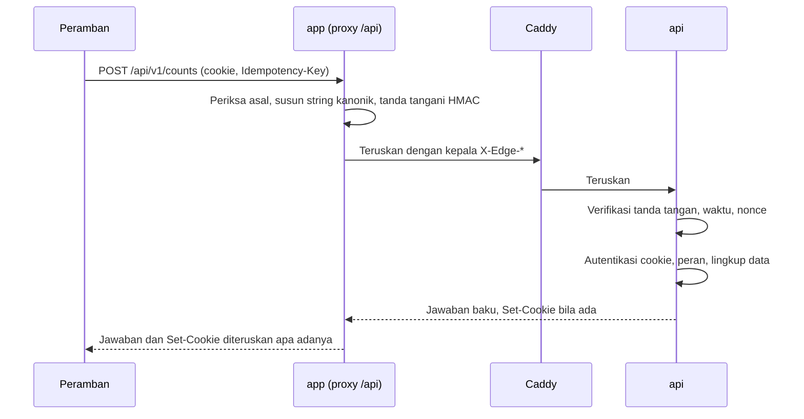
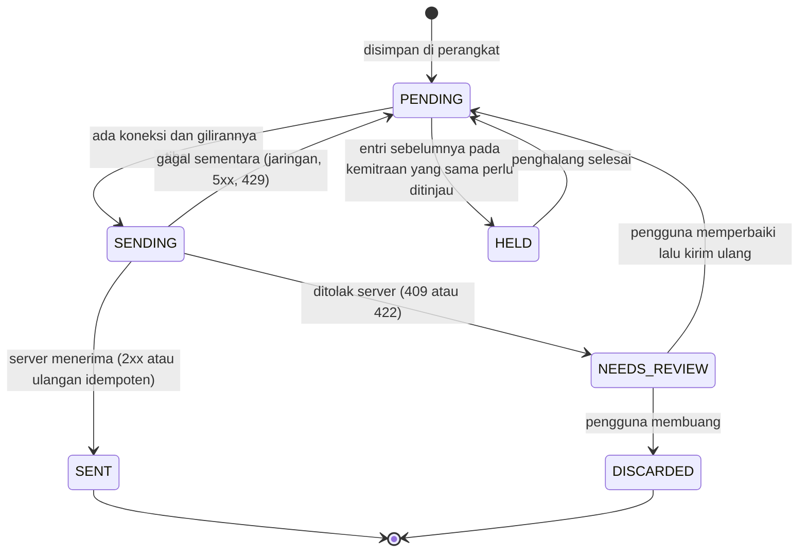

# Aturan Rekayasa: Trustip

| Item | Keterangan |
|---|---|
| Versi | 1.0 |
| Tanggal | 7 Oktober 2026 |
| Dokumen pasangan | `01-PRD.md`, `02-SPESIFIKASI-FITUR.md`, `04-RENCANA-IMPLEMENTASI.md`, `DESIGN.md` |

Dokumen ini berisi aturan yang berlaku untuk setiap baris kode di repositori Trustip. Aturannya mengikat: perubahan yang melanggar satu butir tidak boleh di-commit. Setiap aturan punya ID (`R-<KELOMPOK>-<NN>`) supaya bisa dirujuk saat meninjau kode.

**Urutan otoritas bila dokumen bertentangan**

1. `02-SPESIFIKASI-FITUR.md` untuk perilaku, aturan bisnis, dan angka.
2. Dokumen ini untuk cara menulis kode, arsitektur, dan keamanan.
3. `DESIGN.md` untuk tampilan.
4. `04-RENCANA-IMPLEMENTASI.md` untuk urutan kerja.

Bila ada pertentangan yang tidak terselesaikan oleh urutan itu, pekerjaan berhenti dan pertanyaannya dicatat untuk tim. Tidak ada tebakan.

## Daftar isi

1. Prinsip
2. Struktur repositori
3. Aturan Clean Code
4. Arsitektur API
5. Kontrak API dan bentuk jawaban baku
6. Arsitektur app
7. Keamanan
8. Kerja luring
9. Log
10. Performa
11. Pengujian
12. Git dan commit
13. Dokumentasi wajib
14. Daftar periksa sebelum commit

## 1. Prinsip

1. **Benar dulu, lalu bersih, lalu cepat.** Fitur dianggap ada bila ujinya lulus, kodenya memenuhi dokumen ini, dan ukuran performanya tercapai.
2. **Server adalah sumber kebenaran.** Antarmuka boleh menghitung pratinjau, tetapi hasil yang berlaku selalu hasil server.
3. **Aturan diperiksa mesin.** Setiap aturan yang bisa diperiksa otomatis wajib punya pemeriksa di `make check` dan di CI. Aturan yang hanya ditulis akan dilanggar.
4. **Tidak ada pengaman yang dimatikan.** Tidak ada `--no-verify`, tidak ada direktif pengecualian lint, tidak ada uji yang dilewati, tidak ada verifikasi TLS yang dinonaktifkan.
5. **Jangan membangun untuk kebutuhan yang belum ada.** Tidak ada Redis, antrean pesan, atau layanan terpisah sebelum ada ukuran yang membuktikan perlunya.

## 2. Struktur repositori

Dua folder kode di akar: `api` untuk server dan `app` untuk antarmuka.

```
trustip/
  api/                      Server Go Fiber
  app/                      Antarmuka SvelteKit (PWA)
  docs/                     Dokumen produk, aturan, rencana, keputusan
  .github/workflows/        CI
  Makefile                  Satu pintu untuk setup, dev, check, test, build
  lefthook.yml              Kait git
  README.md
  .editorconfig
  .gitignore
```

- **R-REPO-01** Tidak ada folder kode lain di akar. Berkas deploy API ada di `api/deploy/`.
- **R-REPO-02** `api` dan `app` tidak saling mengimpor kode. Penghubungnya hanya dua: berkas kontrak `api/openapi/openapi.yaml` dan vektor uji `api/testdata/vectors/*.json`.
- **R-REPO-03** `make setup`, `make dev`, `make check`, `make test`, `make build` berjalan dari akar dengan satu perintah masing-masing (bau E1 dan E2 di bagian 3.14).
- **R-REPO-04** Berkas hasil pembangkit (kueri sqlc, tipe OpenAPI) di-commit, ditandai sebagai hasil pembangkit, dan CI menolak bila tidak sama dengan hasil pembangkitan ulang.

## 3. Aturan Clean Code

Aturan di bagian ini diturunkan dari buku *Clean Code* (Robert C. Martin), bab demi bab, dan ditulis ulang untuk Go dan TypeScript. Tiga catatan penerapan supaya jujur terhadap sumbernya:

1. Buku itu memakai Java. Beberapa anjuran diterjemahkan ke idiom Go, misalnya "pakai pengecualian, bukan kode galat" menjadi "kembalikan nilai `error`, bukan angka status atau boolean".
2. Buku itu memberi anjuran, bukan angka kaku. Angka ambang di 3.13 adalah terjemahan tim supaya anjurannya bisa diperiksa mesin.
3. Buku itu masih mengizinkan beberapa jenis komentar. Aturan tim lebih ketat: tidak ada komentar sama sekali (3.4).

### 3.1 Nama yang bermakna (bab 2)

- **R-CC-01** Nama menyatakan maksud. Pembaca tidak perlu membuka isi fungsi untuk tahu apa yang dikerjakannya. `remainingQty`, bukan `r` atau `data`.
- **R-CC-02** Tidak ada nama yang menyesatkan. Jangan menamai sesuatu `list` bila bukan daftar, atau `accountMap` bila isinya irisan.
- **R-CC-03** Perbedaan nama harus berarti. Dilarang: akhiran angka (`item2`), kata pengisi (`Info`, `Data`, `Object`, `Manager`, `Helper`, `Util` sebagai nama tipe), dan dua nama yang hanya beda ejaan.
- **R-CC-04** Nama bisa diucapkan dan bisa dicari. Tidak ada singkatan buatan sendiri. Konstanta menggantikan angka ajaib supaya bisa dicari.
- **R-CC-05** Tidak ada penyandian. Tidak ada awalan tipe, awalan `I` untuk antarmuka, atau awalan anggota.
- **R-CC-06** Tipe dan komponen memakai kata benda (`Settlement`, `CountForm`). Fungsi memakai kata kerja (`issueSettlement`). Fungsi yang mengembalikan boolean diawali `is`, `has`, atau `can`.
- **R-CC-07** Satu kata untuk satu konsep, dipakai di seluruh repositori. Kata kerja baku ada di tabel 3.1.2.
- **R-CC-08** Tidak ada permainan kata. Satu kata tidak dipakai untuk dua maksud.
- **R-CC-09** Nama dari dunia masalah memakai glosarium 3.1.1. Nama dari dunia solusi memakai istilah teknik yang lazim (`Repository`, `Mapper`, `Policy`).
- **R-CC-10** Panjang nama sebanding dengan luas cakupannya. Nama pendek hanya untuk cakupan beberapa baris. Pengecualian yang mengikuti kebiasaan Go: `ctx`, `err`, `ok`, `tx`, `id`, `i`, dan nama penerima metode berupa singkatan satu sampai tiga huruf.
- **R-CC-11** Nama menyebut efek samping. Fungsi yang membuat sekaligus mengambil dinamai `getOrCreate...`, bukan `get...`.
- **R-CC-12** Pengenal kode berbahasa Inggris. Teks yang dilihat pengguna berbahasa Indonesia dan hanya ada di katalog teks (R-APP-09).

#### 3.1.1 Glosarium kode

| Istilah di antarmuka | Nama di kode | Tabel |
|---|---|---|
| Organisasi | `Organization` | `organizations` |
| Penitip | `Consignor` | |
| Toko | `Store` | |
| Anggota | `Membership` | `memberships` |
| Kebutuhan Toko | `Need` | `needs` |
| Ajuan Kerja Sama | `Proposal`, `ProposalRevision` | `proposals`, `proposal_revisions` |
| Kesepakatan Dagang | `Agreement` | `agreements` |
| Kemitraan | `Partnership` | `partnerships` |
| Produk | `Product` | `products` |
| Titipan Masuk | `Drop` | `drops` |
| Batch | `Batch` | `drop_items` |
| Mutasi stok | `StockMovement` | `stock_movements` |
| Hitung Sisa | `Count` | `counts` |
| Setoran | `Settlement` | `settlements` |
| Pembayaran | `Payment` | `payments` |
| Omzet | `GrossAmount` | `gross_amount` |
| Untung toko | `StoreShare` | `store_share_amount` |
| Hak penitip, harus setor | `ConsignorShare` | `consignor_share_amount` |
| Harga setor | `DepositPrice` | `deposit_price` |
| Saran | `Insight` | |
| Skor kecocokan | `MatchScore` | |
| Segel | `Seal` | `seals` |
| Antrean luring | `Outbox` | di perangkat |
| Paket kerja luring | `WorkPacket` | di perangkat |
| Pelaku (pengguna dan organisasinya) | `Actor` | |

#### 3.1.2 Kata kerja baku

| Kata | Arti tunggal |
|---|---|
| `Get` | Mengambil satu berdasarkan kunci. Galat bila tidak ada |
| `Find` | Mencari satu yang boleh tidak ada |
| `List` | Mengambil daftar berpaginasi |
| `Create`, `Update`, `Archive` | Mengubah data induk (produk, profil, kebutuhan) |
| `Record` | Mencatat dokumen kejadian: `RecordDrop`, `RecordCount`, `RecordPayment` |
| `Confirm`, `Reject` | Tanggapan pihak lawan atas dokumen |
| `Send`, `Counter`, `Accept`, `Decline`, `Withdraw` | Aksi pada Ajuan |
| `Issue` | Menerbitkan Setoran |
| `Allocate` | Membagi jumlah ke batch secara FEFO |
| `Seal`, `Verify` | Menyegel dan memeriksa segel |
| `Enqueue`, `Flush` | Memasukkan ke dan mengirim isi antrean luring |

### 3.2 Fungsi (bab 3)

- **R-CC-13** Fungsi itu kecil. Ambangnya di 3.13.
- **R-CC-14** Satu fungsi mengerjakan satu hal. Uji cepatnya: bila bisa mengekstrak fungsi lain dari dalamnya dengan nama yang bukan sekadar pengulangan isinya, fungsi itu mengerjakan lebih dari satu hal.
- **R-CC-15** Satu tingkat abstraksi per fungsi. Fungsi yang memanggil `issueSettlement()` tidak sekaligus menyusun string atau menghitung indeks.
- **R-CC-16** Berkas dibaca dari atas ke bawah seperti cerita. Fungsi pemanggil di atas, fungsi yang dipanggil tepat di bawahnya.
- **R-CC-17** Percabangan menurut jenis hanya muncul sekali. `switch` atas jenis (model harga, jadwal setor, jenis peristiwa) ada di satu tempat yang memilih strategi. Selebihnya memakai antarmuka atau tabel pemetaan. Semua `switch` atas enumerasi harus lengkap.
- **R-CC-18** Jumlah parameter: nol paling baik, satu atau dua wajar, tiga butuh alasan kuat, lebih dari tiga dilarang. `context.Context` tidak dihitung. Kelompok parameter yang selalu bersama dijadikan satu tipe (`RecordDropCommand`).
- **R-CC-19** Tidak ada parameter bendera. Fungsi berparameter boolean dipecah menjadi dua fungsi bernama jelas.
- **R-CC-20** Tidak ada parameter keluaran. Fungsi mengembalikan hasilnya, tidak mengubah argumennya.
- **R-CC-21** Tidak ada efek samping tersembunyi. Fungsi bernama `validate...` tidak menyimpan apa pun.
- **R-CC-22** Perintah dan pertanyaan dipisah. Fungsi mengubah keadaan atau menjawab sesuatu, tidak keduanya. Pengecualian yang disengaja: fungsi `Record...` dan `Issue...` mengembalikan dokumen yang baru dibuat.
- **R-CC-23** Kegagalan dinyatakan dengan nilai `error` (Go) atau `throw` atas tipe galat sendiri (TypeScript). Tidak ada angka status, string ajaib, atau boolean sebagai tanda gagal.
- **R-CC-24** Penanganan galat adalah satu hal. Fungsi yang isinya menangani galat tidak mengerjakan hal lain.
- **R-CC-25** Tidak ada pengulangan. Aturan bisnis ditulis di satu tempat. Hitungan uang di Go dan pratinjaunya di TypeScript adalah satu-satunya pengulangan yang diizinkan, dan keduanya diikat oleh vektor uji yang sama (R-TEST-04).
- **R-CC-26** Jalur utama rata kiri. Kondisi gagal ditangani lebih dulu dengan keluar dini, sehingga tidak ada `else` setelah `return`.

### 3.3 Komentar (bab 4)

Buku itu memandang komentar sebagai tanda kode gagal menjelaskan dirinya. Tim mengambil sikap paling ketat.

- **R-CC-27** **Tidak ada komentar di berkas apa pun yang dilacak git, kecuali berkas Markdown.** Berlaku untuk Go, TypeScript, Svelte, SQL, CSS, YAML, Dockerfile, Caddyfile, dan Makefile.
- **R-CC-28** Yang bukan komentar dan tetap diizinkan karena dibaca mesin: direktif Go (`//go:build`, `//go:embed`, `//go:generate`), anotasi nama kueri sqlc (`-- name: ... :one`), penanda migrasi goose (`-- +goose Up`, `-- +goose Down`, `-- +goose StatementBegin`, `-- +goose StatementEnd`), kepala berkas hasil pembangkit, dan baris `#!` pada skrip.
- **R-CC-29** Direktif pengecualian dilarang: `//nolint`, `// eslint-disable`, `@ts-ignore`, `@ts-expect-error`, `# noqa`. Bila pemeriksa salah, ubah konfigurasinya di satu tempat dan catat alasannya di `docs/adr/`.
- **R-CC-30** Penjelasan yang dulu ditulis sebagai komentar pindah ke salah satu dari empat tempat: nama yang lebih baik, fungsi yang diekstrak, nama uji, atau catatan keputusan di `docs/adr/`.
- **R-CC-31** Kode yang dinonaktifkan dengan komentar dihapus. Riwayat git yang menyimpannya.
- **R-CC-32** Pemeriksa `make check` gagal bila menemukan komentar. Pemeriksanya memakai pemindai token tiap bahasa, bukan pencarian teks, supaya `//` di dalam string dan URL tidak salah tangkap.

### 3.4 Pemformatan (bab 5)

- **R-CC-33** Format ditentukan alat, bukan selera: `gofumpt` dan pengurut impor untuk Go, Prettier dengan plugin Svelte dan Tailwind untuk app. Tidak ada perdebatan gaya.
- **R-CC-34** Baris kosong memisahkan gagasan. Baris yang berhubungan erat tidak dipisah.
- **R-CC-35** Variabel dideklarasikan sedekat mungkin dengan pemakaiannya. Fungsi yang saling memanggil diletakkan berdekatan.
- **R-CC-36** Lebar baris maksimal 120 kolom untuk Go dan 100 untuk app.

### 3.5 Objek dan struktur data (bab 6)

- **R-CC-37** Sebuah tipe adalah objek (menyembunyikan data, menawarkan perilaku) atau struktur data (membuka data, tanpa perilaku). Tidak ada campuran.
- **R-CC-38** Tiga bentuk data dipisah dan dipetakan secara eksplisit: DTO permintaan dan jawaban di penangan, entitas dan nilai di domain, baris hasil sqlc di repositori. Entitas domain tidak pernah dikirim langsung sebagai JSON dan baris basis data tidak pernah keluar dari repositori.
- **R-CC-39** Hukum Demeter: sebuah fungsi hanya berbicara dengan penerimanya, parameternya, objek yang dibuatnya, dan dependensi langsungnya. Rantai `a.B().C().D()` atas objek dilarang.
- **R-CC-40** Nilai yang punya aturan dibungkus tipe: `Rupiah`, `Quantity`, `BasisPoints`, `Period`, `Slug`, `WhatsAppNumber`. Pembuatnya menolak nilai tidak sah, sehingga keadaan tidak sah tidak bisa dibuat.

### 3.6 Penanganan galat (bab 7)

- **R-CC-41** Jalur gagal dirancang lebih dulu. Untuk setiap layanan, uji kegagalannya ditulis sebelum uji jalur suksesnya.
- **R-CC-42** Galat membawa konteks: operasi yang sedang berjalan dan pengenal yang relevan, dibungkus dengan `%w`. Contoh: `fmt.Errorf("issue settlement for partnership %s: %w", id, err)`.
- **R-CC-43** Jenis galat ditentukan oleh kebutuhan pemanggil, bukan oleh sumbernya. Paket `apperror` menyediakan jenis tetap: `Validation`, `Unauthenticated`, `Forbidden`, `NotFound`, `Conflict`, `RateLimited`, `Unavailable`, `Internal`. Masing-masing membawa kode stabil (bagian 5.4).
- **R-CC-44** Galat pustaka pihak ketiga dibungkus di batas. `pgx.ErrNoRows` berubah menjadi `apperror.NotFound` di repositori dan tidak pernah terlihat di layanan.
- **R-CC-45** Tidak mengembalikan kosong sebagai tanda. Di Go tidak ada `return nil, nil`. Yang tidak ditemukan dikembalikan sebagai galat `NotFound` atau sebagai pasangan nilai dan `bool`. Daftar kosong dikembalikan sebagai daftar kosong, dan di JSON menjadi `[]`, bukan `null`.
- **R-CC-46** Tidak meneruskan kosong sebagai argumen. Pilihan opsional dinyatakan dengan tipe atau fungsi terpisah, bukan dengan penunjuk kosong. Di TypeScript `strictNullChecks` menyala dan operator `!` dilarang.
- **R-CC-47** Tidak ada galat yang diabaikan. Tidak ada `_ = err`. Tidak ada `catch` kosong.
- **R-CC-48** `panic` hanya untuk kegagalan saat mulai (konfigurasi tidak sah). Lapisan HTTP punya penangkap yang mengubah `panic` menjadi jawaban 500 dan mencatatnya.
- **R-CC-49** Galat dicatat ke log sekali saja, di batas terluar. Lapisan di bawahnya membungkus dan mengembalikan, tidak mencatat.

### 3.7 Batas dengan kode pihak ketiga (bab 8)

- **R-CC-50** Setiap pustaka pihak ketiga hanya disentuh di satu tempat dan dibungkus antarmuka milik sendiri:

| Pustaka atau layanan | Satu-satunya tempat yang boleh mengimpornya | Antarmuka milik sendiri |
|---|---|---|
| Fiber | `handler` tiap modul dan `platform/httpserver` | DTO dan `Actor` |
| pgx dan hasil sqlc | `repository` tiap modul dan `platform/database` | port repositori, `Transactor` |
| Cloudflare Turnstile | `platform/captcha` | `CaptchaVerifier` |
| Argon2, HMAC, Ed25519, JWT | `platform/security` | `PasswordHasher`, `TokenSigner`, `Sealer`, `EdgeVerifier` |
| Sistem berkas | `platform/storage` | `FileStore` |
| Jam dan pembangkit ID | `platform/clock`, `platform/idgen` | `Clock`, `IDGenerator` |
| `fetch` | `app/src/lib/api/client.ts` | `apiClient` |
| IndexedDB | `app/src/lib/offline/store.ts` | `outboxStore`, `cacheStore` |
| Leaflet | satu komponen `MapView` | properti komponen |
| Widget captcha | satu komponen `CaptchaField` | properti komponen |

- **R-CC-51** Perilaku pustaka yang diandalkan dikunci dengan uji belajar: urutan jarak PostGIS, parameter Argon2id, tanda tangan Ed25519, kunci uji resmi Turnstile.
- **R-CC-52** Menambah pustaka baru butuh tiga hal dalam commit yang sama: alasan, lisensi, dan ukuran di `docs/THIRD_PARTY.md`. Pustaka dipilih yang paling kecil yang memenuhi kebutuhan.

### 3.8 Uji unit (bab 9)

- **R-CC-53** Tiga hukum TDD berlaku untuk lapisan domain dan layanan: tidak menulis kode produksi sebelum ada uji yang gagal, tidak menulis uji lebih dari yang cukup untuk gagal, tidak menulis kode produksi lebih dari yang cukup untuk meluluskan uji itu.
- **R-CC-54** Kode uji dirawat seperti kode produksi dan tunduk pada semua aturan di bagian 3.
- **R-CC-55** Satu uji membuktikan satu konsep. Susunannya tiga langkah: siapkan, jalankan, periksa.
- **R-CC-56** Uji memakai bahasa domain lewat pembangun data, misalnya `aPartnership().withCommission(2000).build()`.
- **R-CC-57** Uji memenuhi lima sifat: cepat, mandiri (tidak bergantung pada urutan), bisa diulang di mana saja, menilai dirinya sendiri (lulus atau gagal tanpa dibaca manusia), dan ditulis tepat sebelum kodenya.
- **R-CC-58** Nama uji adalah kalimat perilaku: `TestAllocateFEFO_SoldExceedsFirstBatch_TakesRemainderFromNext`.

### 3.9 Kelas, tipe, dan komponen (bab 10)

- **R-CC-59** Tipe itu kecil, diukur dari tanggung jawabnya. Bila namanya butuh kata "dan", tipe itu dipecah.
- **R-CC-60** Satu alasan untuk berubah per tipe. Satu berkas layanan berisi satu kasus pakai: `RecordDrop`, `ConfirmDrop`, `CancelDrop` adalah tiga tipe di tiga berkas.
- **R-CC-61** Kohesi tinggi: setiap metode memakai sebagian besar bidang tipenya. Bidang yang hanya dipakai satu metode adalah tanda tipe yang harus dipecah.
- **R-CC-62** Terbuka untuk ditambah, tertutup untuk diubah. Model harga baru (misalnya sewa rak) ditambahkan sebagai strategi baru, tanpa mengubah fungsi hitung yang sudah ada.
- **R-CC-63** Bergantung pada abstraksi. Layanan bergantung pada antarmuka kecil yang didefinisikannya sendiri (port), bukan pada tipe konkret. Antarmuka maksimal empat metode.
- **R-CC-64** Komponen Svelte punya satu tanggung jawab. Komponen tampilan menerima data lewat properti dan tidak memanggil API. Komponen wadah mengambil data dan menyusun komponen tampilan.

### 3.10 Sistem (bab 11)

- **R-CC-65** Pembuatan dipisah dari pemakaian. Semua objek dirakit di akar komposisi (`api/cmd/server`). Kode bisnis tidak pernah membuat dependensinya sendiri.
- **R-CC-66** Dependensi disuntikkan lewat pembuat tipe. Tidak ada kerangka injeksi, tidak ada variabel global yang bisa berubah, tidak ada fungsi `init` yang punya efek samping.
- **R-CC-67** Urusan lintas bagian (log, autentikasi, transaksi, pembatasan laju, pengukuran) dipasang sebagai perantara atau pembungkus, tidak ditaburkan di kode bisnis.
- **R-CC-68** Keputusan arsitektur yang menyimpang dari dokumen ini dicatat di `docs/adr/NNNN-judul.md` dengan tiga bagian: konteks, keputusan, akibat.

### 3.11 Desain yang muncul (bab 12)

- **R-CC-69** Empat aturan desain sederhana, berurutan menurut kepentingan: semua uji lulus, tidak ada pengulangan, maksud penulis terlihat jelas, jumlah tipe dan fungsi sesedikit mungkin.

### 3.12 Kebersamaan (bab 13)

- **R-CC-70** Kode kebersamaan dipisah dari kode bisnis. Hub SSE, penjadwal, pembatas laju, dan mesin sinkron luring hidup di paketnya sendiri.
- **R-CC-71** Data bersama dibatasi sesempit mungkin dan dilindungi satu pemilik. Bila bisa, kirim salinan, jangan berbagi.
- **R-CC-72** Setiap goroutine punya pemilik, punya jalan berhenti lewat `context`, dan ikut dimatikan saat server berhenti dengan tertib. Uji memeriksa tidak ada goroutine yang bocor.
- **R-CC-73** Bagian kritis dijaga sekecil mungkin. Tidak ada panggilan jaringan atau basis data sambil memegang kunci di memori.
- **R-CC-74** Kebersamaan data diselesaikan di basis data dengan kunci baris dan batasan unik, bukan dengan kunci di memori (BR-STK-01).
- **R-CC-75** `go test -race` wajib lulus. Skenario bersamaan di spesifikasi bagian 26 punya uji sendiri.

### 3.13 Ambang yang diperiksa mesin

| Ukuran | Go | TypeScript dan Svelte |
|---|---:|---:|
| Baris per fungsi | 40 | 30 |
| Pernyataan per fungsi | 25 | 20 |
| Parameter per fungsi | 3 di luar `ctx` | 3 |
| Nilai kembali | 2 ditambah `error` | 1 |
| Kompleksitas siklomatik | 10 | 8 |
| Kedalaman blok bersarang | 2 | 2 |
| Baris per berkas | 300 | 250, komponen Svelte 200 |
| Metode per antarmuka | 4 | 4 |
| Lebar baris | 120 | 100 |

Batas Go sedikit lebih longgar karena pemeriksaan `if err != nil` menambah baris dan cabang tanpa menambah kerumitan. Berkas hasil pembangkit dan berkas migrasi dikecualikan. Berkas uji dikecualikan dari batas baris per fungsi dan per berkas saja.

Pemeriksa yang wajib menyala:

| Bahasa | Pemeriksa |
|---|---|
| Go, format | `gofumpt`, pengurut impor |
| Go, benar | `govet`, `staticcheck`, `errcheck`, `errorlint`, `wrapcheck`, `nilnil`, `nilerr`, `bodyclose`, `rowserrcheck`, `sqlclosecheck`, `noctx`, `contextcheck`, `exhaustive`, `unused`, `unparam`, `ineffassign` |
| Go, bersih | `funlen`, `gocyclo`, `gocognit`, `nestif`, `dupl`, `goconst`, `mnd`, `revive` (batas argumen, batas nilai kembali, parameter bendera, kedalaman sarang), `varnamelen`, `interfacebloat`, `gochecknoglobals`, `gochecknoinits`, `lll`, `misspell` |
| Go, arsitektur dan aman | `depguard` (aturan impor 4.2), `forbidigo` (larangan `fmt.Print`, `panic` di luar `cmd`, `time.Now` di luar `platform/clock`), `gosec`, `govulncheck`, pencari kode mati |
| App, format | Prettier |
| App, benar | `svelte-check`, TypeScript `strict` dengan `noUncheckedIndexedAccess` dan `exactOptionalPropertyTypes`, ESLint `typescript-eslint` tingkat `strict-type-checked` |
| App, bersih | `max-lines-per-function`, `max-statements`, `max-params`, `max-depth`, `complexity`, `max-lines`, `no-magic-numbers`, `no-negated-condition`, `no-nested-ternary`, `no-else-return`, `no-param-reassign`, `id-length`, `no-console`, pencari ekspor dan dependensi tak terpakai |
| App, arsitektur dan aman | aturan batas impor (bagian 6.2), `svelte/no-at-html-tags`, larangan `innerHTML`, `eval`, dan `new Function`, audit dependensi |
| Semua | pemeriksa tanpa komentar (R-CC-32), pemindai rahasia, pemeriksa warna mentah di luar berkas token |

### 3.14 Daftar bau untuk tinjauan

Diringkas dari daftar bau dan heuristik di bab 17. Kode ditinjau terhadap daftar ini sebelum commit.

**Lingkungan**

| Kode | Bau | Cara memeriksa |
|---|---|---|
| E1 | Membangun butuh lebih dari satu langkah | `make build` |
| E2 | Menguji butuh lebih dari satu langkah | `make test` |

**Fungsi**

| Kode | Bau |
|---|---|
| F1 | Terlalu banyak parameter |
| F2 | Parameter keluaran |
| F3 | Parameter bendera |
| F4 | Fungsi yang tidak pernah dipanggil |

**Umum**

| Kode | Bau | Penerapan di Trustip |
|---|---|---|
| G1 | Beberapa bahasa dalam satu berkas | SQL hanya di `db/queries` dan `db/migrations`. Tidak ada HTML atau CSS di dalam string kode |
| G2 | Perilaku yang wajar tidak diimplementasikan | Fungsi berperilaku seperti yang dijanjikan namanya |
| G3 | Perilaku salah di batas | Setiap batas angka di spesifikasi punya uji tepat di batas dan satu langkah di luarnya |
| G4 | Pengaman dimatikan | Bagian 1 butir 4 |
| G5 | Pengulangan | R-CC-25 |
| G6 | Kode di tingkat abstraksi yang salah | Detail HTTP tidak ada di layanan. Aturan bisnis tidak ada di penangan |
| G7 | Tipe dasar bergantung pada turunannya | Domain tidak mengenal lapisan lain |
| G8 | Terlalu banyak informasi | Antarmuka kecil. Yang diekspor hanya yang dipakai paket lain |
| G9 | Kode mati | Pencari kode mati di `make check` |
| G10 | Jarak vertikal | R-CC-35 |
| G11 | Tidak konsisten | Pola yang sama untuk hal yang sama: semua modul bersusunan sama (bagian 4.1) |
| G12 | Sampah | Tidak ada pembuat kosong, variabel tak terpakai, atau berkas sisa |
| G13 | Keterkaitan buatan | Konstanta dan fungsi umum tidak diletakkan di tipe yang tidak berhubungan |
| G14 | Iri fitur | Fungsi yang lebih banyak memakai data tipe lain dipindah ke tipe itu |
| G15 | Parameter pemilih | Sama dengan F3, termasuk enumerasi yang hanya memilih cabang |
| G16 | Maksud yang kabur | Tidak ada ekspresi padat yang harus diurai dulu |
| G17 | Tanggung jawab salah tempat | Kode diletakkan di tempat pembaca akan mencarinya |
| G18 | Fungsi lepas yang tidak pada tempatnya | Perilaku yang mungkin berbeda per jenis menjadi metode atau strategi |
| G19 | Tanpa variabel penjelas | Langkah hitungan diberi nama: `grossAmount`, `storeShare`, `consignorShare` |
| G20 | Nama fungsi tidak mengatakan isinya | R-CC-01 |
| G21 | Tidak memahami algoritme | FEFO, pembulatan, dan periode Setoran dibuktikan dengan uji, bukan dicoba sampai lulus |
| G22 | Ketergantungan logis yang tidak dibuat fisik | Modul meminta yang dibutuhkannya lewat parameter, tidak berasumsi tentang modul lain |
| G23 | `if` atau `switch` di tempat polimorfisme lebih tepat | R-CC-17 |
| G24 | Tidak mengikuti konvensi baku | Konvensi Go dan Svelte resmi diikuti, termasuk nama penerima pendek |
| G25 | Angka ajaib | Semua angka aturan bisnis menjadi konstanta bernama yang merujuk ID aturannya, misalnya `maxOpenNeedsPerStore` |
| G26 | Tidak presisi | Uang selalu bilangan bulat. Tidak ada angka pecahan untuk uang. Zona waktu selalu eksplisit |
| G27 | Konvensi di tempat struktur lebih kuat | Aturan ditegakkan oleh tipe dan batasan basis data, bukan oleh kesepakatan nama |
| G28 | Kondisi tidak dibungkus | `if canConfirm(drop, actor)` bukan `if drop.Status == ... && actor.OrgID == ...` |
| G29 | Kondisi negatif | `if isActive` lebih baik dari `if !isInactive` |
| G30 | Fungsi mengerjakan lebih dari satu hal | R-CC-14 |
| G31 | Urutan tersembunyi | Bila langkah harus berurutan, hasil langkah pertama menjadi masukan langkah kedua |
| G32 | Sewenang-wenang | Setiap struktur punya alasan yang terlihat dari susunannya |
| G33 | Kondisi batas tidak dibungkus | `nextSeq := lastSeq + 1` diberi nama, tidak ditabur `+ 1` |
| G34 | Fungsi turun lebih dari satu tingkat abstraksi | R-CC-15 |
| G35 | Data konfigurasi di tingkat rendah | Nilai bawaan dan batas dibaca di akar komposisi lalu diteruskan ke bawah |
| G36 | Navigasi berantai | R-CC-39 |

**Bahasa**

| Kode | Bau | Penerapan |
|---|---|---|
| J1, J2 | Khusus Java | Tidak dipakai. Impor selalu eksplisit |
| J3 | Konstanta lepas di tempat enumerasi | Nilai terbatas memakai tipe bernama dengan daftar nilainya, di Go dan di TypeScript |

**Nama**

| Kode | Bau |
|---|---|
| N1 | Nama tidak deskriptif |
| N2 | Nama di tingkat abstraksi yang salah |
| N3 | Tidak memakai istilah baku yang sudah ada |
| N4 | Nama ambigu |
| N5 | Nama pendek untuk cakupan luas |
| N6 | Nama bersandi |
| N7 | Nama menyembunyikan efek samping |

**Uji**

| Kode | Bau | Penerapan |
|---|---|---|
| T1 | Uji kurang | Setiap aturan `BR-` punya minimal satu uji yang menyebut ID-nya |
| T2 | Tanpa alat cakupan | Cakupan dihitung di CI dengan ambang di bagian 11 |
| T3 | Melewatkan uji sepele | Pemetaan dan pembuat nilai tetap diuji |
| T4 | Uji yang dimatikan | Tidak ada uji yang dilewati di cabang utama |
| T5 | Kondisi batas tidak diuji | Sama dengan G3 |
| T6 | Tidak menguji tuntas di sekitar bug | Setiap bug diperbaiki bersama uji yang mereproduksinya dan uji kasus tetangganya |
| T7, T8 | Pola kegagalan dan pola cakupan tidak dibaca | Uji yang gagal bersamaan diselidiki sebagai satu sebab |
| T9 | Uji lambat | Uji unit seluruhnya di bawah 10 detik. Uji integrasi di bawah 3 menit |

### 3.15 Aturan pramuka

- **R-CC-76** Kode ditinggalkan lebih bersih daripada saat ditemukan. Perapian yang tidak berhubungan dengan fitur dijadikan commit tersendiri (♻️), tidak dicampur.

## 4. Arsitektur API

### 4.1 Susunan folder

```
api/
  cmd/
    server/                 Akar komposisi dan titik mulai
    migrate/                Menjalankan migrasi
    seed/                   Data contoh
  internal/
    kernel/                 Inti bersama tanpa dependensi luar
      actor/  apperror/  money/  quantity/  period/  pagination/
    platform/               Rangka dan penggerak
      config/  logger/  clock/  idgen/
      database/             Kumpulan koneksi, Transactor, pelacak kueri lambat
      httpserver/           Aplikasi Fiber, rantai perantara, penulis jawaban
      security/             PasswordHasher, TokenSigner, EdgeVerifier, Sealer
      captcha/  ratelimit/  storage/  scheduler/  sse/
    modules/
      auth/  org/  file/  product/  need/  proposal/  agreement/
      partnership/  drop/  stock/  count/  settlement/  report/
      insight/  directory/  notification/  publicsite/  trust/
      seal/  audit/
        domain/             Entitas, nilai, fungsi murni, mesin status
        service/            Satu berkas per kasus pakai, port, kebijakan akses
        repository/         Pelaksana port di atas kueri sqlc
        handler/            Rute, DTO, pemetaan, penangan
    db/
      migrations/           Berkas goose bernomor
      queries/              Berkas SQL untuk sqlc, satu per modul
      sqlc/                 Hasil pembangkit
  openapi/openapi.yaml      Kontrak API
  testdata/vectors/         Vektor uji bersama api dan app
  deploy/                   Dockerfile, compose, Caddyfile
```

Setiap modul bersusunan sama. Modul kecil boleh tidak punya `repository` atau `handler` bila memang tidak butuh, tetapi tidak boleh menambah lapisan lain.

### 4.2 Arah ketergantungan



| Paket | Boleh mengimpor | Dilarang mengimpor |
|---|---|---|
| `kernel`, `*/domain` | Pustaka standar, `kernel` | Fiber, pgx, sqlc, `platform`, lapisan lain, modul lain |
| `*/service` | `domain` modul sendiri, `kernel` | Fiber, pgx, sqlc, `handler`, `repository`, `platform` selain lewat port |
| `*/repository` | `domain` modul sendiri, `kernel`, `db/sqlc`, `platform/database` | Fiber, `service`, `handler` |
| `*/handler` | `service` modul sendiri, `kernel`, `platform/httpserver` | pgx, sqlc, `repository`, `domain` modul lain |
| `platform/*` | Pustaka pihak ketiga, `kernel` | `modules` |
| `cmd/*` | Semua | Tidak memuat aturan bisnis |

- **R-API-01** Aturan tabel di atas ditegakkan `depguard` dan satu uji arsitektur yang membaca graf impor.
- **R-API-02** Modul berbicara dengan modul lain hanya lewat port. `count/service` yang butuh menerbitkan Setoran mendefinisikan antarmuka `SettlementIssuer` di paketnya sendiri, dan akar komposisi menyambungkannya ke pelaksana di modul `settlement`.
- **R-API-03** Lapisan domain murni: tanpa I/O, tanpa jam sistem, tanpa bilangan acak. Waktu dan ID masuk sebagai argumen.

### 4.3 Alur baku satu kasus pakai

Setiap layanan mengikuti enam langkah yang sama, dalam urutan ini:

1. **Periksa peran.** `policy.Require(actor, action)` terhadap tabel izin (7.8).
2. **Muat data dalam lingkup pelaku.** Kueri repositori selalu membawa `actor.OrgID`. Yang di luar lingkup tidak ditemukan.
3. **Bentuk nilai domain.** Perintah diubah menjadi nilai domain. Pembuat nilai menolak yang tidak sah.
4. **Putuskan di domain.** Fungsi murni menghasilkan keputusan: dokumen baru, mutasi, alokasi, peristiwa.
5. **Simpan dalam satu transaksi.** Dokumen, mutasi stok, pemberitahuan, log audit, dan segel disimpan bersama atau tidak sama sekali.
6. **Kembalikan hasil domain.** Penangan yang memetakannya ke DTO.

- **R-API-04** Transaksi dibuka di layanan lewat `Transactor.WithinTx(ctx, fn)`. Repositori mengambil koneksi transaksi dari `ctx`. Penangan dan domain tidak tahu soal transaksi.
- **R-API-05** Tanda tangan baku: `func (uc *RecordDrop) Execute(ctx context.Context, actor actor.Actor, cmd RecordDropCommand) (DropReceipt, error)`.
- **R-API-06** Pelaku selalu dibentuk dari sesi oleh perantara. Tidak ada bidang `organization_id` atau `user_id` di DTO permintaan (BR-AUTHZ-05).

### 4.4 Rantai perantara

Urutan tetap, dari luar ke dalam:

| # | Perantara | Tugas |
|---|---|---|
| 1 | Nomor permintaan | Memakai `X-Request-Id` dari tepi atau membuat baru |
| 2 | Penangkap `panic` | Mengubah menjadi 500 berbentuk baku dan mencatatnya |
| 3 | Log akses | Satu baris per permintaan (bagian 9) |
| 4 | Kepala keamanan | Kepala jawaban di 7.14 |
| 5 | Batas ukuran isi | 64 KB untuk JSON, 1,5 MB untuk unggahan |
| 6 | Tanda tangan tepi | Memeriksa HMAC dari proxy (7.6). Dilewati hanya untuk `/healthz`, aliran SSE, dan berkas publik |
| 7 | Pembatas laju umum | Per IP klien yang sudah terverifikasi |
| 8 | Batas waktu | 10 detik per permintaan |
| 9 | Autentikasi | Membaca cookie akses, memverifikasi, membentuk `Actor` |
| 10 | Pemeriksa asal | Untuk semua metode selain GET (7.5) |
| 11 | Pembatas laju per rute | Tabel 7.9 |
| 12 | Penangan | |

- **R-API-07** Perantara 9 sampai 11 dipasang per kelompok rute. Rute tanpa autentikasi terdaftar di satu daftar eksplisit. Sebuah uji gagal bila ada rute baru yang tidak masuk daftar publik dan tidak punya perantara autentikasi.

### 4.5 Akses data

- **R-API-08** Semua SQL ditulis di `db/queries/*.sql` dan dibangkitkan sqlc. Tidak ada string SQL di berkas Go (7.12).
- **R-API-09** Kueri menyebut kolom satu per satu. Tidak ada `SELECT *`.
- **R-API-10** Setiap kueri atas tabel milik organisasi atau kemitraan memuat syarat lingkup di klausa `WHERE`. Penyaringan lingkup tidak pernah dilakukan di Go setelah data diambil.
- **R-API-11** Skema hanya berubah lewat migrasi bernomor yang punya arah turun. Migrasi yang sudah di-push tidak diubah. Perbaikan dibuat sebagai migrasi baru.
- **R-API-12** Batasan basis data adalah pertahanan terakhir dan wajib ada untuk setiap invarian di NFR-08.
- **R-API-13** Dua peran basis data: pemilik skema untuk migrasi (`DATABASE_MIGRATE_URL`) dan peran aplikasi tanpa hak DDL untuk server (`DATABASE_URL`). Server menolak mulai bila tersambung sebagai pemilik skema di lingkungan produksi.

## 5. Kontrak API dan bentuk jawaban baku

### 5.1 Konvensi

- **R-RES-01** Awalan `/api/v1`. Nama sumber daya kata benda jamak berbahasa Inggris dengan tanda hubung: `/drops`, `/counts`, `/settlements`, `/store-profiles`.
- **R-RES-02** GET tidak pernah mengubah data. Membuat memakai POST, mengubah sebagian memakai PATCH. Aksi yang bukan ubah data biasa menjadi sub-sumber berkata kerja: `POST /proposals/{id}/accept`, `POST /drops/{id}/confirm`.
- **R-RES-03** Nama bidang JSON dan parameter kueri `snake_case`. Nilai enumerasi `UPPER_SNAKE`. ID berupa UUID. Uang bilangan bulat rupiah. Persen bilangan bulat basis poin. Waktu RFC 3339 dalam UTC. Tanggal bisnis `YYYY-MM-DD` dalam Asia/Jakarta.
- **R-RES-04** Daftar berpaginasi kursor: `?limit=20&cursor=...`, batas maksimal 50. Tidak ada `OFFSET`. Urutan dipilih lewat `sort` dari daftar tetap.
- **R-RES-05** Isian yang tidak dikenal ditolak dengan 400 `UNKNOWN_FIELD`. Server tidak pernah diam-diam mengabaikan isian.
- **R-RES-06** Semua pembuatan dokumen wajib membawa kepala `Idempotency-Key` berisi UUID. Kunci sama dengan isi sama mengembalikan jawaban semula dengan kepala `Idempotent-Replay: true`. Kunci sama dengan isi berbeda dibalas 422 `IDEMPOTENCY_KEY_REUSED`.
- **R-RES-07** `openapi.yaml` ditulis lebih dulu untuk setiap rute. Uji kontrak memvalidasi jawaban nyata terhadapnya. Tipe TypeScript dibangkitkan darinya.

### 5.2 Amplop jawaban

Satu bentuk untuk semua rute. Status HTTP tetap menjadi penanda utama berhasil atau gagal. Tidak ada jawaban 200 yang berisi galat.

Berhasil, satu objek:

```json
{
  "code": "OK",
  "message": "Titipan masuk tersimpan.",
  "data": { "id": "0192f0c4-7b1e-7c3a-9d2e-5f6a7b8c9d0e", "number": "TM-202610-0007" },
  "meta": { "request_id": "0192f0c4-8a11-7d55-b0aa-3c1f2e4d5a6b" }
}
```

Berhasil, daftar:

```json
{
  "code": "OK",
  "message": "",
  "data": [],
  "meta": { "request_id": "...", "next_cursor": null, "has_more": false }
}
```

Gagal:

```json
{
  "code": "VALIDATION_FAILED",
  "message": "Periksa kembali isian Anda.",
  "errors": [
    { "field": "items[0].qty", "code": "MIN", "message": "Jumlah minimal 1." }
  ],
  "meta": { "request_id": "..." }
}
```

- **R-RES-08** `code` adalah string stabil untuk mesin dan tidak pernah diterjemahkan. `message` adalah kalimat Indonesia untuk pengguna, diambil dari katalog pesan server.
- **R-RES-09** `meta.request_id` selalu ada. Antarmuka menampilkannya di pesan galat tak terduga supaya bisa dilacak di log.
- **R-RES-10** `data` selalu ada pada jawaban berhasil (boleh `null` untuk aksi tanpa hasil). `errors` hanya ada pada 422 validasi.
- **R-RES-11** Jawaban 5xx tidak pernah memuat pesan galat internal, nama tabel, kueri, atau jejak tumpukan.
- **R-RES-12** Hanya paket `platform/httpserver` yang menulis jawaban. Penangan mengembalikan hasil atau galat dan tidak menyusun amplop sendiri.
- **R-RES-13** Jawaban API tidak di-cache: `Cache-Control: no-store`, kecuali rute publik yang secara eksplisit menetapkan lain (10.3).

### 5.3 Status HTTP

| Status | Dipakai untuk |
|---|---|
| 200 | Berhasil membaca, mengubah, atau menjalankan aksi |
| 201 | Berhasil membuat. Kepala `Location` berisi alamat sumber baru |
| 400 | Permintaan tidak terbaca: JSON rusak, isian tak dikenal, jenis isi salah |
| 401 | Belum masuk, sesi habis, atau tanda tangan tepi tidak sah |
| 403 | Data milik organisasinya tetapi perannya tidak cukup |
| 404 | Tidak ada, atau milik organisasi lain (BR-AUTHZ-02) |
| 409 | Bentrok keadaan atau kebersamaan: `STOCK_CHANGED`, `PROPOSAL_ALREADY_DECIDED`, `AGREEMENT_CHANGED` |
| 413 | Isi permintaan terlalu besar |
| 415 | Jenis isi tidak didukung |
| 422 | Terbaca tetapi melanggar validasi atau aturan bisnis |
| 429 | Terkena pembatasan laju. Kepala `Retry-After` wajib ada |
| 500 | Galat tak terduga |
| 503 | Basis data sedang bangun atau layanan luar tidak menjawab. Kepala `Retry-After` wajib ada |

### 5.4 Kode galat

Kode di spesifikasi bagian 24 berlaku. Kode umum tambahan:

| Kode | Status |
|---|---:|
| `VALIDATION_FAILED` | 422 |
| `UNKNOWN_FIELD`, `MALFORMED_REQUEST` | 400 |
| `UNAUTHENTICATED`, `SESSION_EXPIRED`, `EDGE_SIGNATURE_INVALID` | 401 |
| `FORBIDDEN` | 403 |
| `NOT_FOUND` | 404 |
| `CAPTCHA_FAILED` | 422 |
| `ACCOUNT_LOCKED` | 429 |
| `RATE_LIMITED` | 429 |
| `IDEMPOTENCY_KEY_REUSED` | 422 |
| `AGREEMENT_CHANGED` | 409 |
| `SERVICE_UNAVAILABLE` | 503 |
| `INTERNAL` | 500 |

- **R-RES-14** Setiap kode terdaftar sekali di `kernel/apperror` bersama status dan pesannya. Uji memastikan daftar itu sama dengan daftar di `openapi.yaml`.

## 6. Arsitektur app

### 6.1 Susunan folder

```
app/
  src/
    routes/
      (publik)/             Beranda, cari, profil, produk, kebutuhan, verifikasi, kebijakan
      (akun)/               Masuk, daftar
      onboarding/
      app/                  Area setelah masuk
      api/[...path]/        Proxy bertanda tangan ke API
    lib/
      api/                  schema.d.ts (hasil pembangkit), client.ts, satu berkas per sumber daya
      features/
        <fitur>/            components/, state.svelte.ts, schema.ts, mapper.ts
      components/ui/        Komponen dasar sistem desain
      domain/               Fungsi murni untuk pratinjau: uang, FEFO, tanggal, format
      offline/              store.ts, outbox.ts, sync.ts, work-packet.ts
      server/               Hanya jalan di server: penanda tangan tepi, pembaca rahasia
      i18n/id.ts            Katalog seluruh teks antarmuka
      styles/tokens.css     Token desain
    service-worker.ts
    hooks.server.ts         Kepala keamanan, CSP, penjaga rute
  static/                   Manifes, ikon, huruf
  tests/                    Uji ujung ke ujung
```

### 6.2 Aturan lapisan

| Lapisan | Boleh mengimpor | Dilarang |
|---|---|---|
| `routes` | `features`, `components/ui`, `api`, `i18n` | Aturan bisnis, akses IndexedDB langsung, `fetch` langsung |
| `features/<a>` | `components/ui`, `api`, `domain`, `offline`, `i18n` | `features/<b>` lain, `routes` |
| `components/ui` | `styles`, `i18n` | `api`, `features`, `offline` |
| `domain` | Tidak ada | Semuanya. Fungsi murni tanpa DOM, tanpa jaringan |
| `offline` | `api`, `domain` | `features`, `components` |
| `server` | Tidak ada dari klien | Diimpor dari kode klien (ditegakkan SvelteKit lewat `$lib/server`) |

- **R-APP-01** Berkas rute tipis: memuat data, menyusun komponen fitur. Tidak ada aturan bisnis di `+page.svelte`.
- **R-APP-02** Halaman publik dirender di server (`+page.server.ts`) supaya cepat dan terindeks. Area `/app` adalah cangkang yang dirender di klien (`ssr = false`) dan mengambil data lewat `apiClient`.
- **R-APP-03** Keadaan memakai rune Svelte 5 di berkas `state.svelte.ts` per fitur. Tidak ada keadaan di tingkat modul yang hidup di server, karena akan terbagi antar pengguna.
- **R-APP-04** Semua panggilan jaringan lewat `apiClient`. Ia satu-satunya yang membuka amplop, memetakan galat ke tipe `ApiError`, menyegarkan sesi sekali saat 401 lalu mengulang, dan menambahkan `Idempotency-Key`.
- **R-APP-05** Semua tulisan dokumen yang bisa dikerjakan luring (Titipan Masuk, Hitung Sisa) lewat antrean luring, baik saat daring maupun luring. Satu jalur tulis (bagian 8).
- **R-APP-06** Validasi formulir di app hanya untuk kenyamanan. Skema validasi per formulir ada di `schema.ts` fiturnya. Galat `errors[]` dari server dipetakan ke isian yang sama.
- **R-APP-07** Fungsi di `lib/domain` hanya untuk pratinjau dan kerja luring. Hasil server selalu menggantikan hasil lokal. Bila berbeda, yang tampil hasil server dan selisihnya dicatat sebagai galat klien.
- **R-APP-08** Komponen tidak menulis warna, ukuran huruf, atau jarak mentah. Semua lewat token (`DESIGN.md` bagian 10).
- **R-APP-09** Tidak ada teks antarmuka yang ditulis langsung di komponen. Semua lewat `i18n/id.ts`, supaya bahasa kedua bisa ditambah tanpa menyentuh komponen.
- **R-APP-10** Setiap fitur menangani enam keadaan di spesifikasi bagian 24: memuat, kosong, berhasil, gagal validasi, gagal jaringan, luring.
- **R-APP-11** Peta, grafik, pembuat QR, dan widget captcha dimuat malas hanya di halaman yang memakainya.
- **R-APP-12** Rupiah, tanggal, dan jarak diformat lewat satu modul berbasis `Intl` dengan lokal `id-ID` dan zona `Asia/Jakarta`. Tidak ada pustaka tanggal.

### 6.3 Proxy satu asal



- **R-APP-13** Proxy meneruskan hanya kepala yang masuk daftar izin: `cookie`, `content-type`, `accept`, `idempotency-key`, `origin`, `x-request-id`, `x-trustip-client`. Semua kepala `X-Edge-*` dari peramban dibuang sebelum yang asli ditambahkan.
- **R-APP-14** Proxy meneruskan semua `Set-Cookie` dari API tanpa mengubahnya dan tidak pernah membaca isi token.
- **R-APP-15** Alamat API dan kunci tanda tangan hanya ada di variabel lingkungan server. Tidak ada rahasia berawalan `PUBLIC_`.

## 7. Keamanan

Hasil pemeriksaan tiap butir di bagian ini ditulis di `docs/SECURITY_CHECKLIST.md` dengan tautan ke uji yang membuktikannya.

### 7.1 Model ancaman ringkas

| Ancaman | Penangkal utama |
|---|---|
| Menebak kata sandi dan mengisi kredensial bocoran | Captcha, pembatasan laju, penguncian akun, Argon2id dengan salt dan pepper |
| Mencuri sesi lewat skrip | Token hanya di cookie HttpOnly, CSP ketat, larangan HTML mentah |
| Permintaan palsu lintas situs | SameSite, pemeriksaan asal, kepala khusus |
| Mengintip data organisasi lain | Lingkup data di kueri, 404, uji isolasi per rute |
| Menyuntik SQL | Kueri berparameter hasil pembangkit saja, peran basis data terbatas |
| Menyerang API langsung tanpa lewat app | Tanda tangan HMAC dari proxy |
| Mengubah catatan dagang setelah disepakati | Segel bertanda tangan digital dan berantai |
| Unggahan berbahaya | Dekode dan kode ulang gambar, asal berkas terpisah |
| Rahasia bocor ke repositori publik | Rahasia hanya di lingkungan, pemindai rahasia di kait dan CI |

### 7.2 Kata sandi: salt dan pepper

- **R-SEC-01** Kata sandi dinormalkan ke NFKC, panjang 10 sampai 128 karakter, ditolak bila termasuk daftar kata sandi umum yang dibundel di server atau memuat nama atau email pengguna.
- **R-SEC-02** Pepper diterapkan lebih dulu: `praolah = HMAC-SHA256(kunci = pepper aktif, pesan = kata sandi)`.
- **R-SEC-03** Hasilnya di-hash dengan Argon2id memakai **salt acak 16 byte per kata sandi** dari pembangkit acak kriptografis. Parameter minimal: memori 19 MiB, 2 iterasi, 1 jalur, keluaran 32 byte. Parameter dinaikkan lewat konfigurasi sampai satu hash memakan 100 sampai 300 ms di VPS.
- **R-SEC-04** Yang disimpan di `users.password_hash` adalah string PHC yang memuat algoritme, parameter, salt, dan hash. Versi pepper disimpan di `users.pepper_version`.
- **R-SEC-05** Pepper adalah 32 byte acak yang hanya hidup di variabel lingkungan API (`PASSWORD_PEPPER_V1`). Ia tidak pernah masuk basis data, log, repositori, atau app. Rotasi dilakukan dengan menambah `PASSWORD_PEPPER_V2` dan mengubah versi aktif. Hash lama diverifikasi dengan versinya lalu di-hash ulang saat pengguna berhasil masuk.
- **R-SEC-06** Perbandingan hash memakai fungsi waktu tetap. Saat email tidak terdaftar, server tetap menjalankan satu hash tiruan supaya waktu jawab tidak membedakan.
- **R-SEC-07** Jumlah hash yang berjalan bersamaan dibatasi 4. Kelebihannya dibalas 503 dengan `Retry-After`, supaya serangan masuk beruntun tidak menghabiskan memori.
- **R-SEC-08** Pesan gagal masuk tidak membedakan email salah dan kata sandi salah (BR-AUTH-01).

Akibat yang harus dipahami tim: bila pepper hilang, semua kata sandi tidak bisa diverifikasi lagi. Pepper dicadangkan di pengelola kata sandi tim, terpisah dari cadangan basis data.

### 7.3 Captcha

- **R-SEC-09** Captcha memakai Cloudflare Turnstile dan wajib pada: daftar, masuk, tombol akun demo, dan lupa kata sandi.
- **R-SEC-10** Token captcha diverifikasi **di server** ke layanan verifikasi Turnstile dengan batas waktu 3 detik. Server memeriksa tiga hal: berhasil, nama host cocok, dan nama aksi cocok dengan rute.
- **R-SEC-11** Gagal verifikasi, token kosong, atau layanan tidak menjawab dibalas `CAPTCHA_FAILED`. Tidak ada jalur yang meloloskan permintaan saat verifikasi tidak bisa dilakukan.
- **R-SEC-12** Captcha dibungkus port `CaptchaVerifier`. Uji unit dan integrasi memakai pelaksana tiruan. Uji ujung ke ujung memakai kunci uji resmi Turnstile. Tidak ada sakelar "matikan captcha" di lingkungan produksi.
- **R-SEC-13** Skrip widget hanya dimuat di halaman yang memakainya dan asalnya didaftarkan di CSP. Kebijakan privasi menyebut pemakaiannya.

### 7.4 Sesi dan penyimpanan token di cookie server

- **R-SEC-14** Token hanya disimpan di cookie yang dipasang server. Tidak ada token di `localStorage`, `sessionStorage`, IndexedDB, variabel JavaScript, URL, atau isi jawaban JSON.

| Cookie | Isi | Umur | Atribut |
|---|---|---|---|
| `__Host-trustip_at` | Token akses JWT | 15 menit | `HttpOnly; Secure; SameSite=Lax; Path=/` |
| `__Host-trustip_rt` | Token penyegar acak 32 byte | 30 hari, bergeser tiap dipakai | `HttpOnly; Secure; SameSite=Lax; Path=/` |

- **R-SEC-15** Awalan `__Host-` wajib di produksi: cookie terikat ke satu host, tanpa atribut `Domain`. Di pengembangan lokal tanpa HTTPS, nama tanpa awalan dipakai dan itu ditentukan `APP_ENV`, bukan sakelar terpisah.
- **R-SEC-16** Token akses: JWT bertanda tangan HS256 dengan kunci 32 byte, kepala `kid` untuk rotasi. Hanya algoritme itu yang diterima. Klaim: `sub`, `sid` (keluarga sesi), `org`, `org_type`, `role`, `iat`, `exp`.
- **R-SEC-17** Token penyegar: acak, disimpan di basis data hanya sebagai hash SHA-256. Setiap pemakaian memutarnya. Pemakaian ulang token yang sudah diputar mencabut seluruh keluarga sesi dan dicatat sebagai peristiwa keamanan.
- **R-SEC-18** Supaya dua tab yang menyegarkan bersamaan tidak dianggap pencurian: app menyegarkan lewat satu jalur yang dikunci antar tab, dan server menerima token lama selama 10 detik setelah diputar dengan mengembalikan pasangan baru yang sama.
- **R-SEC-19** Masuk selalu membuat keluarga sesi baru. Keluar mencabut keluarga itu dan menghapus kedua cookie. "Keluar dari semua perangkat" mencabut semua keluarga milik pengguna dan memasukkan `sid`-nya ke daftar cabut di memori sampai token aksesnya kedaluwarsa.
- **R-SEC-20** Perubahan peran, penonaktifan anggota, dan penangguhan organisasi mencabut sesi yang terdampak dengan cara yang sama.

### 7.5 Permintaan palsu lintas situs

- **R-SEC-21** Tiga lapis untuk setiap permintaan selain GET: cookie `SameSite=Lax`, pemeriksaan kepala `Origin` terhadap asal app (di proxy dan diulang di API), dan kewajiban kepala `X-Trustip-Client: web` yang tidak bisa dikirim formulir lintas situs.
- **R-SEC-22** Isi permintaan tulis hanya `application/json`, atau `multipart/form-data` untuk unggahan.

### 7.6 Tanda tangan permintaan dari proxy ke API

API hanya menerima permintaan yang ditandatangani proxy app. Ini menggantikan kunci statis bersama.

String kanonik, dipisah baris baru:

```
v1
{METODE}
{JALUR}?{KUERI}
{WAKTU_UNIX_DETIK}
{NONCE_HEX_16_BYTE}
{IP_KLIEN}
{SHA256_HEX_ISI}
```

Kepala yang dikirim proxy: `X-Edge-Key-Id`, `X-Edge-Timestamp`, `X-Edge-Nonce`, `X-Edge-Client-Ip`, `X-Edge-Signature` (HMAC-SHA256 dalam heksadesimal).

- **R-SEC-23** API menolak bila: pengenal kunci tidak dikenal, selisih waktu lebih dari 60 detik, nonce sudah pernah dipakai dalam 120 detik terakhir, atau tanda tangan tidak cocok. Perbandingan memakai waktu tetap. Jawabannya 401 `EDGE_SIGNATURE_INVALID` tanpa rincian, dan dicatat sebagai peristiwa keamanan.
- **R-SEC-24** IP klien ikut ditandatangani, sehingga pembatasan laju dan log tidak bisa dikelabui dengan kepala palsu.
- **R-SEC-25** Kunci HMAC 32 byte acak, sama di app dan API, diberi versi supaya bisa dirotasi tanpa henti layanan.
- **R-SEC-26** Tiga jalur yang tidak lewat proxy dan dijaga cara lain: `/healthz` (tanpa data), aliran SSE (tiket sekali pakai berumur 30 detik yang diminta lewat proxy), dan berkas publik (hanya GET atas kunci acak).

### 7.7 Tanda tangan digital: segel dokumen

Setiap peristiwa dagang yang sudah terjadi disegel supaya tidak ada pihak, termasuk pengelola platform, yang bisa mengubahnya diam-diam. Rinciannya di spesifikasi bagian 18.1.

- **R-SEC-27** Peristiwa yang disegel: Kesepakatan disetujui, Titipan Masuk dicatat, dikonfirmasi, atau dibatalkan, Hitung Sisa dicatat atau dikonfirmasi, Setoran terbit, pembayaran dicatat, dikonfirmasi, atau ditolak, dan kemitraan berakhir.
- **R-SEC-28** Isi dokumen yang tidak boleh berubah diubah ke **bentuk kanonik** (JSON dengan kunci terurut, tanpa spasi, hanya string dan bilangan bulat, mengikuti RFC 8785) lalu di-hash dengan SHA-256 menjadi `content_hash`.
- **R-SEC-29** Entri segel memuat: versi format, kemitraan, nomor urut, jenis peristiwa, jenis dan ID dokumen, nomor dokumen, `content_hash`, pelaku (pengguna dan organisasi), waktu, dan `prev_hash` (hash entri sebelumnya pada kemitraan yang sama). Entri itu di-hash menjadi `entry_hash` lalu **ditandatangani dengan Ed25519** memakai kunci privat platform.
- **R-SEC-30** Segel dibuat di dalam transaksi yang sama dengan peristiwanya. Nomor urut dan `prev_hash` diambil sambil mengunci baris kemitraan, sehingga rantainya tidak bercabang.
- **R-SEC-31** Tabel `seals` hanya bisa ditambah. Pemicu basis data menolak ubah, dan menolak hapus kecuali untuk kemitraan antar organisasi demo yang disetel ulang tiap malam.
- **R-SEC-32** Kunci privat (benih Ed25519 32 byte) hanya ada di variabel lingkungan API (`SEAL_PRIVATE_KEY_V1`). Kunci publik diterbitkan di rute publik dan di `docs/VERIFIKASI-SEGEL.md` bersama cara memeriksa segel secara mandiri.
- **R-SEC-33** Saat dokumen dibuka, server menghitung ulang `content_hash` dan membandingkannya dengan segel terakhir. Hasilnya tampil sebagai "Segel sah" atau "Segel tidak sah". Tugas harian memeriksa keutuhan rantai tiap kemitraan dan mencatat peristiwa keamanan bila ada yang putus.
- **R-SEC-34** Halaman verifikasi publik hanya menampilkan jenis dokumen, nomor, nama kedua pihak, jenis peristiwa, waktu, dan status segel. Nilai uang tidak pernah tampil.
- **R-SEC-35** Bukti bayar ikut terkunci: hash SHA-256 berkasnya masuk ke isi yang disegel.

Batas yang harus ditulis jujur di proposal: segel membuktikan dokumen tidak berubah sejak dicatat platform dan siapa akun yang menyetujuinya. Segel bukan tanda tangan elektronik tersertifikasi dari penyelenggara sertifikasi elektronik.

### 7.8 Hak akses peran dan hak akses data

Dua pemeriksaan terpisah, keduanya wajib, keduanya di server.

**Hak peran.** Tabel di spesifikasi bagian 1 ditulis sekali sebagai data di `service/policy`: pemetaan dari aksi ke gabungan tipe organisasi dan peran yang diizinkan.

- **R-SEC-36** Setiap kasus pakai memanggil `policy.Require(actor, action)` di baris pertamanya. Uji arsitektur gagal bila ada kasus pakai yang tidak memanggilnya.
- **R-SEC-37** Uji tabel izin membandingkan pemetaan di kode dengan tabel di spesifikasi, baris demi baris.

**Hak data.** Siapa boleh melihat data yang mana:

| Data | Organisasi pemilik | Pihak lawan dalam kemitraan | Organisasi lain | Publik |
|---|---|---|---|---|
| Profil organisasi | Penuh | Daftar putih, ditambah alamat dan lokasi persis penitip bila kemitraan aktif | Daftar putih | Daftar putih |
| Produk | Penuh | Katalog dan syarat di Kesepakatan | Daftar putih, tanpa harga setor | Daftar putih, tanpa harga setor |
| Ajuan | Kedua pihak ajuan | | 404 | 404 |
| Kesepakatan, Titipan Masuk, Hitung Sisa, Setoran, pembayaran, segel | Kedua pihak kemitraan, isi yang sama | | 404 | Hanya halaman verifikasi segel |
| Bukti bayar | Kedua pihak kemitraan | | 404 | Tidak |
| Info rekening dan QRIS penitip | Penitip | Toko dengan kemitraan aktif | 404 | Tidak |
| Laporan dan angka gabungan | OWNER organisasi itu | Tidak | 404 | Tidak |
| Anggota, log audit | OWNER organisasi itu | Tidak | 404 | Tidak |
| Pemberitahuan | Pengguna itu sendiri | Tidak | 404 | Tidak |

- **R-SEC-38** Lingkup data ditegakkan di SQL (R-API-10). Ada tiga pola kueri baku: milik organisasi (`organization_id = pelaku`), milik kemitraan (pelaku adalah penitip atau toko pada kemitraan itu), dan milik pengguna.
- **R-SEC-39** Data organisasi lain dibalas 404. Data milik sendiri dengan peran kurang dibalas 403.
- **R-SEC-40** Tampilan data dipilih oleh pemetaan eksplisit per pemirsa: `PublicView`, `PartnerView`, `OwnerView`. Tidak ada struktur yang dipakai ulang untuk pemirsa berbeda dengan bidang yang "nanti disembunyikan".
- **R-SEC-41** Uji isolasi: untuk setiap rute yang memuat ID, satu uji memanggilnya sebagai organisasi lain dan mengharapkan 404. Uji pendaftar gagal bila ada rute ber-ID yang belum punya uji isolasi.
- **R-SEC-42** Tim tidak mengklaim keamanan tingkat baris di basis data. Yang diklaim adalah yang benar-benar ada: lingkup di kueri, peran basis data terbatas, dan uji isolasi.

### 7.9 Pembatasan laju

Penghitung di memori (satu proses API), ember token per kunci, dengan pembersihan kunci lama.

| Rute | Batas | Kunci |
|---|---|---|
| Semua rute | 300 per menit | IP |
| Masuk | 5 per menit dan 20 per jam | IP, dan email |
| Daftar | 3 per jam | IP |
| Akun demo | 10 per jam | IP |
| Lupa kata sandi | 3 per jam | IP dan email |
| Segarkan sesi | 30 per menit | Keluarga sesi |
| Operasi tulis setelah masuk | 60 per menit | Pengguna |
| Cari Mitra dan Papan Kebutuhan | 60 per menit | IP |
| Unggah | 20 per jam | Organisasi |
| Laporkan | 5 per jam | Pengguna |
| Verifikasi segel publik | 30 per menit | IP |
| Tiket SSE | 10 per menit, maksimal 3 koneksi | Pengguna |
| Laporan galat klien | 10 per menit | IP |

- **R-SEC-43** Jawaban 429 berbentuk baku dengan `Retry-After`. Semua jawaban membawa `RateLimit-Limit`, `RateLimit-Remaining`, dan `RateLimit-Reset`.
- **R-SEC-44** Batas bisnis (10 Ajuan per hari, 5 Kebutuhan terbuka) ditegakkan di basis data, bukan di penghitung memori.
- **R-SEC-45** Lima gagal masuk berturut-turut mengunci akun 15 menit (BR-AUTH-01), terlepas dari IP.

### 7.10 Validasi

Lima lapis, dari luar ke dalam. Lapis yang lebih dalam tidak pernah mengandalkan lapis di luarnya.

| # | Lapis | Tempat | Memeriksa |
|---|---|---|---|
| 1 | Angkutan | Perantara | Jenis isi, ukuran, UTF-8 sah, JSON terbaca, tanpa isian tak dikenal |
| 2 | Bentuk | DTO di penangan | Wajib ada, tipe, panjang, rentang, pola, anggota enumerasi |
| 3 | Normalisasi | Penangan, sebelum ke layanan | Bagian 7.11 |
| 4 | Domain | Pembuat nilai dan fungsi domain | Invarian dan aturan `BR-` |
| 5 | Basis data | Batasan | Unik, rujukan, periksa, larangan irisan |

- **R-SEC-46** Setiap aturan validasi di spesifikasi punya uji tepat di batas, satu di bawah, dan satu di atas.
- **R-SEC-47** Galat validasi mengumpulkan semua isian yang salah sekaligus, tidak berhenti di yang pertama.
- **R-SEC-48** Panjang teks dihitung dalam karakter Unicode, bukan byte.
- **R-SEC-49** Parameter `lanjut` setelah masuk hanya menerima jalur relatif satu asal yang diawali satu garis miring. Selain itu diganti dasbor.

### 7.11 Sanitasi masukan

Sanitasi berarti menormalkan, bukan mengubah makna. Pencegahan XSS dilakukan saat keluaran (7.13), sehingga "Roti <3 Keju" tetap tersimpan apa adanya.

- **R-SEC-50** Semua teks bebas: dipangkas di kedua ujung, spasi beruntun dirapatkan, dinormalkan ke NFC.
- **R-SEC-51** Ditolak dengan galat validasi, bukan dibuang diam-diam: karakter kendali selain baris baru pada isian multibaris, karakter tanpa lebar, dan penanda arah teks.
- **R-SEC-52** Email menjadi huruf kecil. Nomor WhatsApp dinormalkan ke `62xxxxxxxxxx`. Slug hanya huruf kecil, angka, dan tanda hubung.
- **R-SEC-53** Teks pengguna disimpan sebagai teks polos. Tidak ada isian yang menerima HTML atau Markdown.
- **R-SEC-54** Nama berkas unggahan dibuang. Kunci penyimpanan dibangkitkan server.
- **R-SEC-55** Ekspor CSV: sel yang diawali `=`, `+`, `-`, `@`, tab, atau baris baru diberi awalan tanda petik tunggal supaya tidak dijalankan sebagai rumus.

### 7.12 Suntikan SQL

- **R-SEC-56** SQL hanya ada di `db/queries` dan `db/migrations`. Semua nilai masuk sebagai parameter. Tidak ada penyusunan SQL dengan `fmt.Sprintf`, penggabungan string, atau templat.
- **R-SEC-57** Hanya paket `repository` dan `platform/database` yang boleh mengimpor pgx. Ditegakkan `depguard` dan diperiksa `gosec`.
- **R-SEC-58** Urutan dan saringan dinamis memakai daftar putih: parameter `sort` dipetakan ke kueri bernama, tidak pernah disisipkan sebagai nama kolom.
- **R-SEC-59** Masukan untuk `LIKE` dan pencarian trigram di-escape untuk `%`, `_`, dan `\`, lalu dikirim sebagai parameter.
- **R-SEC-60** Peran aplikasi di basis data tidak punya hak membuat, mengubah, atau menghapus tabel, dan tidak punya hak ubah atau hapus pada `seals` dan `audit_logs`.
- **R-SEC-61** Uji keamanan mengirim muatan suntikan baku ke setiap parameter pencarian dan saringan, lalu memastikan jawabannya normal dan tabel utuh.

### 7.13 XSS dan keamanan keluaran

- **R-SEC-62** Svelte meloloskan teks secara bawaan. `{@html}` dilarang tanpa pengecualian, ditegakkan lint.
- **R-SEC-63** Dilarang: `innerHTML`, `outerHTML`, `insertAdjacentHTML`, `document.write`, `eval`, `new Function`, dan `setTimeout` atau `setInterval` berargumen string.
- **R-SEC-64** Tautan dari data pengguna dibuat lewat satu fungsi `safeHref` yang hanya meloloskan skema `https` dan jalur relatif. Tautan WhatsApp disusun kode dari nomor yang sudah dinormalkan. Tautan keluar memakai `rel="noopener noreferrer"`.
- **R-SEC-65** Isi penanda dan balon peta dibuat sebagai simpul DOM dengan `textContent`, bukan string HTML.
- **R-SEC-66** Data terstruktur untuk mesin pencari diserialkan dengan `<` diubah menjadi `<`.
- **R-SEC-67** Kebijakan keamanan konten berbasis hash lewat konfigurasi SvelteKit, dengan arahan minimal:

| Arahan | Nilai |
|---|---|
| `default-src` | `'self'` |
| `script-src` | `'self'`, hash skrip sebaris bawaan kerangka, asal widget captcha |
| `style-src` | `'self'` |
| `img-src` | `'self'`, `data:`, `blob:`, asal berkas API, asal ubin peta |
| `font-src` | `'self'` |
| `connect-src` | `'self'`, asal aliran SSE API |
| `frame-src` | asal widget captcha |
| `worker-src`, `manifest-src` | `'self'` |
| `object-src` | `'none'` |
| `base-uri`, `form-action` | `'self'` |
| `frame-ancestors` | `'none'` |

- **R-SEC-68** Tidak ada `'unsafe-inline'` dan `'unsafe-eval'` di `script-src`. Bila gaya sebaris dari kerangka terbukti butuh kelonggaran, yang dibuka hanya `style-src-attr` dan alasannya dicatat di ADR.
- **R-SEC-69** Uji ujung ke ujung menyimpan muatan skrip di setiap isian teks bebas, membuka semua halaman yang menampilkannya, dan gagal bila ada dialog, permintaan keluar tak dikenal, atau pelanggaran CSP.

### 7.14 Kepala keamanan

| Kepala | Nilai |
|---|---|
| `Strict-Transport-Security` | `max-age=63072000; includeSubDomains` |
| `X-Content-Type-Options` | `nosniff` |
| `Referrer-Policy` | `strict-origin-when-cross-origin` |
| `Permissions-Policy` | `geolocation=(self), camera=(), microphone=(), payment=()` |
| `Cross-Origin-Opener-Policy` | `same-origin` |
| `X-Frame-Options` | `DENY` |
| `Cross-Origin-Resource-Policy` | `same-origin`, kecuali berkas publik API yang memakai `cross-origin` |

### 7.15 Unggahan

- **R-SEC-70** Jenis berkas ditentukan dari isinya. Server mendekode gambar sepenuhnya, menolak dimensi di atas 4096 piksel, lalu **mengodekannya ulang** sebelum disimpan, sehingga muatan tersembunyi dan metadata lokasi terbuang walau peramban sudah mengecilkannya.
- **R-SEC-71** Berkas disajikan dari asal API, bukan asal app, dengan `Content-Disposition: inline`, `nosniff`, dan jenis isi yang ditetapkan server.
- **R-SEC-72** Berkas privat (bukti bayar) hanya lewat proxy dengan pemeriksaan keanggotaan kemitraan, dan tidak pernah di-cache.

### 7.16 Rahasia dan rantai pasok

- **R-SEC-73** Rahasia hanya dari variabel lingkungan. `.env` tidak dilacak git. `.env.example` hanya berisi nama variabel tanpa nilai.
- **R-SEC-74** Server menolak mulai bila ada rahasia wajib yang kosong, terlalu pendek, atau masih bernilai contoh.
- **R-SEC-75** Pemindai rahasia berjalan di kait pra-commit dan di CI. Rahasia yang telanjur di-push dianggap bocor dan langsung dirotasi, bukan dihapus dari riwayat lalu dianggap aman.
- **R-SEC-76** Pemindai kerentanan dependensi berjalan di CI untuk Go dan untuk app. Versi dikunci di berkas kunci. Citra Docker minimal, berjalan sebagai pengguna bukan root, dengan sistem berkas hanya baca.
- **R-SEC-77** String koneksi basis data tidak pernah muncul di log, pesan galat, atau keluaran perintah.

## 8. Kerja luring

Sasaran: toko tetap bisa mencatat Titipan Masuk dan Hitung Sisa tanpa sinyal, dan catatannya terkirim sendiri saat sinyal kembali, tanpa dokumen ganda dan tanpa menimpa data yang lebih baru. Kebutuhannya di spesifikasi bagian 19.

### 8.1 Yang bisa dan tidak bisa luring

| Bisa luring | Butuh koneksi |
|---|---|
| Membaca data yang terakhir dibuka | Masuk, daftar |
| Mencatat Titipan Masuk | Ajuan, tawar-menawar, Kesepakatan |
| Mengisi Hitung Sisa | Catat bayar dan unggah bukti |
| Melihat dan mengelola antrean | Cari Mitra, laporan baru |

### 8.2 Rancangan

- **R-OFF-01** Saat daring, app menyimpan **paket kerja** tiap kemitraan aktif ke IndexedDB: kesepakatan aktif dan versinya, daftar produk dan syaratnya, stok tercatat per produk, dan waktu paket itu diambil.
- **R-OFF-02** Menyimpan formulir selalu menulis ke **antrean luring** lebih dulu, lalu mesin sinkron mengirimnya. Saat daring pengiriman terjadi seketika. Saat luring entri menunggu. Tidak ada dua jalur kode.
- **R-OFF-03** Setiap entri punya: ID (UUID, sekaligus kunci idempotensi), jenis, kemitraan, isi, versi kesepakatan yang dipakai, stok tercatat yang dilihat pengguna per baris, waktu catat di perangkat, pengguna, organisasi, status, jumlah percobaan, dan galat terakhir.
- **R-OFF-04** Stok yang tampil di formulir saat luring adalah stok paket kerja ditambah titipan yang masih di antrean, sehingga hitungan setelah titipan luring tetap masuk akal.



### 8.3 Aturan sinkron

- **R-OFF-05** Pemicu kirim: peristiwa kembali daring, aplikasi kembali ke depan, tombol "Kirim sekarang", sinkron latar belakang peramban bila tersedia, dan percobaan ulang berjeda yang makin panjang dengan acakan selama aplikasi terbuka.
- **R-OFF-06** Urutan kirim sesuai urutan catat **per kemitraan**. Entri yang gagal permanen menahan entri berikutnya pada kemitraan yang sama saja.
- **R-OFF-07** Hanya satu pengirim yang berjalan, walau ada beberapa tab dan service worker. Dijaga dengan kunci web antar konteks.
- **R-OFF-08** Entri hanya dikirim oleh pengguna yang membuatnya. Bila sesi habis, antrean tetap tersimpan dan pengguna diminta masuk. Bila yang masuk pengguna lain, entri pengguna sebelumnya tidak dikirim dan tidak ditampilkan isinya.
- **R-OFF-09** Server tetap memvalidasi penuh. Bentrok yang dikenali: stok tercatat berubah (`STOCK_CHANGED`), kesepakatan berganti versi (`AGREEMENT_CHANGED`), kemitraan tidak aktif, dan tanggal di luar rentang yang diizinkan. Semuanya membuat entri `NEEDS_REVIEW`, dengan layar yang menampilkan isian pengguna di samping keadaan terbaru.
- **R-OFF-10** Memperbaiki entri membuat kunci idempotensi baru (ID entri ditambah nomor revisi), karena isinya berubah.
- **R-OFF-11** Waktu: server menyimpan waktu catat perangkat dan waktu terima. Waktu catat perangkat yang lebih dari 5 menit di depan jam server diganti waktu terima. Jendela 48 jam "dianggap sesuai" dan 15 menit pembatalan dihitung dari **waktu terima**, supaya pihak lawan tidak dirugikan oleh catatan yang terlambat terkirim.
- **R-OFF-12** Dokumen yang dicatat luring ditandai dan menampilkan dua waktunya ke kedua pihak.
- **R-OFF-13** Service worker tidak pernah menyimpan atau menjawab permintaan tulis dari simpanan (BR-PWA-01). Antrean hidup di tingkat aplikasi.
- **R-OFF-14** Antrean hanya berisi jumlah, ID, dan syarat yang memang sudah ada di paket kerja. Tidak ada token, kata sandi, atau data pembayaran di IndexedDB.
- **R-OFF-15** App meminta penyimpanan persisten ke peramban setelah catatan luring pertama, menampilkan jumlah entri yang menunggu di kepala aplikasi, dan memberi peringatan mencolok bila ada entri berumur lebih dari 24 jam.
- **R-OFF-16** Keluar saat masih ada entri menunggu memunculkan pilihan: kirim dulu, tetap simpan di perangkat sampai masuk lagi, atau buang. Simpanan baca selalu dihapus saat keluar.

Batas yang ditulis di antarmuka dan proposal: di iPhone tidak ada sinkron latar belakang, sehingga catatan terkirim saat aplikasi dibuka kembali.

## 9. Log

Empat aliran, semuanya JSON satu baris ke keluaran standar, dibedakan bidang `log_type`.

| Aliran | Isi | Contoh bidang |
|---|---|---|
| `access` | Satu baris per permintaan | `request_id`, `method`, `route`, `status`, `duration_ms`, `bytes`, `user_id`, `org_id`, `ip` |
| `app` | Kejadian dan galat aplikasi | `level`, `msg`, `request_id`, `error`, `stack` (hanya galat tak terduga) |
| `security` | Peristiwa keamanan | `event`, `request_id`, `user_id`, `ip`, `reason` |
| `client` | Galat dari peramban | `message`, `route`, `app_version`, `request_id` |

Jejak bisnis (siapa mengubah apa) bukan log, melainkan tabel `audit_logs` (NFR-14) yang ditulis dalam transaksi peristiwanya.

- **R-LOG-01** Pencatat tunggal berbasis `log/slog`, disuntikkan, tidak global. `fmt.Print` dan `console.log` dilarang lint.
- **R-LOG-02** Tingkat: `DEBUG` hanya di pengembangan, `INFO` untuk siklus hidup dan permintaan, `WARN` untuk yang pulih sendiri, `ERROR` untuk yang butuh perhatian.
- **R-LOG-03** `route` berisi pola rute (`/api/v1/drops/:id`), bukan jalur mentah. String kueri tidak dicatat.
- **R-LOG-04** Tidak pernah dicatat: kata sandi, token, cookie, kepala `Authorization` dan `X-Edge-Signature`, isi permintaan, email lengkap, nomor telepon, alamat, string koneksi. Penyaring di pencatat menyamarkan bidang bernama sensitif, dan sebuah uji membuktikannya.
- **R-LOG-05** Nomor permintaan dibuat di tepi, diteruskan ke API, ditulis di setiap baris log, dan dikembalikan di `meta.request_id`.
- **R-LOG-06** Peristiwa keamanan yang wajib dicatat: gagal masuk, akun terkunci, pemakaian ulang token penyegar, tanda tangan tepi tidak sah, captcha gagal, terkena pembatasan laju, akses lintas organisasi yang dibalas 404, unggahan ditolak, segel tidak sah.
- **R-LOG-07** Kueri yang lebih lama dari 200 ms dicatat dengan nama kuerinya, tanpa argumen.
- **R-LOG-08** Galat klien dikirim ke satu rute dengan batas ukuran dan batas laju, tanpa data pengguna.
- **R-LOG-09** Log kontainer diputar: maksimal 10 MB per berkas, 5 berkas. Tidak ada log yang ditulis ke volume data.
- **R-LOG-10** `/healthz` hanya memeriksa proses dan tidak menyentuh basis data, supaya pemantau tidak membangunkannya. `/readyz` memeriksa basis data dan hanya dipanggil saat deploy.

## 10. Performa

### 10.1 Anggaran

| Ukuran | Batas | Diperiksa oleh |
|---|---|---|
| LCP halaman publik dan dasbor, 4G lambat | di bawah 2,5 detik | Lighthouse di CI |
| INP | di bawah 200 ms | Lighthouse dan uji manual di HP kelas bawah |
| CLS | di bawah 0,1 | Lighthouse di CI |
| Skor performa Lighthouse HP | 90 ke atas | Lighthouse di CI |
| JavaScript awal halaman publik | maksimal 90 KB terkompresi | Pemeriksa ukuran bundel di CI |
| JavaScript awal layar pencatatan | maksimal 120 KB terkompresi | Pemeriksa ukuran bundel di CI |
| API baca, p95 | di bawah 150 ms | Uji beban ringan |
| API tulis, p95 | di bawah 300 ms | Uji beban ringan |
| Cari terdekat pada 10.000 organisasi | di bawah 200 ms | Uji beban dan rencana kueri |
| Jumlah kueri per permintaan daftar | maksimal 3 | Penghitung kueri di uji integrasi |

### 10.2 Aturan API dan basis data

- **R-PERF-01** Tidak ada kueri di dalam perulangan. Data berelasi diambil dengan gabungan atau satu kueri kumpulan.
- **R-PERF-02** Setiap kueri daftar punya indeks yang mendukungnya, dan rencana kuerinya pada data contoh dicatat di `docs/KINERJA.md`.
- **R-PERF-03** Setiap panggilan basis data membawa `ctx` dengan batas waktu: 3 detik untuk baca, 10 detik untuk tulis.
- **R-PERF-04** Kumpulan koneksi: maksimal 10, minimal 0, koneksi diam ditutup setelah 3 menit supaya basis data bisa tidur. Tidak ada penjaga hidup kecuali pada jam penjurian.
- **R-PERF-05** Agregasi laporan dikerjakan basis data. Ringkasan reputasi disimpan, tidak dihitung per permintaan.
- **R-PERF-06** Fungsi domain yang dipanggil per baris (alokasi, hitungan uang) punya tolok ukur dan tidak mengalokasikan memori berlebih.
- **R-PERF-07** Aliran SSE: denyut tiap 25 detik, klien lambat diputus, bukan diantrekan tanpa batas.

### 10.3 Aturan app

- **R-PERF-08** Halaman publik dirender server dengan `Cache-Control: public, s-maxage=60, stale-while-revalidate=300`. Halaman yang memuat data pribadi tidak pernah di-cache.
- **R-PERF-09** Aset bernama hash disajikan `immutable` setahun. Gambar publik juga, karena kuncinya acak dan tidak pernah ditimpa.
- **R-PERF-10** Setiap gambar punya `width`, `height`, `loading="lazy"`, `decoding="async"`, dan dua ukuran lewat `srcset`. Gambar di atas lipatan tidak dimuat malas.
- **R-PERF-11** Kode dipisah per rute. Peta, grafik, QR, dan captcha dimuat saat dibutuhkan.
- **R-PERF-12** Daftar panjang dimuat bertahap 20 butir. Tidak ada daftar yang memuat semua data.
- **R-PERF-13** Isian pencarian menunda permintaan 300 ms dan membatalkan permintaan sebelumnya.
- **R-PERF-14** Tidak ada pergeseran tata letak: kerangka muat berukuran sama dengan isi, huruf memakai `font-display: swap` dengan metrik cadangan yang disesuaikan.
- **R-PERF-15** Performa tidak dioptimalkan dengan tebakan. Perubahan demi performa menyertakan ukuran sebelum dan sesudah di pesan commit.

## 11. Pengujian

| Tingkat | Alat | Cakupan wajib |
|---|---|---|
| Unit domain | `go test`, Vitest | Semua fungsi murni. Cakupan baris minimal 90% untuk uang, stok, saran, skor, segel |
| Unit layanan | `go test` dengan port tiruan | Setiap kasus pakai: jalur sukses, setiap galat, setiap penolakan peran |
| Integrasi | `go test` dengan PostgreSQL nyata | Transaksi, idempotensi, kebersamaan, batasan, isolasi, pencarian terdekat |
| Kontrak | Validasi jawaban terhadap `openapi.yaml` | Semua rute |
| Komponen | Vitest dan pustaka uji komponen | Komponen formulir dan komponen dasar |
| Ujung ke ujung | Playwright, HP dan desktop | Alur A sampai E, luring, XSS, pemberitahuan lintas peramban |
| Aksesibilitas | Pemeriksa otomatis di Playwright | Setiap halaman, tanpa pelanggaran serius |
| Performa | Lighthouse CI, uji beban ringan | Anggaran 10.1 |

- **R-TEST-01** Pengembangan, uji integrasi, dan uji ujung ke ujung memakai server Neon yang sama dengan aplikasi live (ADR 0009). Uji integrasi bekerja di basis data sementara `trustip_test_<acak>` yang dibuat dan dihapus di server itu, tidak pernah di basis data aplikasi. Uji ujung ke ujung dan `make dev` memakai basis data aplikasi, sehingga data uji ikut tersimpan di sana. Migrasi turun hanya boleh ke basis data `trustip_test_*`.
- **R-TEST-02** Setiap aturan `BR-` punya minimal satu uji yang menyebut ID-nya di nama atau sub-nama uji.
- **R-TEST-03** Setiap "contoh wajib jadi kasus uji" di spesifikasi menjadi vektor di `api/testdata/vectors/`.
- **R-TEST-04** Vektor yang sama dijalankan oleh uji Go dan uji TypeScript, sehingga hitungan server dan pratinjau app tidak bisa menyimpang.
- **R-TEST-05** Waktu dan ID di uji berasal dari jam dan pembangkit tiruan. Tidak ada `sleep` di uji.
- **R-TEST-06** Uji tidak bergantung pada urutan dan tidak berbagi data. Setiap uji integrasi berjalan dalam transaksi yang dibatalkan atau skema sementara.
- **R-TEST-07** Tidak ada uji yang dilewati atau dimatikan di cabang utama.
- **R-TEST-08** Bug diperbaiki dengan urutan: tulis uji yang gagal karena bug itu, perbaiki, lalu tambah uji kasus tetangganya.

## 12. Git dan commit

- **R-GIT-01** Satu fitur, satu commit, lalu langsung push ke `origin main`. Fitur adalah satu baris di daftar fitur `04-RENCANA-IMPLEMENTASI.md`: irisan utuh dari migrasi sampai antarmuka dan ujinya.
- **R-GIT-02** Commit hanya dibuat saat `make check` dan `make test` lulus. Cabang utama selalu bisa dibangun dan dijalankan.
- **R-GIT-03** Bentuk pesan: `<gitmoji> <kalimat perintah berbahasa Indonesia>`, maksimal 72 karakter, tanpa titik di akhir. Pesan menyebut pekerjaan nyata, bukan nomor tahap atau nomor fitur.
- **R-GIT-04** Badan pesan opsional, dipisah satu baris kosong, berisi alasan dan baris `Rujukan:` dengan ID kebutuhan, misalnya `Rujukan: FR-DRP-01, BR-DRP-03, BR-DRP-07`.
- **R-GIT-05** Penulis commit adalah identitas git anggota tim yang mengerjakannya. Badan pesan tidak memuat trailer apa pun selain `Rujukan:`. Kait `commit-msg` menolak pesan yang bentuknya menyimpang atau memuat trailer lain.
- **R-GIT-06** Tidak ada `--no-verify`, `--force`, atau penulisan ulang riwayat yang sudah di-push.
- **R-GIT-07** Tidak ada rahasia, berkas `.env`, berkas keluaran, atau berkas sementara yang di-commit.
- **R-GIT-08** Perapian (♻️), perbaikan bug (🐛), dan fitur (✨) tidak dicampur dalam satu commit.

| Gitmoji | Dipakai untuk |
|---|---|
| 🎉 | Commit pertama |
| ✨ | Fitur baru |
| 🐛 | Perbaikan bug |
| ♻️ | Perapian tanpa mengubah perilaku |
| ✅ | Menambah atau memperbaiki uji |
| 🔒️ | Keamanan |
| 🛂 | Peran, izin, dan lingkup data |
| 🦺 | Validasi |
| ⚡️ | Performa |
| 💄 | Tampilan dan gaya |
| 📱 | Tata letak responsif |
| ♿️ | Aksesibilitas |
| 🚸 | Kenyamanan pakai |
| 💬 | Teks antarmuka |
| 🗃️ | Migrasi dan kueri basis data |
| 🌱 | Data contoh |
| 🔊 | Log |
| 🥅 | Penanganan galat |
| 🏗️ | Perubahan arsitektur |
| 🧱 | Infrastruktur |
| 🔧 | Konfigurasi |
| 👷 | CI |
| 🚀 | Deploy |
| ➕ / ➖ | Menambah atau membuang dependensi |
| 📝 | Dokumentasi |
| 🔥 | Menghapus kode atau berkas |
| 🚚 | Memindah atau mengganti nama |

Contoh:

```
✨ Tambah pencatatan Titipan Masuk dengan kunci idempotensi

Stok bertambah dalam transaksi yang sama dengan dokumen, tiap baris
menjadi satu batch yang menyalin syarat kesepakatan.

Rujukan: FR-DRP-01, FR-DRP-05, BR-DRP-03, BR-DRP-04, BR-DRP-07
```

## 13. Dokumentasi wajib

| Berkas | Isi |
|---|---|
| `README.md` | Masalah, tangkapan layar, arsitektur, cara menjalankan dengan satu perintah, akun demo, tautan ke dokumen lain |
| `docs/THIRD_PARTY.md` | Semua pustaka dan layanan pihak ketiga, versi, lisensi, alasan dipakai |
| `docs/SECURITY_CHECKLIST.md` | Setiap aturan `R-SEC` dengan status dan tautan ke ujinya |
| `docs/KINERJA.md` | Hasil ukur terhadap anggaran 10.1 dan rencana kueri penting |
| `docs/VERIFIKASI-SEGEL.md` | Format kanonik, kunci publik, langkah memeriksa segel secara mandiri |
| `docs/adr/` | Catatan keputusan arsitektur |
| `api/openapi/openapi.yaml` | Kontrak API |

## 14. Daftar periksa sebelum commit

1. Fitur memenuhi semua kriteria penerimaan dan aturan `BR-` yang dirujuknya.
2. Uji ditulis lebih dulu untuk domain dan layanan, dan semua uji lulus termasuk `-race`.
3. `make check` lulus: format, lint, tipe, arsitektur, tanpa komentar, tanpa rahasia, tanpa warna mentah.
4. Rute baru: ada di `openapi.yaml`, berbentuk jawaban baku, punya uji peran, uji isolasi, dan batas laju.
5. Isian baru: tervalidasi lima lapis, dinormalkan, dan punya uji batas.
6. Data baru yang tampil: lewat pemetaan pemirsa yang benar, tanpa bocor ke publik.
7. Peristiwa dagang baru: menulis pemberitahuan, log audit, dan segel dalam transaksi yang sama.
8. Layar baru: enam keadaan ditangani, memakai token desain, teks dari katalog, target sentuh cukup, bisa dipakai dengan papan ketik.
9. Daftar bau 3.14 sudah dibaca terhadap perubahan ini.
10. Pustaka baru tercatat di `docs/THIRD_PARTY.md`.
11. Pesan commit berbentuk benar, menyebut pekerjaan nyata, dan memuat baris `Rujukan:`.
12. Sudah di-push.
